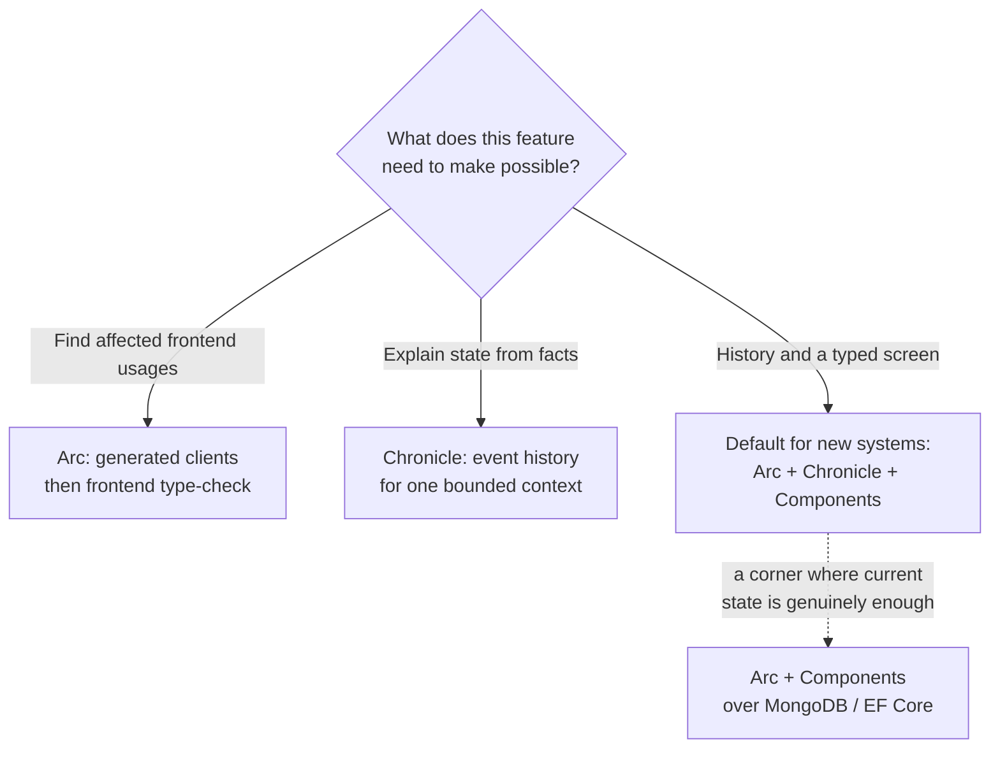

import { Aside, CardGrid, LinkCard, Steps } from '@astrojs/starlight/components';
import TopicHero from '@components/TopicHero.astro';

Improve one feature without making a rewrite the starting point. With Cratis Platform, you can find typed frontend usages affected by a backend contract change, keep the history behind one business process, or build a new view from facts you already recorded. Choose the result you can check while the rest of the application keeps its existing path.

<TopicHero icon="rocket" eyebrow="Getting oriented" title="Start with the result your team needs">
Choose one behavior you can implement and check on its own. Use the entry-point table to find the capability and product that deliver it, then follow the [new-project](#starting-from-scratch-greenfield) or [existing-system](#adding-to-an-existing-system-brownfield) path. Your backend language determines the setup guide and available capabilities.
</TopicHero>

## Pick your entry point

To see which frontend code a contract change affects, use generated clients and a frontend type-check: Cratis Arc supplies the command/query boundary and generation. Commands request changes; queries request reads, the separation called Command Query Responsibility Segregation (CQRS). To explain state from recorded changes or derive new views, use event storage and projections: Cratis Chronicle supplies that history. Cratis Components brings Arc's contracts into React.

For a new information system, Cratis recommends Chronicle, Arc, and Components together. Event sourcing is the default architecture we recommend for information systems; CQRS, generated contracts, and edge identity can still be adopted independently.

| Result your team needs | Start with | What this gives you and what to check |
| --- | --- | --- |
| Find frontend usages affected by changes to an existing .NET API | **Arc**, added to your app | Generate typed TypeScript clients for new commands and queries while existing endpoints keep running. Regenerate after a change and type-check the frontend; this does not replace runtime integration checks. |
| Explain how one business area reached its current state | **Chronicle**, incrementally | Record that context's facts as events; leave the rest of the system as it is. Decide where history begins: existing rows do not become events automatically. |
| Answer a new question from existing event history | **Chronicle projections** | Derive a focused [read model](/chronicle/projections/) from the recorded facts. Supported replay can rebuild a view, but cannot supply missing facts; projections update asynchronously. |
| Keep history behind a typed React screen in a new information system | **Arc + Chronicle + Components** | The default Cratis loop: CQRS at the boundary, event history underneath, TypeScript clients generated from C#, consumed by React — the [full-stack capstone](/build-a-full-app/) builds the shape. |
| Check frontend contract changes in a bounded slice that needs only current state | **Arc + Components** over a database | Typed commands, queries, and a generated React client with CQRS but no event log — [CQRS without event sourcing](/arc/arc-without-event-sourcing/). |
| Keep history behind a new Kotlin or Java full-stack app | **Arc + Chronicle** on Spring Boot | The [Cratis Kotlin](/templates/cratis-kotlin/) and [Cratis Java](/templates/cratis-java/) templates scaffold the same full-stack shape with a React frontend. Check the backend's capabilities rather than assuming parity. |
| Keep event history from a TypeScript, Kotlin/Java, or Elixir service | **Chronicle** with your language's client | Chronicle's clients talk to the same kernel over gRPC — see [Chronicle in your language](/chronicle-clients/). |
| Keep a typed application boundary without choosing event sourcing | Read first | [CQRS without event sourcing](/arc/arc-without-event-sourcing/), then [Why developers choose Cratis](/why-cratis/). |
| Agree on expected behavior before implementation | **Screenplay**, with **Cratis Studio** for shared editing | Keep commands, events, views, and specifications together. Studio is an optional paid workspace built on Chronicle for editing Screenplay event models together. [Sign-up is open with a 14-day free trial](https://lobby.cratis.studio/register) and [per-seat pricing](https://cratis.studio/#pricing). It is not required to use Arc, Chronicle, or Components; model checks do not replace implementation tests. |
| Set how far agents can proceed and review why work advanced | **Direct** | [Cratis Direct](https://cratis.direct/) defines progression ceilings, journeys, gates, and recorded evidence for work across GitHub repositories. Governance depends on the rules activated, and people retain review and approval responsibilities. It runs Cratis's own engineering today; access opens in stages to enabled accounts, who [sign in with GitHub](https://app.cratis.direct/). A GitHub account alone does not grant access. [Public docs cover the Direct Agent Runner](/direct/). |

<Aside type="tip" title="See a model run">
Keep the feature's commands, events, and views together in Cratis Screenplay, then [send a command and see its resulting state in Stage](/stage/docker/). Stage runs the supported subset as a disposable sandbox, not a production host; bind published ports to `127.0.0.1`. This is optional model exploration, not a migration step.
</Aside>

## Starting from scratch (greenfield)

For a new information system, follow [Build a full-stack feature](/build-a-full-app/) to implement one behavior through the whole loop: command → event → projection → query → React. A projection turns recorded events into a read model shaped for the screen. The event log keeps the history behind that view.

The C# and JVM paths start from the [Cratis templates](/templates/getting-started/). The TypeScript backend is published on npm at 1.0.0 (`npm install @cratis/arc.core`, or `@cratis/platform` for Arc and Chronicle together) and starts from a sample rather than a scaffold. In C#, the [Cratis package](/arc/backend/csharp/chronicle/cratis-package/)'s `AddCratis`/`UseCratis` calls register Arc and the Chronicle client in the application host. The Chronicle server runs separately; those calls do not embed it in your API.

If a bounded part of the app needs only current state, such as reference data or settings, choose [Arc over a database](/arc/arc-without-event-sourcing/) for that part. You still get CQRS, generated proxies, and live queries. To add Chronicle later, change the write side to record events and build a read model with a projection. The query contract and React screen can stay the same, while the query implementation and storage wiring may need to change.

<Aside type="tip" title="CQRS and event sourcing are independent">
Arc gives you CQRS: commands for changes and queries for reads. Chronicle gives you event sourcing: facts as the durable source of truth. You can use either without adopting the other.
</Aside>

## Adding to an existing system (brownfield)

Keep existing behavior running while you introduce a new boundary. Choose a feature with a clear owner and a result you can check independently; do not make a system-wide rewrite a prerequisite.

### Find frontend usages affected by backend changes

If you maintain controllers, duplicate data types in TypeScript, and fetch wrappers for each new feature, start with Arc's application boundary. Register Arc on your existing host and express new endpoints as commands and queries. Arc generates their typed proxies while existing controllers continue to serve their routes. [Set up a standalone Arc backend](/arc/backend/csharp/getting-started/) gives you the packages and proxy-generation settings without requiring Chronicle or a template.

Arc's persistence meets your data where it already lives: its [MongoDB](/arc/backend/csharp/mongodb/) and [Entity Framework](/arc/backend/csharp/entity-framework/) integrations read and write the database you already use — EF Core even has a [direct-registration path](/arc/backend/csharp/entity-framework/getting-started/) designed for slotting into an existing application without taking over the whole framework. For controllers and MediatR handlers, the [MediatR, MVC, and Arc](/arc/backend/csharp/coming-from-mediatr-and-mvc/) bridge maps familiar concepts onto Arc's model.

### Explain how one business area reached its current state

If you need to answer "how did this order get into this state?", start with the part of the domain whose facts and rules you can define clearly. That is your bounded context: an area with its own model and vocabulary. Decide where its event history begins before changing how it writes data.

<Aside type="caution" title="Writing to two places">
Appending an event alongside an existing write is a dual write: the two can succeed or fail independently. Decide which one is the source of truth for that context, make the other derived from it where you can, and plan how you detect and reconcile a mismatch. The [CRUD, EF Core, and Chronicle](/chronicle/coming-from-crud/) guide maps the concepts.
</Aside>

<Steps>

1. Model the facts for that area as [events](/chronicle/concepts/event/). For new behavior, append the event when it happens. If an existing write must remain, appending alongside it requires the dual-write plan above. Existing rows do not become events on their own; decide whether you need historical events and, if so, write them deliberately.
2. Build [projections](/chronicle/projections/) that turn those events into the read models the context needs. They can sit alongside existing tables. Follow one event into its projected result before moving another feature.
3. Keep the rest of the system on its existing path. Use the first context's events and read models to check the new behavior before expanding the adoption.

</Steps>

Continue with [CRUD, EF Core, and Chronicle](/chronicle/coming-from-crud/) to map tables and `SaveChanges` onto events and projections.

<Aside type="caution" title="Keep the boundary honest">
Event sourcing is the default for information systems, not a mandate that every settings table needs a stream. Use Chronicle for the facts and processes that define the domain, and leave genuinely current-state-only corners on Arc-over-a-database. [When to use event sourcing](/chronicle/concepts/when-to-use-event-sourcing/) helps you decide which history the feature needs.
</Aside>

## Add history or a typed screen when the feature needs it

If you started with Arc over a database, add Chronicle by moving one slice's write side from a direct insert to an event append with a projection behind it. Keep the query contract where it still serves the same need, and update the implementation to read projected state. [CQRS without event sourcing](/arc/arc-without-event-sourcing/) shows the two versions side by side.

If a worker or service already uses Chronicle, put Arc in front when you need typed commands and queries for a frontend. That does not require changing how the events are stored. Once Arc generates proxies, Components can use them in command forms and query-backed tables.

Components is not a frontend-only integration for an arbitrary backend. If your backend does not expose Arc contracts, establish the [Arc command/query boundary and proxy generation](/arc/understanding-the-proxy-boundary/) first.

## Next steps

<CardGrid>
  <LinkCard title="Compare the outcomes and trade-offs" href="/why-cratis/" description="Compare event history, generated frontend contracts, and independent adoption." />
  <LinkCard title="Keep typed contracts without an event log" href="/arc/arc-without-event-sourcing/" description="Use standalone Arc, then see the write-side change that adds Chronicle." />
  <LinkCard title="Build a live React screen with event history" href="/build-a-full-app/" description="Follow one feature from command to event, read model, and screen." />
</CardGrid>
