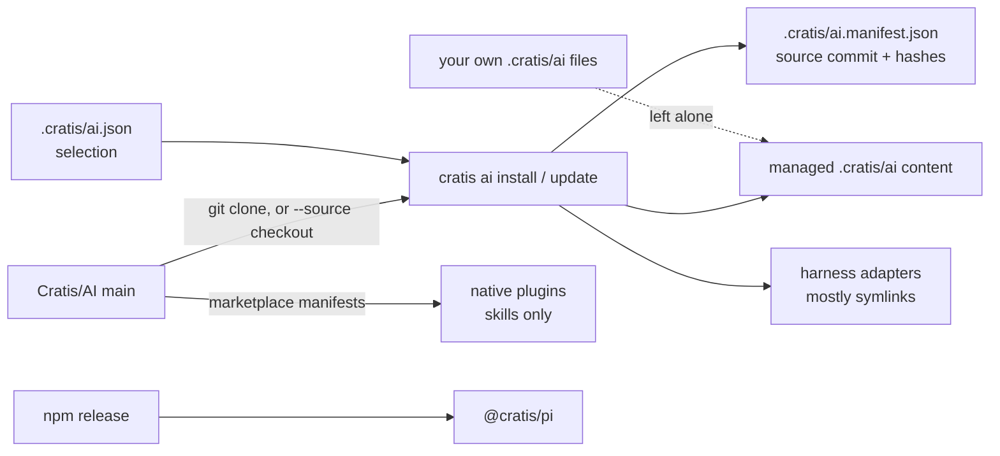

import { Aside } from '@astrojs/starlight/components';

Choose the Cratis CLI when your team needs reviewable AI guidance in the
repository, `@cratis/pi` for a versioned Pi integration, or a skills-only
plugin for one coding tool. These channels differ in what they install and
how you can roll back. The canonical guidance lives in
[Cratis/AI](https://github.com/Cratis/AI); the separate
[Cratis/AI.Distribution](https://github.com/Cratis/AI.Distribution) packages a
selected subset of passive skills.

## Three channels

| Channel | Delivers | Version semantics |
| --- | --- | --- |
| `cratis ai install` / `cratis ai update` | Rules filtered by profile and language, selected skills, prompts, agents, hooks, and adapters for the chosen harnesses | Uses the current default branch of `Cratis/AI` unless `--source <path>` or `CRATIS_AI_SOURCE` supplies a local checkout. Keep that checkout at a known commit for a fixed source. |
| `@cratis/pi` (npm) | Skills, rules, prompts, agents, a subagent tool, and quality hooks inside Pi | Numbered package releases. Pin or roll back to an exact package version. |
| Skills-only plugins and bundles | The `Cratis/AI` marketplace plugins expose the source skills; `Cratis/AI.Distribution` contains a selected subset | The full-corpus marketplace commands use the default branch. The separate public distribution offers tagged sources, including a Git package for Pi. |

`.cratis/ai.json` records the managed selection, not a source revision pin.
The CLI records the source revision in `.cratis/ai.manifest.json`.
`cratis ai status` compares it with the selected source and reports whether
they differ; that difference does not necessarily mean the source is newer.
Even status and dry-run commands download the corpus by default, so pass
`--source` or set `CRATIS_AI_SOURCE` when working offline.

The diagram follows the full-corpus routes:



## Selection, not a universal copy

A repository selects its harnesses, profiles, and languages:

```json
{
  "schemaVersion": "1.0",
  "harnesses": ["claude", "cursor", "opencode", "pi"],
  "profiles": ["cratis/application/csharp", "cratis/documentation"],
  "languages": ["csharp", "typescript"]
}
```

The CLI resolves that selection against the source corpus's profile catalog.
Application profiles and engineering profiles serve different repository
roles; [choose profiles](/ai/profiles/) before installing a broad aggregate.

The `@cratis/pi` package reads the same configuration file to select skills;
without it, the package exposes every packaged skill. The `Cratis/AI`
marketplace plugins do not read that selection, and the public distribution
has its own fixed skill subset. Neither is a per-profile package.

## Ownership and synchronization

The CLI marks managed text files with a `cratis-ai-managed` source identity
and records installed hashes in `.cratis/ai.manifest.json`. It also records
owned adapters and MCP (Model Context Protocol) registrations. Updates use
those records to distinguish installed content from your files.

An update synchronizes selected source files and removes managed content no
longer selected. If a managed file has changed locally, update or uninstall
stops before writing. Review the change first. `--force` allows replacing or
removing an edited managed corpus file, but does not override ownership checks,
a conflicting file you own, or a changed MCP entry.

MCP ownership is narrower than file ownership. The CLI can add its server
entry to an existing configuration file while leaving your entries in place.
If that managed entry changes, the conflict needs review even with `--force`.
The [harness guide](/ai/harnesses/) lists the configuration paths and the
servers selected by profiles.

<Aside type="tip" title="Use the lifecycle commands">
Run `cratis ai status` before updating; it exits non-zero when a managed file
was edited, so it also works as a CI check. Run `cratis ai update --dry-run` to
see what an update would change. Review `cratis ai uninstall --dry-run` before
running `cratis ai uninstall` to remove unchanged owned content and the
integrations the CLI created. These commands do not remove your own files.
</Aside>

## Keep project knowledge in the repository

Shared guidance covers Cratis conventions and reusable workflows. Your
repository owns the rest: architecture decisions, build commands, environments,
approved secret mechanisms, and fixtures. Put that knowledge in
`.cratis/ai/rules/project.md` and its concern files. Add repository-specific
skills under `.cratis/ai/skills/` with names that do not start with `cratis-`
to avoid collisions with shared skills. The CLI leaves these files under your
ownership instead of merging them with upstream guidance.

Install guidance for each repository rather than copying `.cratis/ai`,
`.claude`, `.github`, `.agents`, or `.pi` trees from another project. Copying
also carries selection and ownership assumptions from that project. Keep
local adaptations in project-owned files: editing a managed file blocks the
next update. Propose reusable changes in `Cratis/AI` through review, without
private or project-specific material.

## Quality is verification

The `Cratis/AI` checks cover corpus structure, profile composition, harness
adapters, and the Pi package. Resource-loader checks verify discovery of
skills, prompts, and extensions. They establish that the integration can find
the content, not that an agent will use it well on your task.

A skill can carry a `verification.json` with an example input and assertions
that the skill contains the guidance that input needs. Those assertions are
static checks. Separate checks compile supported Screenplay examples and run
specifications where required; they are not a general compilation guarantee
for every example. Assess agent behavior with a real task and review its
output before relying on the guidance for your workflow.

## Plugins and marketplaces

Use a skills-only plugin when you need guidance in one tool without managing
a shared corpus. The `Cratis/AI` marketplace plugins do not include rules or
profile filtering, and they do not provide CLI ownership checks.

The public distribution is a tagged subset with different install identifiers
and comes without installation support. Its published skill set excludes
workflows such as live Chronicle CLI operations, Chronicle MCP inspection,
and event-type migration. Check that subset before choosing
it for a task; publication does not establish behavioral results.
The [harness guide](/ai/harnesses/) has commands for both sources.

## Review updates and choose a rollback path

For the managed channel, review `cratis ai update --dry-run` before applying
an update. To return to a known source revision, use a local `Cratis/AI`
checkout at that commit with `--source <path>`. The manifest records what was
installed; it does not make update automatically reuse that commit. Keep the
configuration, manifest, installed corpus, and adapters together in repository
history so a guidance change can be reviewed as one change.

For `@cratis/pi`, choose an exact npm version. The public distribution uses
tagged sources instead. The full-corpus marketplace commands follow the
default branch and do not provide the same source pin. None of these native
routes provides CLI checks for edited managed content. [Updates and rollback](/ai/scenarios/updates-and-rollback/)
covers the channel-specific procedure.
