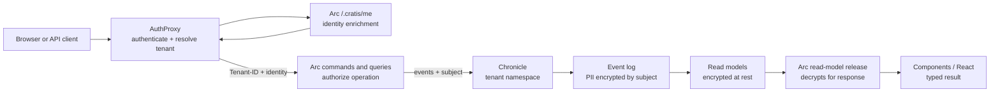

import { Aside, CardGrid, LinkCard } from '@astrojs/starlight/components';

A customer places an order, and your application needs to check who they are, whether they may place it,
and how to protect their email address. In Cratis, those checks happen at different points in the request.
AuthProxy authenticates the caller and resolves the tenant; Arc authorizes the command or query;
Chronicle stores events in a tenant namespace and encrypts marked personally identifiable information
(PII) using a key tied to the person it belongs to.

Use this page when connecting those parts. Follow the request from the edge to the read model, including
Arc's release of encrypted values before a query response reaches the client. Tenant membership,
access policies, and the handling of copies outside Chronicle remain application decisions.

The integration and attribute examples below use Arc's .NET backend. They do not establish equivalent identity, tenancy, or PII-release behavior in every backend. For another host, check your [Arc backend's capabilities](/arc/backend/) and [Chronicle client](/chronicle-clients/) before applying this flow.

## The edge owns authentication

Put [AuthProxy](/authproxy/) in front of your frontend and backend services when you want one place to
own the browser and API edge. It handles OpenID Connect, OAuth providers, JWT bearer authentication,
provider selection, invite onboarding, tenant resolution, and routing.

AuthProxy then forwards requests with the resolved tenant and identity context. In an Arc application,
the identity-enrichment endpoint is `/.cratis/me`: AuthProxy calls it, Arc composes the domain-specific
identity payload, and the frontend can consume the resulting identity state instead of making every
service rediscover the user.

<Aside type="note" title="Authentication is not authorization">
Authentication answers "who is calling?" Tenant resolution answers "which tenant are they acting in?"
Authorization answers "can they run this operation?" Compliance answers "whose personal data is this,
and how is it protected?"
</Aside>

## Arc owns operation-level access

Arc applies authorization where the behavior is declared: commands and queries. Use ASP.NET Core
authorization attributes, Arc's `[Roles]` convenience attribute, and policy-based authorization on the
command record or read-model query method that represents the operation.

That matters because authorization happens before the behavior runs. If a command is not authorized, its
`Handle()` method is not executed. If a query is not authorized, the read is not performed. The generated
frontend proxy receives authorization state as part of the command or query result, so screens can react
without hand-written protocol glue.

Use edge authentication for entry, then command/query authorization for business operations. Do not rely
on the UI hiding a button as the only access-control layer.

## Tenant context follows the request into Chronicle

In a multi-tenant Cratis application, the tenant resolved at the edge becomes application context in Arc.
When Arc is integrated with Chronicle, that tenant context is used as the Chronicle namespace. Events,
projections, reducers, and read models for one tenant go to that tenant's namespace without every
command manually choosing one.

This is the operational boundary:

| Concern | Owner | Result |
| --- | --- | --- |
| Resolve the tenant | AuthProxy or Arc tenancy resolvers | One tenant id for the request |
| Carry tenant through command/query handling | Arc | Commands, queries, filters, identity, and generated endpoints see the same tenant context |
| Isolate event-sourced state | Arc + Chronicle integration | Chronicle uses the tenant as the event-store namespace |
| Isolate MongoDB storage | Arc MongoDB integration | The injected `IMongoDatabase` and `IMongoCollection<T>` resolve a tenant-specific database (`{Database}+{TenantId}` for non-default tenants) |
| Isolate EF Core storage | You | Arc does not append the tenant to the connection string; you choose and implement relational isolation |
| Check tenant membership | You | Resolution selects a tenant; your services and policies verify that this caller may use it |

<Aside type="caution" title="A correct resolver is not membership authorization">
Resolving a tenant id selects where the request goes; it does not prove the caller belongs there.
Check membership in your application services and policies, and trust tenant headers only when they
come from AuthProxy or another component you control. Storage isolation depends on that resolved id.

A request without a tenant does not fail: Arc maps a missing or default tenant to Chronicle's
**default** namespace. Decide whether any caller may reach that data, and reject requests without a
valid tenant when they may not. [Tenancy with Chronicle](/arc/backend/csharp/chronicle/tenancy/) describes
the mapping, and [database isolation](/arc/backend/csharp/tenancy/database-resolvers/) covers MongoDB and EF Core.
</Aside>

## Compliance subject decides the PII key

Chronicle compliance uses a **subject** to identify whose protected data an event contains. That subject
is the lookup key for PII encryption material. It is often a person or customer id; it is not always the
authenticated user, and it is not always the aggregate id.

For example, an order event may be appended to an `OrderId` event source while the protected email
address in the event belongs to a `CustomerId`. In that case the command should provide the customer as
the Chronicle `Subject`. If no explicit subject is provided, Chronicle falls back to the event source id.

Arc's Chronicle integration can resolve the subject from command return values, command properties,
`ICanProvideSubject`, or a `[Subject]`-marked property. Set the subject to the identity that owns the
PII, not merely the thing being changed. The [subject examples](/arc/backend/csharp/chronicle/compliance/subject/)
show the command declarations for these choices.

## PII is protected at write and released at read

Chronicle detects `[PII]` on event properties and on `ConceptAs<T>` value types. At append time, those
values are encrypted under the subject's key before they are stored in the event log.

Read models keep that protection:

| Read-model style | How PII is tracked |
| --- | --- |
| Projection | Chronicle can infer PII lineage from mapped event properties. |
| Reducer | The read model must mark PII properties explicitly, because reducer logic is arbitrary C#. |
| Arc query response | Arc releases the read model before serving it, so clients receive decrypted values when the subject key exists. |

Managed read-model documents also carry Chronicle's reserved `__subject` field (and a `__subjects` map
when properties belong to different subjects) so the correct key can be used during release. Do not
declare your own properties named `_subject`, `__subject`, or `__subjects`; Chronicle reserves all three.

## Commands leave a permanent record

With Arc and Chronicle together, a command's name and property values are written into the causation
chain of the events it appends. That chain lives in the event log and is as permanent as the events, and
it is **not** covered by event encryption. Mark top-level command properties `[PII]` or `[NotAudited]`
to keep them out of it. The exclusion is not recursive: a marked member inside a nested object or
collection is still written. Exclude the containing property, its type, or the whole command when nested
data is sensitive. See [causation](/arc/backend/csharp/chronicle/commands/causation/).

## Erasure and its limits

For the concept and a comparison of erasure approaches, see [Event sourcing and GDPR](/concepts/event-sourcing-gdpr/).

The event log can stay structurally immutable while protected values become unreadable. For GDPR-style
erasure, Chronicle deletes the subject's PII encryption key. After that, PII encrypted with that key
cannot be decrypted by the running system.

Erasure also records a fence that prevents Chronicle from silently creating a replacement key for
that subject in the affected namespace. It does not automatically remove stored ciphertext. Do not
assume a replay or rebuild will clean it up: processing a protected value for an erased subject can
fail with `EncryptionKeyErased`. Follow the [subject-erasure procedure](/chronicle/compliance/erasing-a-subject/)
for the affected namespaces and read models. Authorizing a new key is a separate decision, not a step
needed to finish erasure. If an entire event payload must be removed, review
[event redaction](/chronicle/events/redaction/) as a separate operation.

Key deletion only reaches what Chronicle's key store protects. Plan for the rest:

A backup taken before erasure still holds the key. Restoring it brings the key back, so your restore
procedure must re-apply erasures made since the backup. Decrypted values in exports, warehouses,
search indexes, logs, caches, or systems reached by a reactor are outside Chronicle's erasure.

Values that were never marked `[PII]`, including command values recorded in causation, were never
encrypted and are not affected. Check those paths when deciding whether an erasure request is complete.

[Erasing a subject](/chronicle/compliance/erasing-a-subject/) and
[key lifecycle](/chronicle/compliance/key-lifecycle/) cover the full procedure.

## What to decide up front

| Decision | Ask this | Start here |
| --- | --- | --- |
| Identity provider | Where do browser users and API clients authenticate? | [AuthProxy authentication](/authproxy/configuration/authentication/) |
| Tenant resolution | Which host, claim, route, or configured value selects the tenant? | [AuthProxy tenancy](/authproxy/configuration/tenancy/) |
| Operation access | Which roles or policies can run each command or query? | [Arc authorization](/arc/backend/csharp/core/authorization/) |
| Compliance subject | Whose personal data does this event contain? | [Arc Chronicle subject](/arc/backend/csharp/chronicle/compliance/subject/) |
| PII modeling | Which event properties or concepts are personal data? | [Chronicle compliance](/chronicle/compliance/) |
| Command audit | Which command values must stay out of the permanent causation record? | [Arc causation](/arc/backend/csharp/chronicle/commands/causation/) |
| Erasure | What must be key-deleted, re-projected, redacted, or handled outside Chronicle? | [Erasing a subject](/chronicle/compliance/erasing-a-subject/) |

## Go deeper

<CardGrid>
  <LinkCard title="AuthProxy" description="Authenticate users, resolve tenants, enrich identity, and route requests at the edge." href="/authproxy/" />
  <LinkCard title="Arc identity" description="Expose /.cratis/me and compose the identity details AuthProxy and the frontend consume." href="/arc/backend/csharp/identity/" />
  <LinkCard title="Arc authorization" description="Authorize commands and queries with attributes, roles, and policies before behavior runs." href="/arc/backend/csharp/core/authorization/" />
  <LinkCard title="Chronicle subject" description="Set the compliance subject so PII is encrypted under the correct identity." href="/arc/backend/csharp/chronicle/compliance/subject/" />
  <LinkCard title="Chronicle compliance" description="Understand PII annotations, per-subject encryption keys, read models, and erasure." href="/chronicle/compliance/" />
  <LinkCard title="Production readiness" description="Review the operational checklist for TLS, secrets, storage, observability, and deployment." href="/production-readiness/" />
</CardGrid>

