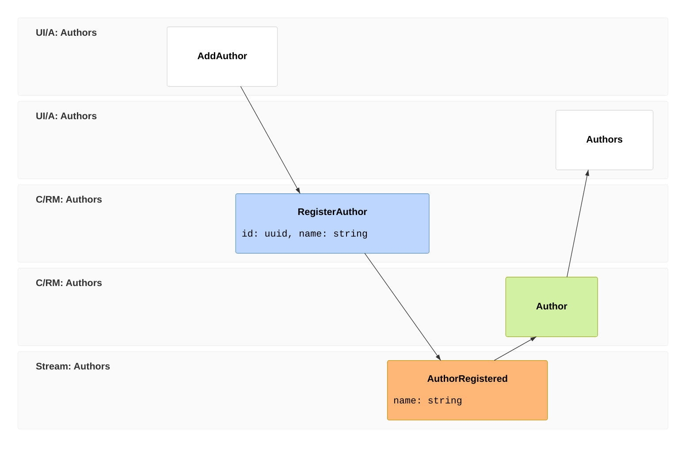

import { Aside, Steps } from '@astrojs/starlight/components';
import Recap from '@components/Recap.astro';
import YouWillLearn from '@components/YouWillLearn.astro';

By the end of this Cratis Platform tutorial, you can register an author and see their name appear in a live React list without refreshing, once projection processing catches up. The view comes from a recorded `AuthorRegistered` event, so you can follow the fact behind the displayed author.

You build that flow with [Cratis Arc](/arc/) handling the command, [Cratis Chronicle](/chronicle/) recording the event and deriving the author list as a read model, a view shaped for the screen, and [Cratis Components](/components/) supplying the command dialog. The screen calls the backend through generated TypeScript proxies rather than a hand-written API wrapper. Together, the command, event, read model, query, and screen form a vertical slice: the code for one behavior kept together.

Choose C#, Kotlin, Java, or TypeScript for the backend. The TypeScript backend is source-only, with no published npm package or scaffold, so you start it from a sample. The table below explains the backend differences; do not assume the implementations have identical capabilities.

[First projection](/learning-paths/#first-projection) follows cart events into a read model in a C# console program. That journey stops before HTTP and React. Here, you build the later API/UI slice in a different domain: library authors. For the C# path, trace the command and event in step 3, the read model and query in step 4, and the dialog and screen in step 5.

<YouWillLearn>

- how an Arc command's handler returns a Chronicle event, and how the command's id selects the event stream
- how a read model and a query turn those events into the author list
- how a React screen calls the backend through proxies generated from your backend types

</YouWillLearn>

Keep the feature under one module so you can navigate by behavior rather than technical layer. The [event model](/event-modeling/) below is a map of what you will implement. Read it from left to right: the user acts on a screen, a command records a fact, that fact produces a read model, and the next screen reads it:



Frames 01–03 show the command pattern: intent → fact. Frames 03–05 show the view pattern: fact → read model → screen. In code, Components owns the `ui` screens, Arc owns the `cmd` command and the query for the `rmo` read model, and Chronicle stores the `evt` event and derives the read model. The backend build generates the typed proxies that connect it to React. Pick a backend language in the tabs below; your selection follows you through the steps.

## Before you start

Start the backend and frontend for one language before adding the author feature. Use the matching setup below; the steps that follow assume that host is in place.

Before running `docker compose up`, check the generated `docker-compose.yml` (or `Samples/Library/docker-compose.yml` for TypeScript). The current templates and Library sample bind published ports to loopback, for example `"127.0.0.1:35000:35000"`. If your copy has mappings without a host IP, override them by replacing each mapping with a loopback-bound one: `"35000:35000"` becomes `"127.0.0.1:35000:35000"`. Keep the existing host and container port numbers for every service, including the database and dashboard; for example, `"4317:18889"` becomes `"127.0.0.1:4317:18889"`. Replace the original mappings rather than adding a second set. Run `docker compose config` (with `-f Samples/Library/docker-compose.yml` for TypeScript) and confirm every published port has `host_ip: 127.0.0.1` before starting containers.

### C#

Install the [.NET 10 template](https://github.com/Cratis/Templates#how-to-use) and run `dotnet new cratis -o Library`. The [buildable Capstone sample](https://github.com/Cratis/Samples/tree/main/Capstone) contains this exact slice. From `Library/`, run `docker compose up -d`, `dotnet build`, then `dotnet run`. Start the Vite frontend with the package manager selected by your scaffold (for example, `npm run dev`).

For brevity, the C# slice keeps its four types (`AuthorId`, `RegisterAuthor`, `AuthorRegistered`, `Author`) in one `Authors/` folder at the project root; the generated proxies land beside them, which is why the screen below imports `./RegisterAuthor` and `./Author`.

### Kotlin or Java

Run `dotnet new cratis --language Kotlin -o Library` or `dotnet new cratis --language Java -o Library`. With JDK 17 active, run `docker compose up -d`, `./gradlew build`, then `./gradlew bootRun` from `Library/`. Start the Vite frontend separately, following the generated [Kotlin](https://github.com/Cratis/Templates/blob/main/Templates/Cratis.Kotlin/README.md) or [Java](https://github.com/Cratis/Templates/blob/main/Templates/Cratis.Java/README.md) README. The Gradle build generates the proxies under `build/generated/arc-proxies/`.

### TypeScript from source

There is [no TypeScript scaffold yet](https://github.com/Cratis/Templates/issues/61). Start from the [Arc TypeScript Library sample](https://github.com/Cratis/Arc.TypeScript/tree/main/Samples/Library): from the Arc.TypeScript repository root run `yarn install`, `docker compose -f Samples/Library/docker-compose.yml up -d`, then `yarn workspace @cratis/arc.sample.library dev`.

The TypeScript tabs mirror the sample's `Features/Authors/AuthorId.ts`, `AuthorName.ts`, `Registration/Registration.ts` and `Listing/Listing.ts`, without its `Librarian` role, unique-name constraint and `authorsPage` query; [`AuthorName.ts`](https://github.com/Cratis/Arc.TypeScript/blob/main/Samples/Library/Features/Authors/AuthorName.ts) adds the name validation. The sample builds its proxies beside each feature as `*.proxy.ts`; see its README for setup and the local-only development identity.

The scaffolded C# and JVM Compose configurations start a separate Chronicle server with the default MongoDB choice, which persists the projected read model. Keep the author id, command/event, and read model/query together in the feature, with the host supplying their runtime wiring. Layouts differ by language; follow the sample's neighboring files for imports.

## How the backends differ in this slice

Each backend follows the same feature flow, but its host registration, access defaults, and read-model implementation differ. Use this table when you reach the named step:

| Behavior | C# | Kotlin and Java | TypeScript (source-only) |
| --- | --- | --- | --- |
| Host change (step 1) | None; the scaffold's `AddCratis` host | Add the author types to `KnownClientArtifacts` | None; the Library sample's host |
| Author id in the generated proxy (step 2) | `Guid`, from `EventSourceId<Guid>` | `Guid`, from a UUID-backed concept | `Guid`, from `ConceptAs<Guid>` |
| Anonymous callers (step 3) | Accepted; the command declares no authorization | Rejected by default; the author types carry `@AllowAnonymous` | Accepted; the command declares no authorization |
| Read model (step 4) | Projection from the event, with AutoMap | Reducer keyed by the event's source id | Projection from the event |
| Author list (step 4) | Live: re-renders when the projection changes | Live: observes the first page of 50 materialized instances; needs Chronicle 19.22.2 or later | Live: re-renders when the projection changes |
| Generated proxies (step 4) | `dotnet build`, beside the types in `Authors/` | `./gradlew build`, under `build/generated/arc-proxies/` | The sample's `build`, as `*.proxy.ts` beside each feature |

## 1. Wire the host (backend)

The host connects Arc to Chronicle and exposes generated command and query endpoints. The scaffolds and Library sample supply this wiring; find it before changing the feature. C# and TypeScript need no change: their tabs show the existing host for orientation. On Kotlin and Java, add the three author types to the scaffold's `KnownClientArtifacts` in `ChronicleConfiguration`, so an executable jar registers them. Keep the scaffold's existing imports and add imports for the author types. Keep its sink fallback too: a non-MongoDB `--Database` generates `WellKnownSinkTypes.SQL` there, not `MONGODB`.

<ArcBackendTabs snippet="capstone/host" />

## 2. Identify the event stream (backend)

Chronicle uses the command key to select the author's event stream. Every backend backs `AuthorId` with a GUID, so the generated command proxy types the id as a `Guid` whichever backend you chose. In C#, `AuthorId` derives from `EventSourceId<Guid>`, which also makes it the read model's key without a `[Key]` attribute:

<ArcBackendTabs snippet="capstone/author-id" />

## 3. Register the author (backend)

The command expresses intent; its handler returns the event that happened. Chronicle appends that event to the stream selected by the id. The Kotlin and Java command and read model carry `@AllowAnonymous`, as the scaffold's own `Register` and `Listing` do, because Arc.Kotlin rejects anonymous callers by default and the JVM scaffolds have no sign-in:

<ArcBackendTabs snippet="capstone/register-author" />

## 4. Build and query the author list (backend)

The read model describes the list entry; the event feeds it, and a query exposes the list. C# and TypeScript declare a projection from the event; in C#, AutoMap matches `AuthorRegistered.Name` to `Name`. Kotlin and Java use a reducer keyed by the event context's source id, rather than a model-bound event mapping:

<ArcBackendTabs snippet="capstone/author-read-model" />

Build your backend now (`dotnet build`, `./gradlew build`, or the Library sample's `yarn workspace @cratis/arc.sample.library build`) to generate the TypeScript command and query proxies. After changing a backend property, regenerate those proxies and type-check the frontend to find incompatible typed usages. This checks the contract, not the running integration.

Chronicle processes projections asynchronously, so a successful command can return before the author appears in the list. On Kotlin and Java, `allAuthors` observes a page of materialized instances, as described in the table above.

## 5. Build the screen (frontend)

The screen below is the shared React flow from the [compiled C# Capstone sample](https://github.com/Cratis/Samples/tree/main/Capstone): run a generated command in a dialog, read a generated query, mount a route. Use the same Components with every backend, adjusting the generated proxy imports:

- **C#:** The snippets below import proxies co-located in `Authors/`; the id in the command proxy is a `Guid`.
- **Kotlin and Java:** Import `RegisterAuthor.ts` and `AllAuthors.ts` under `build/generated/arc-proxies/` via your scaffold's `Api/` alias; the id in the command proxy is a `Guid`, as in C#. `AllAuthors` is observable, so `.use()` re-renders when the new author is projected. It can take a moment to appear, because Chronicle projects asynchronously.
- **TypeScript:** Import `RegisterAuthor` from `Features/Authors/Registration/RegisterAuthor.proxy.ts` and `AllAuthors` from `Features/Authors/Listing/AllAuthors.proxy.ts`; keep `Guid.create()` for its id. Its [RegisterAuthorForm](https://github.com/Cratis/Arc.TypeScript/blob/main/Samples/Library/Features/Authors/Registration/RegisterAuthorForm.tsx) seeds the id before validation with `initialValues`.

<Steps>

1. Create the command dialog in [`AddAuthor.tsx`](https://github.com/Cratis/Samples/blob/main/Capstone/Authors/AddAuthor.tsx). `CommandDialog` instantiates and runs the generated command and renders the OK/Cancel footer; you supply the fields:

   ```tsx
   import { CommandDialog } from '@cratis/components/CommandDialog';
   import { InputTextField } from '@cratis/components/CommandForm';
   import { RegisterAuthor } from './RegisterAuthor';
   import { Guid } from '@cratis/fundamentals';

   export const AddAuthor = () => (
       <CommandDialog<RegisterAuthor>
           command={RegisterAuthor}
           title="Add author"
           okLabel="Add"
           initialValues={{ id: Guid.create() }}>
           <InputTextField<RegisterAuthor> value={i => i.name} title="Name" />
       </CommandDialog>
   );
   ```

2. Create the list screen in [`Authors.tsx`](https://github.com/Cratis/Samples/blob/main/Capstone/Authors/Authors.tsx). The generated `AllAuthors` proxy is observable: `.use()` re-renders when the projection changes. Kotlin and Java observe a page of materialized instances, as described in the table. Add a button to open the dialog:

   ```tsx
   import { useDialog } from '@cratis/arc.react/dialogs';
   import { AllAuthors } from './Author';
   import { AddAuthor } from './AddAuthor';

   export const Authors = () => {
       const [AddAuthorDialog, showAddAuthor] = useDialog(AddAuthor);
       const [authors] = AllAuthors.use();

       return (
           <main>
               <h1>Authors</h1>
               <button type="button" onClick={() => { void showAddAuthor(); }}>Add author</button>
               <ul>
                   {authors.data.map(a => <li key={String(a.id)}>{a.name}</li>)}
               </ul>
               <AddAuthorDialog />
           </main>
       );
   };
   ```

3. Mount the screen in the scaffold's `App.tsx`. Import `Authors` from `./Authors/Authors` and add this route inside the existing `<Routes>`, alongside `/` and `/demo`:

   ```tsx
   <Route path='/authors' element={<Authors />} />
   ```

   Open `/authors` in the browser, choose **Add author**, and submit an author. Wait for projection processing, then check that the new name appears in the list without refreshing. If the command succeeds but the name does not appear:

   - Confirm that `AuthorRegistered` was appended and that its `name` maps to the author read model, following [Chronicle's empty or out-of-date read model checks](/chronicle/troubleshooting/#my-read-model-is-empty-or-out-of-date). On Kotlin and Java, check the reducer's mapping instead of a projection.
   - Check for observer failures in the Workbench or with `cratis chronicle diagnose`; [Chronicle diagnostics](/chronicle/operations/diagnostics/) explains how to inspect observers and failed partitions.
   - In the browser's Network panel, inspect the author query's connection and incoming data for the submitted id and name. If the query receives the author but the list stays empty, inspect `authors.data` in React. If no data arrives, use [observable query diagnostics](/arc/frontend/react/queries/observable-query-diagnostics/) to check `subscribed` and `hasResult` before changing the screen.

</Steps>

<Recap>

- You built one vertical slice in your chosen backend: host, id, command, event, read model, query, and React screen for one behavior.
- The screen calls proxies generated from your backend types, not a hand-written client. After a backend change, regenerate the proxies and type-check the frontend; check the running integration separately.
- The command returned a fact; Chronicle appended it and built the read model, and the query delivered the list to the UI. Every backend updates the list live.

Next, the [vertical slices series](/scenarios/vertical-slices/) grows the same Library domain one Event Modeling pattern at a time.

</Recap>

## Go deeper

- C# backend: [Commands](/arc/backend/csharp/commands/) and [Queries](/arc/backend/csharp/queries/) in Arc, and the [Cratis package](/arc/backend/csharp/chronicle/cratis-package/) that `AddCratis` configures.
- Kotlin and Java backend: the [Chronicle guide](/arc/backend/kotlin/guides/chronicle/) for Arc.Kotlin.
- TypeScript backend: the [Arc TypeScript Library sample](https://github.com/Cratis/Arc.TypeScript/tree/main/Samples/Library).
- Every backend: [Projections](/chronicle/projections/) in Chronicle.
- Frontend: [CommandDialog](/components/commanddialog/) and [data tables](/components/datatables/) in Components.
- The reasoning: [Why developers choose Cratis](/why-cratis/) and [Why Arc](/arc/why-arc/).

<Aside type="tip" title="Questions? Ask on Discord">
Ask questions and get help from the Cratis team and other developers on the [Cratis Discord](https://discord.gg/kt4AMpV8WV). See [Community and help](/community/) for where else to go.
</Aside>
