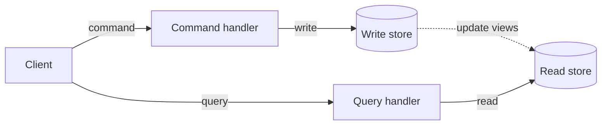
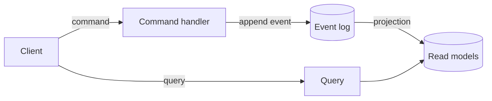

CQRS, or Command Query Responsibility Segregation, separates the model used to change data from the model used to read it. Use it when a business decision and a screen need different views of the same information. A **command** requests a change; a **query** returns data without changing business state.

For example, placing an order requires rules about stock and payment, while listing orders needs dates, totals and statuses. Those jobs do not have to share one model. A command may succeed or be rejected, and its response can report that outcome without also serving as the screen's query.

CQRS and event sourcing are often mentioned together, but they are independent. You can use CQRS over a plain relational or document database, and you can use event sourcing without a rich read side. This page covers CQRS on its own, then shows how the two combine. For the other half, see [what is event sourcing?](/concepts/event-sourcing/).

## How CQRS works

When one `Order` model handles both updates and lists, a new screen can pull display concerns into code that enforces business rules. CQRS gives the two paths separate responsibilities:

- The command side receives an intent such as `PlaceOrder`, checks the business rules and records an accepted change.
- The query side serves data shaped for a screen or API, often combining fields so the caller does less work.

The dotted line is the part that varies. Both models can use the same database, with changes visible in the same transaction. If read models update asynchronously, a query can briefly return old data. That is eventual consistency; it comes from how updates reach the read side, not from the CQRS name.

### CQRS with event sourcing

When the write store is an event log, the dotted line has a natural implementation. A command appends events. A [projection](/concepts/projections-and-read-models/) folds those events into read models. Queries read the read models.

The stored history lets a projection rebuild a read model, and the separate query model gives screens a place to read without replaying that history on every request.

### CQRS without event sourcing

CQRS does not require an event log. Arc, the Cratis application framework, treats commands and queries as its core model. Its .NET backend can use MongoDB or Entity Framework Core without Chronicle, while the JVM example below uses a Spring Data repository. The page on [CQRS without event sourcing](/arc/arc-without-event-sourcing/) shows the same slice with and without events.

## A concrete example: registering and listing authors

A library application has a screen to register authors and a screen that lists them.

The command takes an author id and name and inserts an `Author` document. In C#, the inputs are record properties and the handler is `Handle()`; the JVM examples use a repository:

<ArcBackendTabs snippet="site-concepts/cqrs/register-author-state" variants="csharp,kotlin,java" />

The query returns the stored authors without running the registration command. Arc exposes the query over HTTP and can generate a typed frontend proxy from its contract:

<ArcBackendTabs snippet="site-concepts/cqrs/author-read-model" variants="csharp,kotlin,java" />

These are excerpts, not a configured application. They assume Arc and the database dependencies are registered. For the host setup, follow [Arc's .NET getting started guide](/arc/backend/csharp/getting-started/) or the [Kotlin](/arc/backend/kotlin/get-started/) and [Java](/arc/backend/kotlin/get-started/java/) guides.

The split is visible in the result: registration writes one author; listing reads authors. You can test the two behaviours separately even when they share a database and deployment.

To event-source this slice, the command returns `AuthorRegistered` for Arc's Chronicle integration to append. Its id identifies the event source, and a projection must now build the stored `Author` view:

<ArcBackendTabs snippet="site-concepts/cqrs/register-author-events" variants="csharp,kotlin,java" />

The query still reads `Author`, but you now need a projection from `AuthorRegistered` to that view. [Projections and read models](/concepts/projections-and-read-models/) explains how event facts become stored query data.

## Benefits

CQRS lets you change how a screen reads data without forcing the same shape onto the code that decides whether a change is allowed. `RegisterAuthor` names an action, while `AllAuthors` answers a different question. That separation makes each responsibility easier to locate and test.

It also gives you options later. You can cache or scale a read path separately when the deployment supports it. You can move a slice to event storage while keeping its query contract, provided the new projection supplies the same data. Neither outcome happens automatically just because the models are separate.

## Trade-offs and when not to use it

Separate models mean more types and contracts to maintain. A domain change may affect both a command and the views built from it. If the read side updates asynchronously, the interface must also handle a successful write whose result is not visible yet.

Use CQRS where reads and writes have different shapes, load or rules. For a single form over one table, ordinary create, read, update and delete (CRUD) operations may be simpler. You can make that choice per feature rather than applying one architecture to the whole application.

## Common pitfalls

- **A command that returns query data.** A command can report success or failure, and a response where needed, but it should not become a back door for reading. Use a query.
- **A query that changes business state.** A query that also reserves stock is unsafe to repeat or cache. Diagnostic logging is not the business-state change CQRS separates.
- **Applying CQRS to the whole system.** CQRS is a decision per slice. Parts that are plain CRUD can stay plain CRUD.
- **Assuming CQRS means two databases.** One database with separate models is already CQRS. Add stores only when a measured need justifies them.
- **Ignoring consistency.** When reads lag behind writes, design for it: show a pending state, or let the client observe the read model so it updates when the data arrives.
- **Confusing CQRS with event sourcing.** Choosing one does not commit you to the other. See [event store vs. a regular database](/concepts/event-store/) for the storage question.

## Frequently asked questions

### Is CQRS the same as event sourcing?

No. CQRS separates reading from writing. Event sourcing stores changes as events. They combine well, but each works alone.

### Do I need separate databases for CQRS?

No. You need separate models, not separate databases. Eventual consistency arises when the read side updates asynchronously, including when both models live in one database.

### Is CQRS the same as having a repository and a service layer?

No. A repository and service layer usually share one entity model for reads and writes. CQRS gives reads and writes different models and different entry points.

### Does CQRS need a message bus?

No. A command can be an ordinary method call handled in the same process. A bus is one way to deliver commands or to update read models, not a requirement.

### How do commands and queries reach a React or TypeScript frontend?

Arc generates TypeScript proxies from the .NET command and query contracts, so the frontend calls typed methods. See [Why Arc](/arc/why-arc/).

## Next steps

To build the state-based version first, read [CQRS without event sourcing](/arc/arc-without-event-sourcing/). The [Arc overview](/arc/) and [.NET getting started guide](/arc/backend/csharp/getting-started/) explain the framework and host setup. For a language-specific path, choose [C# and .NET](/cqrs/dotnet/), [TypeScript and Node.js](/cqrs/typescript/), or [Kotlin and Java](/cqrs/kotlin/).

If your feature needs history, first review [what is event sourcing?](/concepts/event-sourcing/) and [projections and read models](/concepts/projections-and-read-models/), then [add event sourcing to an Arc slice](/arc/backend/csharp/chronicle/add-event-sourcing/). Adding notifications between components is a separate decision, covered in [event-driven architecture vs. event sourcing](/concepts/event-driven-architecture/).
