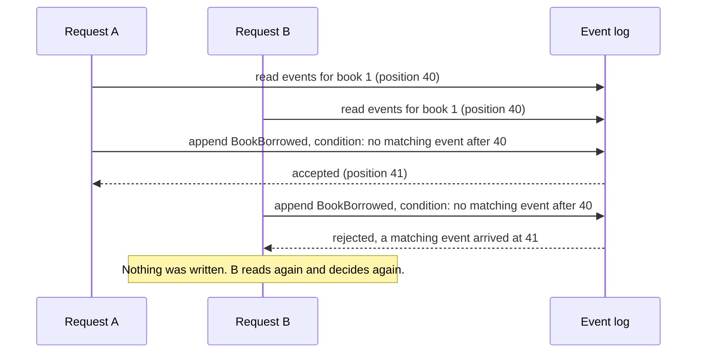

A Dynamic Consistency Boundary (DCB) protects a business decision by making its append conditional on the events it read. Use it when a rule must still hold while other requests write: the event store rejects the append if a matching event arrived after the read's recorded position.

Consider a library with one copy of a book left. Two members press Borrow at the same moment. Each request sees one copy and appends `BookBorrowed`. Without a check at append time, both loans can be accepted.

Optimistic concurrency checks for competing writes rather than holding a lock while a command decides. Checking the version of a whole stream means an unrelated change in that stream can still cause a conflict. DCB instead selects the events that matter to this decision, so the boundary can differ from one command to the next.

Start with the pattern below, then see how Chronicle and Arc apply it. For how a command guards its reads in code, see [Keeping decisions correct under concurrency](/concepts/keeping-decisions-correct/). For a walk through the whole stack, see [Decisions that hold, from model to frontend](/decisions-that-hold-walkthrough/).

## The idea in one picture

A decision has three steps: read the events it depends on, decide, append. DCB attaches a condition to the append. That condition selects the relevant events and records a position before the read begins. A matching event appended during the read or while the command decides must then cause a conflict.

Request B used stock that has since changed, so the log refuses its append. The caller can read again and decide whether to resubmit. No lock was held while either request made its decision.

## One boundary per decision

The boundary in DCB is not fixed by the model. It is the set of events one decision read, so two decisions about the same entity can have different boundaries.

| | Boundary per aggregate or stream | Boundary per decision (DCB) |
| --- | --- | --- |
| What guards the append | The expected version of the whole stream | A position and a query selecting relevant events |
| What conflicts | Any append to that stream since the load | An append matching the condition after its position |
| An unrelated change in the same stream | Causes a version conflict | Does not conflict if the query excludes it |
| A rule that spans two entities | Requires coordination across the chosen boundaries | Can read both and guard one atomic append |
| What you design up front | The aggregate boundaries | The events and the values that identify them |

In the library, a rename need not conflict with a borrow if stock does not depend on the book's name. A whole-stream version check conflicts if both events land in that stream. A condition selecting only stock-changing events excludes the rename.

The cost moves in the other direction. A per-decision boundary is only as good as the description of what the decision read. If a read is missed, nothing guards it.

## What an append condition rejects

An append condition says: reject this append if any event that matches my query was written after the position I read. The query is what makes the boundary dynamic.

- The append fails when a matching event arrived after the read, whatever wrote it: another request, another service, or a process on another node.
- Non-matching events do not violate this condition. The append can still fail another condition or constraint.
- A failed append writes nothing. The conflicting writer was not blocked, and the loser is not rolled back because it was never applied.
- Nothing re-runs the decision for you. Arc and Chronicle do not re-run the command; the caller reads again and chooses whether to submit again, because the right reaction to a changed fact is often to look at it again, not to repeat the same request.

A condition can reject an append only for events it was asked about. A rule that depends on state outside the event log, such as another database or an HTTP call, is outside the condition.

## Where Chronicle and Arc sit

Cratis Chronicle supports DCB-style decision models and append conditions within its own event-source model. It is not a DCB event store and does not implement the DCB specification's API. Cratis Arc can arrange protected reads and their commit for commands that use Chronicle.

| DCB term | In Chronicle | In Arc |
| --- | --- | --- |
| Tags that select events | Event types and single-valued routing metadata: event source id, event source type, event stream type and event stream id. Custom tags do not guard appends | The read model's key and event types supply the guard |
| Decision model | A decision read: state built from events, with a position captured before the read | A supported read-model parameter of the command or its validator, under read protection `On` |
| Query item | A concurrency scope | Derived from the events the read model folds |
| Append condition | The conditions on one atomic append. Any violation rejects the append | Derived for you and carried on the command's append |

Two differences from a DCB store follow from this. An event belongs to exactly one event source, so a fact about two entities is two events appended together in one atomic append. And custom tags on an event are stored and filterable, but they take no part in the consistency check.

[Read this first: write-side consistency](/concepts/read-this-first-write-side-consistency/) maps familiar stream and aggregate concepts onto Chronicle's mechanisms. The Chronicle documentation covers [DCB in Chronicle](/chronicle/dynamic-consistency-boundary/) in depth, including which events make an append fail.

## Limits

A guard protects only the dependencies it captures. Every writer that decides on the same rule needs a suitable guard, unless the rule is enforced by a kernel constraint. An advisory read or a call to another database is not protected by the append condition.

Chronicle guards apply within one event sequence. Position-only scopes detect appends, not revisions or redactions of earlier events. The .NET decision-read path also captures a history-mutation marker when the kernel supplies one; a revision or redaction then invalidates the read's guard. Do not assume this extra check for a hand-built scope or another client.

A reported conflict can identify the first matching event when the kernel supplies that detail. Its absence is not evidence that no conflict occurred. Several reads can also produce a broader guard than any one read, causing extra conflicts; the [guard derivation guide](/chronicle/dynamic-consistency-boundary/how-guards-are-derived/) explains the merge rules.

## Next steps

To choose a mechanism for your rule, continue with [Keeping decisions correct under concurrency](/concepts/keeping-decisions-correct/). Then use [Getting started with read protection](/arc/backend/csharp/chronicle/consistency/getting-started/) for Arc commands, or [Choosing how a rule holds in Chronicle](/chronicle/dynamic-consistency-boundary/choosing/) when using the client directly.

For a connected example from a Screenplay model to a frontend that handles a lost race, follow [Decisions that hold, from model to frontend](/decisions-that-hold-walkthrough/). The [write-side consistency learning path](/learning-paths/#write-side-consistency) links the wider sequence of guides.

The blog series [Decisions that hold](https://blog.cratis.io/the-bug-you-never-see/) approaches the pattern from the problem and ends with a [decision guide](https://blog.cratis.io/decisions-that-hold-faq/).
