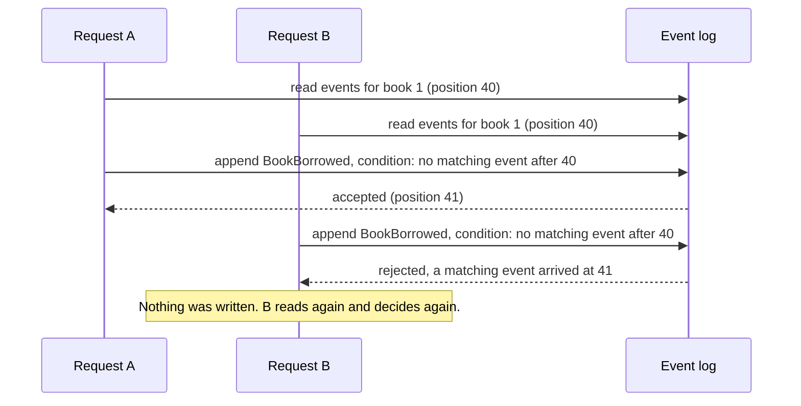

A library has one copy of a book left. Two members press Borrow at the same moment. Each request reads the stock, sees one copy and decides that the loan is fine. Each appends a `BookBorrowed` event. The library now has two loans and one copy, and neither request did anything wrong with the information it had.

The usual fix is to lock something around the decision: one aggregate, or one stream, for the whole entity. The Dynamic Consistency Boundary (DCB) is a different answer to the same question. It does not ask which entity the command belongs to. It asks which facts the decision depended on, and it makes the append fail if any of those facts changed.

This page explains the idea without tying it to a product. For how a command guards its reads in code, see [Keeping decisions correct under concurrency](/concepts/keeping-decisions-correct/). For a walk through the whole stack, see [Decisions that hold, from model to frontend](/decisions-that-hold-walkthrough/).

## The idea in one picture

A decision has three steps: read the events it depends on, decide, append. DCB attaches a condition to the append. The condition names the events the decision depended on and the position in the log where the read happened.

Request B is not wrong. It decided on facts that are no longer true, and the log refuses to accept the result. The caller can read again, decide again and submit again. No lock was held while either request thought.

## One boundary per decision

The boundary in DCB is not fixed by the model. It is the set of events one decision read, so two decisions about the same entity can have different boundaries.

| | Boundary per aggregate or stream | Boundary per decision (DCB) |
| --- | --- | --- |
| What guards the append | The version of the whole stream | The events the decision read, matched by type and by identifying values |
| What conflicts | Any append to the same stream since the load | Only an event that the decision's read would have included |
| An unrelated change to the same entity | Conflicts, so the caller has to retry | Does not conflict |
| A rule that spans two entities | Needs a process, a saga, or a bigger aggregate | One decision reads both and one condition covers both |
| What you design up front | The aggregate boundaries | The events and the values that identify them |

In the library, renaming a book does not need to conflict with a borrow of the same book, and a borrow of another book never does. A per-aggregate lock treats the rename as a conflict, because both land on the same stream. A per-decision condition does not, because the borrow decision never read the rename.

The cost moves in the other direction. A per-decision boundary is only as good as the description of what the decision read. If a read is missed, nothing guards it.

## What an append condition rejects

An append condition says: reject this append if any event that matches my query was written after the position I read. The query is what makes the boundary dynamic.

- The append fails when a matching event arrived after the read, whatever wrote it: another request, another service, or a process on another node.
- The append succeeds when only non-matching events arrived. Other types, or other keys, do not conflict.
- A failed append writes nothing. The conflicting writer was not blocked, and the loser is not rolled back because it was never applied.
- Nothing re-runs the decision for you. Arc and Chronicle do not re-run the command; the caller reads again and chooses whether to submit again, because the right reaction to a changed fact is often to look at it again, not to repeat the same request.

A condition can reject an append only for events it was asked about. A rule that depends on state outside the event log, such as another database or an HTTP call, is outside the condition.

## Where Chronicle and Arc sit

Chronicle supports DCB-style decision models and append conditions within its own event model. It is not a DCB event store.

| DCB term | In Chronicle | In Arc |
| --- | --- | --- |
| Tags that select events | Event source id, event source type, event stream type and event stream id. Each event carries one value for each | The command's key and the read model's key |
| Decision model | A decision read: a projection that notes the log position before it folds | A read-model parameter of the command or its validator, under read protection `On` |
| Query item | A concurrency scope | Derived from the events the read model folds |
| Append condition | The conditions on one atomic append. Any violation rejects the append | Derived for you and carried on the command's append |

Two differences from a DCB store follow from this. An event belongs to exactly one event source, so a fact about two entities is two events appended together in one atomic append. And custom tags on an event are stored and filterable, but they take no part in the consistency check.

[Read this first: write-side consistency](/concepts/read-this-first-write-side-consistency/) maps Chronicle onto the terms of DCB, KurrentDB, Marten and Axon. The Chronicle documentation covers [DCB in Chronicle](/chronicle/dynamic-consistency-boundary/) in depth, including which events make an append fail.

## Limits

- A condition covers the events the read model folds for the key it reads. An event of another type, or for another key, does not conflict.
- A revision or a redaction of an earlier event does not move the position that a condition compares, so a decision made before the change can still commit.
- A condition guards the reads it was built from. A writer that decides without one, a read marked as advisory, and state outside the event log are not covered.
- The condition names the read it protects. It does not name the conflicting event.
- It protects decisions made against one event sequence. A read across event sequences is not guarded.

## Next steps

- Learn the Cratis mechanisms and when each fits: [Keeping decisions correct under concurrency](/concepts/keeping-decisions-correct/).
- Build a protected command from a Screenplay model to a frontend that handles a lost race: [Decisions that hold, from model to frontend](/decisions-that-hold-walkthrough/).
- Start from the Arc guide: [Getting started with read protection](/arc/backend/csharp/chronicle/consistency/getting-started/).
- Using Chronicle without Arc: [Choosing how a rule holds in Chronicle](/chronicle/dynamic-consistency-boundary/choosing/).
- The wider write-side path: [Write-side consistency learning path](/learning-paths/#write-side-consistency).
