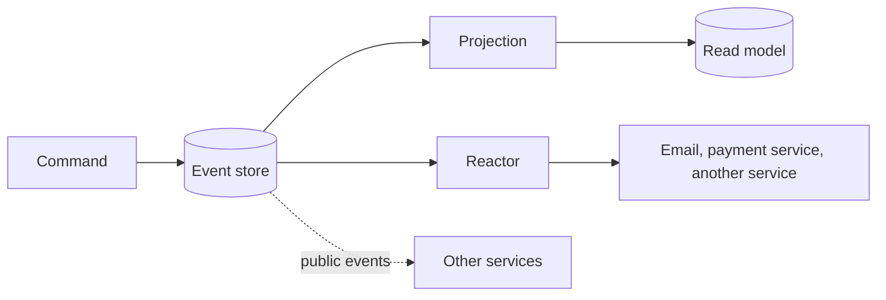

Event-driven architecture (EDA) connects components through notifications about things that happened. Event sourcing stores those facts as the source of truth from which state is derived. Choose the first to coordinate work through events; choose the second when the history itself is your data model.

The two choices are independent. A service can publish an order notification while keeping its state in ordinary tables. An event-sourced service can keep its history private and publish nothing to other services. If you need both a history and reactions to it, the same stored facts can support both jobs. For the storage model, see [what is event sourcing?](/concepts/event-sourcing/).

## How the two differ

| | Event-driven architecture | Event sourcing |
| --- | --- | --- |
| Main question | How do parts of the system learn what happened? | What is the record of truth for this entity? |
| Role of the event | A message that triggers work elsewhere | The stored fact that defines state |
| Lifetime | Depends on transport and retention policy | Retained as the system of record |
| Scope | Between components, services or systems | A service's data model |
| Typical tools | Message brokers, queues, streams | An event store |
| Rebuilding state | Only if the retained messages contain the required facts | Replay the recorded facts |
| Main risk | Hidden coupling and hard-to-trace flows | Modelling effort and eventual consistency |

A notification can contain just an order id if the recipient is expected to look up the details. An event-sourced history must retain the facts needed to reconstruct its state; a lookup against today's external data cannot recover a value that has since changed.

## How they combine

An accepted append records a fact before follow-up work begins. A consumer can then read that stored fact to build a view, send a notification or start another action. This avoids asking the command handler to both save state and publish a separate message, where either operation could fail alone. Delivery after storage still needs progress tracking, retries and duplicate handling.

The event store retains the facts. Projections build queryable read models from them. Reactors handle follow-up work, such as sending email or issuing another command. These roles have different replay needs: rebuilding a view should not send another confirmation email.

For communication between services, Chronicle distinguishes private facts from **public events**, the contract exposed to consumers. Public events are produced from private facts, for example into the outbox; they are not appended directly to the event log. Choose that contract deliberately so consumers do not depend on internal details. See [public events](/chronicle/events/public-events/) for visibility and publication rules.

## A concrete example: a library loan

Consider a library loan with these responsibilities:

1. The loan is recorded. That is event sourcing: a `BookBorrowed` event is appended to the book's stream.
2. A confirmation email is sent. That is event-driven: a reactor reacts to the event.
3. The member's loan list is updated. That is a projection, the read side of event sourcing.

The event and the reactor in Chronicle look like this:

<ArcBackendTabs snippet="site-concepts/event-driven-architecture/loan-confirmation-reactor" variants="csharp,kotlin,java" />

The reactor receives `BookBorrowed` after the event is stored and uses its email address and due date for the confirmation. The sending method is a placeholder: this excerpt sends no real email. It assumes a registered Chronicle client and reactor discovery. See [Reactors](/chronicle/reactors/) for setup.

The command that records the fact in Arc returns the event, and Chronicle appends it:

<ArcBackendTabs snippet="site-concepts/event-driven-architecture/borrow-book" variants="csharp,kotlin,java" />

The book id identifies the event source, and the returned event contains what the confirmation handler needs. The command does not send email or update the loan list. This excerpt also omits availability validation and the append-time guard needed to prevent concurrent loans; returning an event does not enforce that rule by itself.

Replaying a reactor can repeat external actions. Rebuilding a projection does not itself replay a separate reactor, but replaying that reactor needs its own policy. In .NET, `[OnceOnly]` on a handler skips it during replay; on the reactor class it makes the whole observer non-replayable. The example above does not apply the attribute.

`[OnceOnly]` is not exactly-once delivery. Recovery after a failure can invoke the handler again, even if the first attempt already sent the email. Use an operation identity or another duplicate-handling strategy that the recipient can honour. See [Reactors](/chronicle/reactors/) for replay and delivery rules.

## Benefits of combining them

The loan command can finish recording the fact without knowing how confirmation email or the loan list is implemented. Each consumer has a stored starting point, so a failed reaction can be investigated and retried without asking the user to borrow the book again.

New views can use existing history when it contains the facts they need. New reactors can also read history, but must distinguish catch-up from actions that should happen only for new events. A shared source makes these flows easier to relate; it does not make downstream delivery atomic or remove the need to monitor failures.

## Trade-offs and when to use which

If services need notifications but their current-state tables meet their storage needs, use EDA without event sourcing. If a service needs a reconstructable history but no external consumers, event sourcing alone may be enough. Combine them when other components need to act on that retained history. For straightforward create, read, update and delete (CRUD) workflows, neither pattern may be necessary.

Once reactions are asynchronous, the parts of the system can disagree temporarily. A loan may be recorded while its email is still pending. The interface and operations need to distinguish that delay from a failed command.

A reaction chain also crosses more boundaries than a call stack. Keep event names precise, trace causes, monitor stalled consumers and version contracts that other services rely on. A stored history helps investigate failures; it does not operate the consumers for you.

## Common pitfalls

- **Treating a broker as the system of record.** Messages can be deleted after delivery. If you need to rebuild state, you need a store.
- **Publishing internal events as the public API.** Consumers couple to your internal model. Publish a smaller, deliberate set.
- **Thin events when you need rebuilds.** A notification with only an ID is fine in EDA. In event sourcing, the event must carry the facts.
- **Side effects in projections.** A projection builds state and must be safe to replay. Sending an email belongs in a reactor.
- **Assuming exactly-once delivery.** A retry can repeat a reaction. Make external actions safe to repeat or explicitly deduplicate them.
- **Long reaction chains.** Event A causes B causes C causes D. Debugging becomes archaeology. Model the flow first; [event modeling](/event-modeling/) helps.

## Frequently asked questions

### Is event sourcing a type of event-driven architecture?

No. They are related but different. Event sourcing is a way to store state. Event-driven architecture is a way to connect components. An event-sourced service often takes part in an event-driven system, but neither requires the other.

### Do I need Kafka or another broker for event sourcing?

No. An event store keeps the events and lets projections and reactors observe them in order. You may add a broker to connect to other systems, but event sourcing does not need one.

### Is event streaming the same as event sourcing?

No. Streaming platforms move and retain events for consumers, and some treat the log as long-lived. Event sourcing is a modelling choice: the events are the facts of your domain, and your state derives from them.

### What is the dual-write problem?

Writing state and separately publishing a message can leave only one operation completed. Driving publication from a stored event avoids that split in the command handler. The consumer still has to handle delivery failures and retries.

### How does CQRS relate?

CQRS separates the write and read models. It often appears alongside both patterns. See [CQRS explained](/concepts/cqrs/).

## Next steps

For a follow-up action inside your application, read [Reactors](/chronicle/reactors/) and follow [React to an event](/arc/backend/csharp/chronicle/react-to-an-event/). For a contract consumed by another service, start with [public events](/chronicle/events/public-events/).

If you are still choosing the data model, return to [what is event sourcing?](/concepts/event-sourcing/) and [event store vs. a regular database](/concepts/event-store/). If the next task is displaying the result rather than acting on it, continue with [projections and read models](/concepts/projections-and-read-models/).
