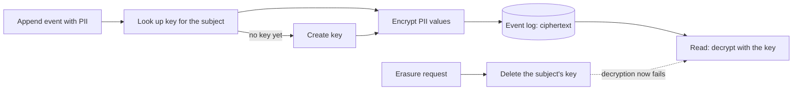

import { Aside } from '@astrojs/starlight/components';

Yes, an event-sourced system can meet the GDPR right to erasure without rewriting its event log. You keep personal data out of the log in readable form: either you encrypt each person's values under a key that belongs to that person (crypto-shredding), or you store the personal data outside the log and keep only a reference in the events. When a person asks for erasure, you delete the key or the external record. The events, their order and every non-personal field stay intact, and the personal data can no longer be read. Cratis Chronicle implements the crypto-shredding route as a built-in feature: you mark a value `[PII]` and delete the subject's key with one call.

This page explains why immutability seems to conflict with the regulation, compares the three common approaches, and walks through erasing a person in Chronicle. It is not legal advice; the last section says what a lawyer still has to decide.

*Applies to Chronicle 19.64.1. Last reviewed October 19, 2026 by the Cratis documentation team.*

## Why immutability seems to conflict with GDPR

An [event store](/concepts/event-store/) is append-only. [Event sourcing](/concepts/event-sourcing/) depends on that: the history is the source of truth, and you rebuild state by replaying it. Nothing is updated and nothing is deleted.

[Article 17 of the GDPR](https://eur-lex.europa.eu/eli/reg/2016/679/oj) gives a person the right to have their personal data erased "without undue delay" when, for example, the data is no longer needed for the purpose it was collected for, or they withdraw consent and no other legal ground applies. Article 17(3) lists exceptions, such as a legal obligation to keep the data. Under Article 12(3) you normally have one month to act on the request.

The conflict is real if the log holds a name, an address or a diagnosis in plain text. You cannot delete one event without breaking sequence numbers, replays and audit guarantees, and rewriting history defeats the reason you chose the pattern.

The way out is to change what "erase" means for an immutable log. You do not remove the event. You remove the ability to read the personal data inside it.

## Three approaches

Event sourcing teams use three patterns. They can be combined.

| | Crypto-shredding | Data segregation | Retention and archival |
|---|---|---|---|
| **Idea** | Encrypt personal values per person; delete the key to erase | Keep personal data in a separate mutable store; events hold only a reference | Delete or archive whole streams or events after a fixed period |
| **Erase on request** | Delete one key; all of that person's values become unreadable | Delete the external record; events keep a dangling reference | Not on request: only when the period ends, unless you also delete early |
| **Log stays intact** | Yes | Yes | No: events are removed, so replays and audits lose them |
| **Design cost** | Low if the platform does it; high if you build key management yourself | You must decide at modeling time what is personal, and keep two stores consistent | Low to build, but you need a retention rule for every event type |
| **Main risk** | Key backups, copies and anything already decrypted can keep the data alive; keys must be managed correctly | Personal data leaks back into events through careless modeling; joins across two stores | Deleting history you still need; may not meet a request that arrives before the period ends |
| **Reads of erased data** | Empty value, event still present | Lookup fails or returns nothing | Event no longer exists |
| **Fits when** | Personal data is embedded in events and you want one mechanism | You can model personal data as a lookup from the start | A legal retention period applies anyway |

None of these is free. Crypto-shredding moves the problem to key management, so it is only as good as your key handling and your backups. Data segregation is the simplest to reason about, but it relies on discipline: one name in an event description and the segregation is gone. Retention is blunt, because it deletes history rather than only the personal data in it.

The [event-driven.io article on GDPR in event-driven architecture](https://event-driven.io/en/gdpr_in_event_driven_architecture/) covers segregation and retention in depth from a vendor-neutral view. This page concentrates on crypto-shredding because Chronicle ships it.

## How crypto-shredding works

<Aside type="note" title="Definition">
**Crypto-shredding** erases data by destroying the encryption key instead of the data. Ciphertext that nobody can decrypt is, for practical purposes, gone.
</Aside>

Each person whose data you store gets their own key. When an event with a personal value is appended, the value is encrypted under that person's key and the ciphertext is stored in the event. Reading reverses the step.

Two design points decide whether this works in practice:

- **One key per person, not per event or per system.** Deleting one key must erase everything about that person and nothing about anyone else. Chronicle calls the person the *subject*. It defaults to the event source id and can be set explicitly when the event source is not the person.
- **Only the personal values are encrypted.** The event type, sequence number, timestamp and non-personal fields stay readable, so the log still works for audit, replay and analytics. The event source id itself is stored in clear text, so it must not be a name or an email address. Use an opaque id.

## Projections, read models and caches after erasure

Events are not the only place personal data lives. [Projections and read models](/concepts/projections-and-read-models/) copy values out of events into documents or tables, and those copies are what your application queries.

Chronicle decides what to encrypt from the schema of the thing it stores. Marking an event property `[PII]` protects the value in the event. It does not mark the read model property the value is projected into. Unless you also mark that read model property `[PII]` (or give it a concept type marked `[PII]`), the projected value is stored in plain text and stays readable after the subject's key is erased. Reducers follow the same rule.

For read model properties that are marked, Chronicle stores the value encrypted and releases it on read with the subject's key. After the key is gone, the read returns the empty value of the property's type: an empty string, `0` or `false`, `null` for a nullable type, and an empty collection or object. The caller gets a normal object with a blank name, not an exception.

What the application still has to do: mark every read model property that holds personal data, remove ciphertext from the read model store if your policy requires it, and clean up any copies Chronicle does not manage.

Three consequences are worth knowing before you rely on this:

- **Existing read model documents keep their ciphertext.** Nothing can decrypt it once the key is gone, which crypto-shredding relies on. Rebuilding a stored read model asks for the subject's key again, and Chronicle refuses it for an erased subject. If your policy requires the ciphertext removed from the read model store, that is a deliberate operation on the store.
- **Erased values look like empty values.** An erased `0` or `false` cannot be told apart from a value that was recorded as `0` or `false`. Chronicle tracks whether to make them distinguishable in [issue 4620](https://github.com/Cratis/Chronicle/issues/4620).
- **Copies you made yourself are yours.** A search index, an export, a cache or a data warehouse that received the decrypted value is outside Chronicle's reach.

The details, including how joined values keep the subject of the event they came from, are in [Read models and PII](/chronicle/compliance/read-models/).

## Erasing a subject in Chronicle: worked example

The tabs show the C#, Kotlin, Java, TypeScript and Elixir clients. Each has a PII marker and exposes subject-key deletion, but they differ in detail. For example, only the .NET and TypeScript clients expose the call that authorizes a new key after erasure. See [Marking data as PII](/chronicle/compliance/pii/) and [where the clients differ](/chronicle/clients/where-the-clients-differ/).

**1. Mark the personal values.** Chronicle encrypts only what you mark. Use your client's PII marker on the event properties that hold personal data; unmarked values are stored in plain text and erasure does not cover them. The department is not personal in this example, so it stays plain:

<ChronicleClientTabs snippet="compliance/pii/property-level" />

When this event is appended, the first and last names are encrypted under the subject's key. The department is stored as it is. If the same personal value appears in many events, declaring PII once on a concept type is less error-prone; see [Declaring PII on a concept](/chronicle/compliance/pii-with-concepts/).

**2. Append as usual.** Nothing in the append call changes for PII-marked events. These tabs show the ordinary append API using an order:

<ChronicleClientTabs snippet="events/appending/example" />

For the employee example, append a `PiiAttrEmployeeRegistered` event instead, using `person-42` as the event source id. The event source id is the subject by default. If no key exists for `person-42`, Chronicle creates one before encrypting the marked names.

**3. Erase on request.** One call deletes the key:

<ChronicleClientTabs snippet="compliance/erasure/delete-key" />

Deleting the subject's key removes every revision of the key, evicts it from every silo's cache, and records the erasure so that nothing puts the key back. The erasure covers every event store in the namespace you call it in, because an event store subscription can copy a subject's key into another store. It runs in two phases, fencing every store before destroying any key, and reports failures together as `EncryptionKeyErasureIncomplete`. A partial erasure is not an erasure: if the call throws, repeat it once the failing store is reachable.

**4. Check the result.** Read `person-42`'s events: they are still there with the same sequence numbers. The first and last names come back as empty strings and the department still holds its value.

After the erasure, the subject is fenced, not banned. Appending a new `[PII]` value for `person-42` fails with `EncryptionKeyErased`. Chronicle does not silently create a new key or silently blank the value. If the person later has a lawful basis to be protected again, you authorize that deliberately with `AllowNewEncryptionKeyFor`. The new key protects data written from then on and decrypts nothing from before.

<Aside type="caution">
The namespace is the boundary. In a multi-tenant deployment, the same person in two namespaces has two keys and counts as two subjects. Issue one erasure per namespace the person appears in.
</Aside>

For the mechanism behind the fence and what it cannot stop, read [The encryption key lifecycle](/chronicle/compliance/key-lifecycle/). For the call and its follow-up work, read [Erasing a subject](/chronicle/compliance/erasing-a-subject/). If an entire event payload has to go, not only the personal values, Chronicle also offers [event redaction](/chronicle/events/redaction/).

## Proving erasure happened

A regulator or a customer can ask you to show that the erasure took place. Chronicle logs the completion of each erasure and of each new-key authorization at information level: the namespace, the event stores it reached, and the subject as a one-way binding rather than by name. That way a log aggregator, whose retention sits outside your deployment, does not end up holding the name of the person who asked to be forgotten. No key material is ever logged. An incomplete erasure produces a different message at error level, so it cannot be mistaken for a finished one.

The binding is a pseudonym, not an anonymization. A small or guessable id space can be worked backwards.

Chronicle does not record who asked for the erasure or on what legal basis, because it does not know. That record is yours to keep, for example as an entry in your own request register that references the erasure log line.

## Limits and what legal review still has to decide

This is not legal advice. Chronicle gives you a mechanism. Whether your use of it satisfies Article 17 depends on your data, your retention duties and your supervisory authority.

Know what the mechanism does not do:

- **Restoring a backup** from before the erasure brings the key back and removes the fence. You need a restore procedure that re-applies erasures made since the backup.
- **Unmarked values and unmarked read model properties** are stored in plain text and erasure does not touch them. Existing read model ciphertext stays in the store until you remove it.
- **Copies outside Chronicle** are not reached: exported keys, application caches, database dumps, anything already decrypted or displayed.
- **Values stored before you added `[PII]`** stay readable. Adding `[PII]` to an existing property encrypts new appends only. Redact earlier events if their plaintext must go.
- **Causation properties are not encrypted** under the subject's key. Chronicle can omit new ones through configuration, but values already stored need separate handling.
- **The event source id remains in clear text**, and so does every non-PII field. Whether what is left is still personal data is a legal question about your model.

Open legal questions for your own review include whether deleting a key counts as erasure for your regulator, which Article 17(3) exceptions apply to your data, and how long backups may keep a key. For Cratis's own data handling, see the [trust page](https://cratis.no/trust/).

## FAQ

### Can event sourcing comply with GDPR?

Yes, if you design for it. The log does not need to be rewritten if personal data is encrypted per person or kept outside the log. Compliance depends on the whole system, including read models, backups and copies, not on the event store alone.

### Is crypto-shredding GDPR compliant?

There is no certification for a technique. Crypto-shredding makes personal data unreadable by destroying the key, which many teams treat as erasure. Whether a supervisory authority accepts that for your data is a question for your data protection officer or legal counsel.

### What about events I wrote before I added encryption?

They stay as they were. Adding `[PII]` to an existing property applies to later appends only. Redact the earlier events if their content has to go.

### Do I have to delete projections too?

Not by hand, if you marked them. Marking an event property `[PII]` does not mark the read model property it projects into, so mark that property too. Marked properties are stored encrypted and release as empty after erasure. Unmarked properties are stored in plain text and stay readable. Existing ciphertext remains in the read model store until you remove it, and a rebuild is refused for an erased subject.

### Does this work outside .NET?

The kernel does the encryption. The C#, Kotlin, Java, TypeScript and Elixir clients each have a PII marker and expose subject-key deletion. They differ elsewhere: Kotlin, Java and Elixir do not expose the call that authorizes a new key, and marker placement coverage varies. The [PII page](/chronicle/compliance/pii/) and [where the clients differ](/chronicle/clients/where-the-clients-differ/) have the details. The tabs above show each client's marking, append and erasure APIs.

## Next steps

- Read [Compliance in Chronicle](/chronicle/compliance/) for the overview.
- See where compliance sits across the stack in [Auth and compliance end to end](/auth-and-compliance/).
- Follow the [Chronicle tutorial](/chronicle/tutorial/) if you have not appended an event yet.
