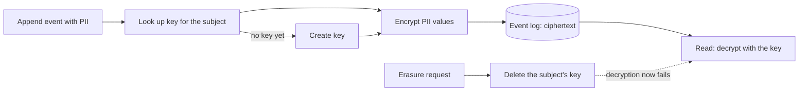

import { Aside } from '@astrojs/starlight/components';

Event sourcing can support the GDPR right to erasure without deleting the event log: encrypt personal values under a key for their subject, then destroy that key. Cratis Chronicle uses this approach, called crypto-shredding, for values marked `[PII]` (personally identifiable information). It makes those encrypted values unreadable while leaving the events in place. It does not erase plaintext copies, other namespaces or backups.

Use this page to plan what an erasure request must reach, then follow the worked client examples. Whether that plan satisfies your legal duties depends on the data and its use, not just the event store.

## Why immutability seems to conflict with GDPR

An [event store](/concepts/event-store/) records changes as an append-only history. [Event sourcing](/concepts/event-sourcing/) uses that history to rebuild state by replaying events. Removing recorded facts can change what a replay produces, even when the store supports redaction.

[Article 17 of the GDPR](https://eur-lex.europa.eu/eli/reg/2016/679/oj) sets out the right to erasure and its exceptions. A name, address or diagnosis left readable in the log must be part of your erasure assessment; calling the log immutable does not resolve that obligation.

Encrypting personal values separately lets you remove access to them without removing the event. Another option is to keep personal data outside the log and record only an opaque reference. In either design, assess whether the remaining identifiers or other fields can still identify the person.

## Three approaches

Choose how personal data will be stored before relying on an erasure procedure. These approaches can be combined, but archiving data alone does not erase it.

| | Crypto-shredding | Data segregation | Retention and archival |
|---|---|---|---|
| **Idea** | Encrypt personal values per person; delete the key to erase | Keep personal data in a separate mutable store; events hold only a reference | Delete or archive whole streams or events after a fixed period |
| **Erase on request** | Destroy all usable copies of the subject's key; values encrypted under it become unreadable | Delete the external record and its copies; events retain the reference | A schedule alone does not answer an earlier request; archived readable data remains data to assess |
| **Log stays intact** | Yes | Yes | Deletion removes history; archival moves it but may preserve readable copies |
| **Operational work** | Manage keys, revisions, caches and backups | Keep personal values out of events and coordinate the two stores | Define retention rules and manage archive access and deletion |
| **Main risk** | Key backups, copies and anything already decrypted can keep the data alive; keys must be managed correctly | Personal data leaks back into events through careless modeling; joins across two stores | Deleting history you still need; may not meet a request that arrives before the period ends |
| **Reads of erased data** | Depends on the read API; Chronicle normally releases type-appropriate empty values | Lookup fails or returns nothing | Deleted events are absent; archived events may still be readable |
| **Fits when** | Personal data is embedded in events and you want one mechanism | You can model personal data as a lookup from the start | A legal retention period applies anyway |

Crypto-shredding depends on key handling: a usable key in a backup can restore access. Segregation depends on keeping personal values out of events, including free-text descriptions. Deleting whole events removes non-personal history too, which may affect later replays.

The [event-driven.io article on GDPR in event-driven architecture](https://event-driven.io/en/gdpr_in_event_driven_architecture/) covers segregation and retention in depth from a vendor-neutral view. This page concentrates on crypto-shredding because Chronicle ships it.

## How crypto-shredding works

Crypto-shredding destroys the key rather than the ciphertext. In Chronicle, a subject identifies the person whose PII values share a key. When an event is appended, its marked values are encrypted under that subject's key; reads use the key to decrypt them. After erasure, new PII writes for that subject are refused unless a new key has been explicitly authorized.

Choose the subject carefully. It defaults to the event source id, but can be set explicitly when the event source is not the person. If one person's values are stored under several subject identifiers, erasing only one identifier cannot reach the others.

The event type, sequence number and unmarked fields remain readable. Use an opaque event source id, not a name or email address: the id itself is stored in clear text. Review the remaining fields too, because encryption of selected properties does not make the rest anonymous.

## Projections, read models and caches after erasure

Events are not the only place personal data lives. [Projections and read models](/concepts/projections-and-read-models/) copy values out of events into documents or tables, and those copies are what your application queries.

Chronicle decides what to encrypt from the schema of the thing it stores. Marking an event property `[PII]` protects the value in the event. It does not mark the read model property the value is projected into. Unless you also mark that read model property `[PII]` (or give it a concept type marked `[PII]`), the projected value is stored in plain text and stays readable after the subject's key is erased. Reducers follow the same rule.

For read model properties that are marked, Chronicle stores the value encrypted and releases it on read with the subject's key. After the key is gone, the read returns the empty value of the property's type: an empty string, `0` or `false`, `null` for a nullable type, and an empty collection or object. The caller gets a normal object with a blank name, not an exception.

What the application still has to do: mark every read model property that holds personal data, remove ciphertext from the read model store if your policy requires it, and clean up any copies Chronicle does not manage.

Existing read model documents keep their ciphertext after key deletion. Projection and reducer replay can rebuild marked properties for an erased subject as empty markers without creating a key or removing the erasure fence. A rebuild is not a scrub of existing storage: stale documents or values copied under the wrong subject may remain. Use a clean destination or an audited migration when those copies must be removed.

Ordinary reads cannot distinguish an erased `0` or `false` from a genuine value. An explicit .NET sequence read, `GetFromSequenceNumberWithErasedProperties`, can report confirmed erased paths in the returned current event content when the server supports it. An empty path list is not proof that nothing was erased, and this opt-in does not add erasure metadata to projection or observer reads. Broader read surfaces remain tracked in [issue 4620](https://github.com/Cratis/Chronicle/issues/4620).

A search index, export, cache or warehouse that received decrypted values is outside this key-deletion mechanism. Include those copies in the erasure procedure.

The details, including how joined values keep the subject of the event they came from, are in [Read models and PII](/chronicle/compliance/read-models/).

## Erasing a subject in Chronicle: worked example

The tabs show the C#, Kotlin, Java, TypeScript and Elixir clients. Use your client's tab for the marking and erasure syntax; marker placement and lifecycle APIs differ. See [Marking data as PII](/chronicle/compliance/pii/) and [where the clients differ](/chronicle/clients/where-the-clients-differ/) before translating an example between clients.

Start by marking the personal values. Chronicle's subject-key erasure covers PII-marked values, not unmarked plaintext or values encrypted separately for confidentiality. In this example the names are personal; the department is left unmarked:

<ChronicleClientTabs snippet="compliance/pii/property-level" />

When this event is appended, the first and last names are encrypted under the subject's key. The department is stored as it is. If the same personal value appears in many events, declaring PII once on a concept type is less error-prone; see [Declaring PII on a concept](/chronicle/compliance/pii-with-concepts/).

Next, append the event through the ordinary API. Marking its values as PII does not change the append call. These tabs illustrate that API with an order:

<ChronicleClientTabs snippet="events/appending/example" />

For the employee example, append a `PiiAttrEmployeeRegistered` event instead, using `person-42` as the event source id. The event source id is the subject by default. On the first PII write for this subject, Chronicle creates a key before encrypting the marked names. An erased subject cannot get a replacement key without explicit authorization.

When an erasure is required, call the subject-key deletion API:

<ChronicleClientTabs snippet="compliance/erasure/delete-key" />

Deletion records the erasure, removes every revision of the subject's key and evicts cached keys across the cluster. The recorded erasure prevents normal provisioning or forwarding from recreating the key; it cannot prevent a storage restore from bringing back an older key store.

The call covers every event store in the namespace, because subscriptions can copy the subject's key between stores in that namespace. It first records an erasure fence in every store, then destroys the keys. Failures are reported together as `EncryptionKeyErasureIncomplete`. Treat that as incomplete work: repeat the call after the failures have been resolved.

Check the result by reading `person-42`'s events. They retain their sequence numbers. The names return as empty strings; the department retains its value. That check shows the behavior of these fields, not completion of erasure across your whole system.

After erasure, appending a new value marked as personal data for `person-42` fails with `EncryptionKeyErased`. Chronicle does not silently create a key or blank a new value. If there is later a lawful basis to store the person's data again, .NET exposes `AllowNewEncryptionKeyFor` to authorize a fresh key on the next PII write. The new key cannot decrypt earlier ciphertext. Check your client's lifecycle API rather than assuming the same method is available everywhere.

<Aside type="caution">
The namespace is the boundary. In a multi-tenant deployment, the same person in two namespaces has two keys and counts as two subjects. Issue one erasure per namespace the person appears in.
</Aside>

For the mechanism behind the fence and what it cannot stop, read [The encryption key lifecycle](/chronicle/compliance/key-lifecycle/). For the call and its follow-up work, read [Erasing a subject](/chronicle/compliance/erasing-a-subject/). If an entire event payload has to go, not only the personal values, Chronicle also offers [event redaction](/chronicle/events/redaction/).

## Proving erasure happened

Keep evidence of both the key operation and the request it answered. Chronicle logs completed erasures and new-key authorizations at information level, including the namespace, the event stores reached and a one-way subject binding. Those messages do not include the subject identifier or key material. An incomplete erasure has a separate error-level message; do not treat it as completion.

The binding is a pseudonym, not an anonymization. A small or guessable id space can be worked backwards.

Chronicle does not record who asked for the erasure or on what legal basis, because it does not know. That record is yours to keep, for example as an entry in your own request register that references the erasure log line.

## Limits and what legal review still has to decide

This is not legal advice. Chronicle gives you a mechanism. Whether your use of it satisfies Article 17 depends on your data, your retention duties and your supervisory authority.

Before closing a request, account for what key deletion does not reach:

- A key-store backup from before erasure can restore the key and remove the fence. Reapply erasures made since the backup as part of the restore procedure.
- Unmarked event and read model properties are not protected by PII key deletion. Existing read model ciphertext also remains until you remove it.
- Exported keys and decrypted copies in application caches, search indexes, database dumps or other systems need separate handling.
- Adding `[PII]` to an existing property encrypts subsequent appends, not earlier plaintext. Redact earlier events if that plaintext must go.
- Causation property values are not encrypted under the subject's key. Configuration can omit new values, but does not remove those already stored.
- Event source IDs and other unmarked metadata remain readable. Review whether they still identify the person.

Open legal questions for your own review include whether deleting a key counts as erasure for your regulator, which Article 17(3) exceptions apply to your data, and how long backups may keep a key. For Cratis's own data handling, see the [trust page](https://cratis.no/trust/).

## FAQ

### Can event sourcing comply with GDPR?

It can support a compliant design when personal data is encrypted per subject or kept outside the log. Compliance still depends on the whole system, including remaining identifiers, read models, backups and copies. An append-only log is neither a compliance guarantee nor an exemption from erasure.

### Is crypto-shredding GDPR compliant?

Crypto-shredding makes encrypted values unreadable by destroying all usable copies of their key. The technique alone does not establish GDPR compliance. Ask your data protection officer or legal counsel whether it meets the erasure requirement for your data and retention duties.

### What about events I wrote before I added encryption?

They stay as they were. Adding `[PII]` to an existing property applies to later appends only. Redact the earlier events if their content has to go.

### Do I have to delete projections too?

PII-marked read model properties release as empty values after key deletion; marking only the event property is not enough. Unmarked plaintext copies need separate cleanup. Projection and reducer replay can rebuild erased subjects without creating keys, but replaying over existing storage does not guarantee removal of stale documents or wrong-subject copies. Use a clean destination or an audited migration when those must be removed.

### Does this work outside .NET?

The C#, Kotlin, Java, TypeScript and Elixir clients expose PII marking and subject-key deletion; the kernel performs encryption. That does not imply matching marker placement, lifecycle calls or erasure metadata across clients. For example, Elixir exposes new-key authorization, while Kotlin and Java do not. The [PII page](/chronicle/compliance/pii/) and [where the clients differ](/chronicle/clients/where-the-clients-differ/) explain the differences; use your client's tab above for marking, append and erasure syntax.

## Next steps

Continue with [Compliance in Chronicle](/chronicle/compliance/) to plan the implementation, or [Auth and compliance end to end](/auth-and-compliance/) to trace responsibilities across the stack. If you have not appended an event yet, start with the [Chronicle tutorial](/chronicle/tutorial/).
