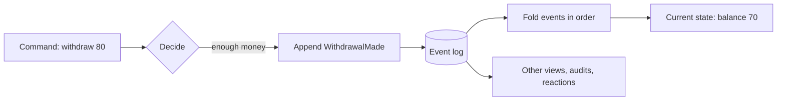

Event sourcing stores business changes as events so you can explain how the current state came to be. Instead of overwriting a record, you append a fact about what happened to a log. The events are the source of truth; current state is derived by applying them in order.

A bank account is the classic example. A traditional table stores `Balance = 70`. An event-sourced account stores that it was opened with 100, that 50 was deposited and that 80 was withdrawn, and the balance of 70 follows from those facts. You can answer "what is the balance?" and also "how did we get here?"

Use event sourcing when the sequence of business changes matters, not just the latest values. The example below separates recording a fact from building a view of it. Related decisions are covered in [CQRS](/concepts/cqrs/), [event store vs. a regular database](/concepts/event-store/), [event modeling](/event-modeling/), [projections and read models](/concepts/projections-and-read-models/), and [event-driven architecture vs. event sourcing](/concepts/event-driven-architecture/).

## How event sourcing works

An event names a fact in the past tense: `DepositMade`, not `MakeDeposit`. Ordinary business changes append new facts instead of editing earlier ones. Corrections and personal-data erasure need explicit handling; an append-only model does not remove those obligations.

Events are associated with the thing they describe. Chronicle calls that an **event source**, such as one account or one order. Applying its events in order to a running value is called a **fold**: an opening balance starts the calculation, deposits add to it, and withdrawals subtract from it. A view shaped for queries is a **read model**.



The decision step matters. A command such as "withdraw 30" is a request, not a fact. Before recording it, the application must enforce the account's rules. Reading a balance and then appending is not enough when two withdrawals race: both can see the same balance. [Keeping decisions correct under concurrency](/concepts/keeping-decisions-correct/) explains how to protect the decision at append time.

For frequently queried or long histories, keeping derived state up to date as events arrive avoids repeating the calculation on every request. Those views are [projections and read models](/concepts/projections-and-read-models/).

## A concrete example: a bank account

Three event types describe opening an account, depositing money and withdrawing it. In the C# example, each is a record marked `[EventType]`; the tabs show the corresponding Kotlin and Java declarations:

<ChronicleClientTabs snippet="site-concepts/event-sourcing/events" variants="csharp,kotlin,java" />

The service appends a withdrawal to Chronicle's event log through `IEventLog`. The event source id identifies which account the event belongs to:

<ChronicleClientTabs snippet="site-concepts/event-sourcing/account-service" variants="csharp,kotlin,java" />

This excerpt shows the append call and result check, not a complete withdrawal workflow. It neither checks available funds nor configures a guard against concurrent withdrawals. It also assumes the Chronicle client is registered in your host; [Get started with Chronicle](/chronicle/get-started/) covers setup.

Appending returns an `AppendResult`. A schema rejection, constraint violation or concurrency conflict means the append was refused. A timeout or lost response is different: the event may already be stored. Check the outcome before retrying, following [Appending events](/chronicle/events/appending/).

To read state, you fold the events. Chronicle can do this for you with a projection, but the underlying idea is a plain function. The balance after the three events above is:

```text
AccountOpened(Owner: "Ada", InitialBalance: 100)  -> balance 100
DepositMade(Amount: 50)                           -> balance 150
WithdrawalMade(Amount: 80)                        -> balance 70
```

The balance alone hides the withdrawal; the event history preserves it. To investigate the 80, you can inspect that event and the preceding changes. The history can only explain facts the application actually recorded.

## Benefits

The main benefit is an explainable history. `AddressChangedAfterMove` says more than a changed `Address` column, and a sequence of claim or order events shows how a process reached its current step. This supports investigation, but it is not a complete access audit or a compliance guarantee.

Keeping the facts also lets you ask new questions. A new screen can use a new projection over existing events, provided those events contain the data it needs. Replaying a history can help investigate a state-calculation bug; it does not reproduce external systems or missing inputs.

Other components can react to the stored facts too. [Event-driven architecture vs. event sourcing](/concepts/event-driven-architecture/) explains that separate choice.

## Trade-offs and when not to use it

For a settings table or reference list, create, read, update and delete (CRUD) operations may be all you need. If nobody needs the changes as business facts, keeping events adds modelling and operational work without answering a useful question.

Read behaviour needs deliberate design. Stored views usually update after the append, so a read can temporarily return old data. This is **eventual consistency**. Chronicle offers ways to read your own write, but they have costs; see [read model consistency](/chronicle/read-models/consistency/).

Personal data needs a separate retention and erasure design. Encryption per subject is one tool, not proof that every copy has been erased. Read Chronicle's [compliance documentation](/chronicle/compliance/) before deciding what belongs in events.

You do not have to choose for the whole system. Event-source the core domain and keep ordinary tables for data that is only current state. Cratis's own position and its limits are in [Why event sourcing](/chronicle/why-event-sourcing/) and [When to use event sourcing](/chronicle/concepts/when-to-use-event-sourcing/).

## Common pitfalls

- **Modelling events as CRUD.** Events such as `CustomerUpdated` with a bag of nullable fields lose the intent. Name the business fact: `CustomerMoved`, `CustomerEmailChanged`.
- **Confusing a correction with schema evolution.** A new business fact usually calls for a corrective event. A changed event schema needs an evolution strategy; Chronicle documents [event type migrations](/chronicle/concepts/event-type-migrations/).
- **Treating stream layout as a correctness guarantee.** Group facts with a deliberate event source id, but protect decisions with append-time checks. One source per entity does not enforce a rule by itself.
- **Reading the event log for every query.** Prefer stored views for frequent queries over long histories. Reserve on-demand replay for cases where its cost and freshness suit the request.
- **Retrying an append blindly.** A timeout does not prove the write failed. Use an idempotency key on the original append where supported, and reuse that key on retry; otherwise verify the original attempt before appending again. See [Appending events](/chronicle/events/appending/).
- **Treating events as a public API too early.** Events are internal facts until you decide to publish some of them. Keep the contract small and intentional.

## Frequently asked questions

### Is event sourcing the same as an audit log?

No. An audit log records activity alongside the application's state. In event sourcing, the events themselves are the state of record, and current values are derived from them. Either kind of history needs protection against loss and unauthorised changes; the distinction is its role in the application.

### Do I need CQRS to do event sourcing?

No, but they fit together. Appending events and querying derived views naturally give reads and writes different models. You can keep those models small, and you can also use CQRS without event sourcing. See [CQRS explained](/concepts/cqrs/).

### Does event sourcing make everything slower?

Not inherently. A materialized read model lets a query read stored values instead of replaying history. Append validation, storage, projection lag and rebuilds all have costs, so assess performance against your workload rather than assuming either a speed gain or a penalty.

### Can I add event sourcing to an existing application?

Yes, one slice at a time. Existing rows do not become events by themselves, so you need to decide how to import initial facts or start the new model from a cut-over point. Arc's guide to [adding event sourcing to a slice](/arc/backend/csharp/chronicle/add-event-sourcing/) walks through it.

### What do I need to run event sourcing in .NET?

You need a durable event log, a way to protect decisions during concurrent writes, and a way to derive state for reads. Chronicle supplies event storage and processing with a .NET client. See [event sourcing in .NET](/event-sourcing/dotnet/) for a starting point.

## Next steps

Before implementing a feature, use [event modeling](/event-modeling/) to identify its decisions, facts and views. Then read [projections and read models](/concepts/projections-and-read-models/) to see how the recorded history becomes queryable state.

To build the first slice, follow [Get started with Chronicle](/chronicle/get-started/) or the [Chronicle tutorial](/chronicle/tutorial/). If you are still evaluating the approach, [Why event sourcing](/chronicle/why-event-sourcing/) gives the Cratis rationale, and [event sourcing for .NET](/compare-event-sourcing-dotnet/) compares implementation options.
