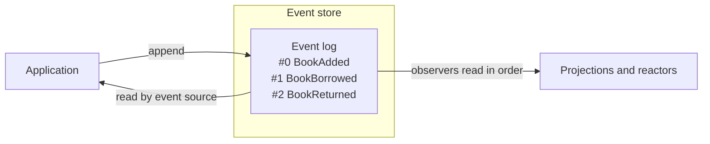

An event store preserves an ordered history of business events so an application can reconstruct state and build new views from past changes. Use one when those changes are the record you need to keep, rather than just a way to update today's values.

A relational or document database can hold either current state or an event log. The distinction is the storage model and the operations around it: a dedicated event store supplies append, ordering and observation capabilities that you would otherwise build yourself. In ordinary business use, changes append new facts instead of overwriting earlier ones.

The comparison below uses Cratis Chronicle to show what that means in practice. Start with [what is event sourcing?](/concepts/event-sourcing/) if you are still deciding whether events should be your source of truth.

## How an event store works

An event store keeps one or more ordered logs of events. In Chronicle these are **event sequences**, and the main one is the **event log**. Each event gets a sequence number that never changes. Each event also belongs to an **event source**, such as one account or one order, so you can read the history of a single entity.



An application uses three core operations:

- Append an event, identifying its event source and any checks that must hold for the write.
- Read the events of one event source, or a sequence from a chosen position.
- Observe new events to build views or run reactions, tracking progress so processing can resume.

In Chronicle, projections and reducers build state from events; reactors run follow-up work. Observation happens after storage, not inside the append.

Chronicle also tracks event types, observers and projections in the event store, and it can partition data into namespaces, for example per tenant. Its event-store data lives in a database you provide: MongoDB (the default), PostgreSQL, SQL Server or SQLite. Read the [event store concept](/chronicle/concepts/event-store/) for the details.

## Event store vs. a regular database

| | Regular database | Event store |
| --- | --- | --- |
| What is stored | Usually current state, but can also store history | Business changes as events |
| Ordinary business write | Insert, update, delete | Append a fact |
| History | Requires a history or audit design | The primary record |
| Typical read | Query tables or collections | Query a read model built from events |
| Ad hoc queries | SQL or document queries, depending on the database | Usually run against read models |
| Consistency of reads | Depends on transactions, replicas and isolation | Materialized views can lag behind accepted appends |
| Fit | General-purpose data storage | Domains that need changes as durable facts |

The last row is the real decision. Neither is better in general.

An event store does not replace querying. You almost never run business queries against the raw log. You build read models from it, and those can live in a document or relational database. An event-sourced system therefore often uses an event store and a regular database together. See [projections and read models](/concepts/projections-and-read-models/).

## A concrete example: a library

Suppose a library keeps only one row per book in a `Loans` table, with `BorrowedBy` and `DueDate` columns. Returning the book clears those values. Without a separate history, that design can show that the book is on the shelf but cannot explain its earlier loans.

In an event store, the same book's history looks like this:

```text
#0  BookAdded(Title: "Dune")
#1  BookBorrowed(Member: "Ada", DueDate: 2025-03-01)
#2  BookReturned()
#3  BookBorrowed(Member: "Grace", DueDate: 2025-03-22)
```

Applying these events in order shows that Grace has the book now. Counting the borrow events gives its loan frequency. With the occurrence times of borrow and return events, you can also calculate loan durations. Those questions need history, whether you store it as events or design separate history tables.

In Chronicle, the lending service appends `BookBorrowed` with the book id as the event source id:

<ChronicleClientTabs snippet="site-concepts/event-store/lending-service" variants="csharp,kotlin,java" />

This excerpt ignores the `AppendResult`. Application code must check the result and handle rejections and unknown outcomes as described in [Appending events](/chronicle/events/appending/). The example does not check whether the book is already on loan or protect that rule from concurrent requests. It also assumes a registered Chronicle client; [Get started with Chronicle](/chronicle/get-started/) covers setup.

To read the history of one book back, ask the event log for the events of that event source and the event types you care about:

<ChronicleClientTabs snippet="site-concepts/event-store/book-history-reader" variants="csharp,kotlin,java" />

## What an event store gives you that a regular database does not

The difference is ready-made event infrastructure, not an inability to store events in SQL or documents. Chronicle tracks sequence positions and observer progress so consumers can resume and read models can be rebuilt from history. You would otherwise own that infrastructure.

Chronicle also validates event schemas and supports append-time [constraints](/chronicle/constraints/) and concurrency checks. You must choose and configure the checks your business rule needs; storing events alone does not stop two callers from making conflicting decisions.

Append-only business writes preserve the sequence of facts, but do not imply tamper-proof storage or unlimited retention. Chronicle has explicit revision and redaction operations. Access controls, backups and personal-data handling remain part of the system design.

## What it does not give you

An event store is not a replacement for the query models your screens and reports need. Build those from events, including joins and aggregates where appropriate. Stored views update after the append and may be stale or stop advancing if processing fails.

It also changes how you correct business data. A mistaken loan normally needs a corrective fact, not a free-form update that removes the original decision from history.

## When not to use an event store

Choose a regular database when:

- The data is reference data or settings that nobody audits.
- The current state is all that matters and no process hangs on the changes.
- The team needs read-after-write everywhere and cannot design for lagging views.
- You need ad hoc reporting over arbitrary fields and have no appetite for building read models first.

You can mix both. Use Chronicle for the event history and a relational or document store for features that only need current state. See [when to use event sourcing](/chronicle/concepts/when-to-use-event-sourcing/).

## Common pitfalls

- **Using the event store as a general-purpose database.** Store facts about your domain, not arbitrary documents.
- **Querying the log for screens.** Serve screens from read models.
- **Making events too generic.** An event named `RecordChanged` is an update statement with a new name. Name the business fact.
- **Forgetting storage planning.** Retained events accumulate. Plan capacity, retention, erasure and backups for the underlying database.
- **Assuming a message broker is an event store.** A broker delivers messages and may discard them after delivery. An event store keeps events as the system of record. See [event-driven architecture vs. event sourcing](/concepts/event-driven-architecture/).
- **Skipping idempotency.** After a timeout, an append may already be stored. Use an idempotency key on the original append where supported and reuse it on retry, or verify the original attempt before writing again. A generic concurrency check is not automatic duplicate protection.

## Frequently asked questions

### Is an event store a NoSQL database?

It is a specialised database. Some event stores run on top of NoSQL or SQL databases. Chronicle stores its data in MongoDB, PostgreSQL, SQL Server or SQLite, and adds sequence numbers, event types, constraints and observers on top.

### Can I use PostgreSQL or SQL Server as an event store?

Yes. You can build an event log with an append-only table, but then you own sequencing, concurrency checks, subscriptions and replay. A dedicated event store supplies that infrastructure. Chronicle can use PostgreSQL or SQL Server as its underlying storage.

### Can I delete personal data from an event store?

Erasure needs an explicit design. Chronicle's `[PII]` marking supports encrypting personal values with a subject key; deleting that key is called crypto-shredding. It is not proof that every copy is erased: caches, read models, exports and backups need attention, and unmarked values are not covered by the marking. Start with [event sourcing and GDPR](/concepts/event-sourcing-gdpr/) and check the current limits in [Chronicle compliance](/chronicle/compliance/).

### Where do my queries run?

On read models. A projection folds events into a read model that is stored in a database, and your queries run there.

### Does an event store replace my main database?

Not usually. It is the system of record for events. Read models in a regular database serve queries.

### How do I try one?

Follow the [Chronicle tutorial](/chronicle/tutorial/), or read about [event sourcing in .NET](/event-sourcing/dotnet/).

## Next steps

If the storage model fits your feature, read Chronicle's [event store concept](/chronicle/concepts/event-store/) and choose a setup in [Get started with Chronicle](/chronicle/get-started/). Continue with [projections and read models](/concepts/projections-and-read-models/) to plan how users will query the facts you store; [CQRS](/concepts/cqrs/) explains why those read and write models can differ.

For an implementation comparison, see [event sourcing for .NET](/compare-event-sourcing-dotnet/) or [Marten vs Chronicle](/compare/marten-vs-chronicle/).
