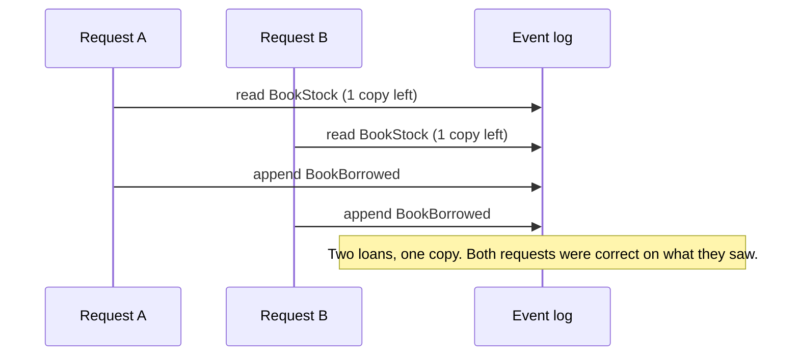

Use this page when a rule depends on state: "a book cannot be borrowed when no copy is left", "a member may hold three loans", "an email address is used once". It explains why the obvious code can break the rule, what Cratis does about it, and which mechanism to pick.

## Why a read model can be stale at write time

The usual code reads current state, decides, then appends an event. Those are three separate steps, and another request can run between them.



Two things make the plain read unsafe:

- A read model is built from events after they are appended, so it can lag behind the event log.
- Even a read model that is fully up to date describes the state at the moment you read it, not at the moment you append.

A rule holds under concurrency only if the append itself fails when the facts the decision depended on have changed.

## What read protection does

Read protection makes the state a command reads part of the append. Chronicle notes the position of the event log before it reads the state. When the command commits, Chronicle rejects the append if an event that the read depended on was written after that position.

| Mode | What an injected read model is | Use it when |
| --- | --- | --- |
| `Off` (default) | A plain read. It returns a snapshot and guards nothing | Nothing changes for existing commands |
| `Measure` | A plain read. Arc records what `On` would do and changes nothing | You adopt it on an existing application |
| `On` | Read fresh and guarded. A read that cannot be guarded is refused | New code, and migrated code |

The mode is the Arc switch. Underneath it is the Chronicle API that refuses unguarded reads inside one unit of work, see [Read protection in Chronicle](/chronicle/read-models/read-protection/). The two layers have similar names: Chronicle gives you the mechanism, and the Arc mode turns it on for your commands.

What a guarded command does when it loses the race:

| Outcome | What happens |
| --- | --- |
| The state the command read has not changed | The events are appended |
| A relevant event arrived after the read (`ReadChanged`) | The command returns a `400` with the reason `concurrencyViolation` and asks the caller to submit again |
| Either way | Nothing is written on a failure. There are no locks, and Arc does not retry for you |

A concurrent event that does not matter to the rule does not conflict. The guard covers the event types the read model folds, for the key it reads. A rename of the same book does not conflict with a borrow, and neither does a borrow of another book.

Read protection guards the reads the command makes. It does not guard a writer that decides without a guard, state outside the event log such as another database or an HTTP call, or a read you mark as advisory. A rule holds fully only when every writer that decides on it is guarded, or when it is a constraint.

## An example

Under `On`, the rule goes in a `CommandValidator<T>` that takes the read model as a constructor parameter. `Handle()` says only what happens.

A library lets a member borrow a book only while a copy is available. The read model `BookStock` counts available copies per book from `CopyAdded`, `BookBorrowed` and `BookReturned`. The command `BorrowBook` returns `BookBorrowed` from `Handle()`, and its `CommandValidator<BorrowBook>` takes `BookStock` as a constructor parameter and refuses when no copy is left. Under `On`, that read guards the command's append: if another member borrows the last copy first, this command writes nothing and the caller is asked to submit again.

The full code, with the read model, command, validator and a test of the race, is in [Getting started with read protection](/arc/backend/csharp/chronicle/consistency/getting-started/#2-write-a-protected-command).

Turn the mode on in the project file:

```xml
<PropertyGroup>
    <CratisReadProtection>On</CratisReadProtection>
</PropertyGroup>
```

With the mode `On`, the append is guarded by `CopyAdded`, `BookBorrowed` and `BookReturned` for that book, after the position captured before the read. With the mode `Off`, the same validator is a hint: it gives the user quick feedback, and two requests can still both pass. The [getting started guide](/arc/backend/csharp/chronicle/consistency/getting-started/) walks through the command step by step, including the `400` the loser receives.

## Which mechanism holds which rule

Pick the lightest tool that makes the rule hold.

| Mechanism | Use this when | Guards |
| --- | --- | --- |
| Protected read | A rule over state on one or more keys: stock, a count, a capacity | The event types the read model folds, on the key it reads |
| Per-stream read model | The rule depends on one stream of an entity, such as one account's withdrawals in one month. The model is declared with `[EventStream<TSource>(stream)]` | That stream only. Another month does not conflict |
| Stream decision | You decide on the raw events of one routed stream, with no model, such as "was this report already approved" | Any event in that stream |
| Aggregate | Rich behaviour with many rules over one entity's lifecycle | The event types the aggregate handles, on its event source |
| Constraint | A value must be unique, or something may happen once | Every writer, checked inside the append. It cannot count |
| Reactor repair | A rare violation is acceptable and you can correct it with a new event afterwards | Nothing. It is a later correcting event |

Two more shapes are covered in the guides: an explicit scope when the caller sends the revision it saw (editing conflicts), and a plain read when a hint is enough.

A few cautions:

- A constraint is cheaper than a protected read for uniqueness. Use it.
- A stream decision reads the whole stream, so keep streams short.
- Do not ask for protection where a hint is enough. A protected read costs a fresh fold of the key's history on every command.
- Under `On`, a read that cannot be guarded is refused with an error that names the fix. A join or a child collection in a read model is an example. Flat, event-source-keyed models work best.

## The Dynamic Consistency Boundary idea

Read protection is Chronicle's take on the Dynamic Consistency Boundary (DCB): the boundary is the set of events one decision read, not a whole stream or aggregate. [The Dynamic Consistency Boundary](/concepts/dynamic-consistency-boundary/) explains the idea and where Chronicle sits. If you know DCB from another store, start with [Read this first](/concepts/read-this-first-write-side-consistency/). For exactly which events make an append fail, see [how guards are derived](/chronicle/dynamic-consistency-boundary/how-guards-are-derived/).

## Where to go next

Follow the [write-side consistency learning path](/learning-paths/#write-side-consistency), or choose by how you work with Cratis.

| You are using | Go to |
| --- | --- |
| The whole stack, in order | [Decisions that hold, from model to frontend](/decisions-that-hold-walkthrough/) |
| Arc commands | [Consistency in Arc](/arc/backend/csharp/chronicle/consistency/) |
| The Chronicle client directly | [Choosing how a rule holds in Chronicle](/chronicle/dynamic-consistency-boundary/choosing/) |
| Screenplay models | [What `reads` guarantees](/screenplay/commands/#what-reads-guarantees) |
| Event source definitions and streams | [Event sources](/chronicle/event-sources/) and, for Arc commands, [event source definitions](/arc/backend/csharp/chronicle/commands/event-source-definitions/) |

For the ideas underneath, see [what is event sourcing?](/concepts/event-sourcing/) and [event modeling](/event-modeling/).
