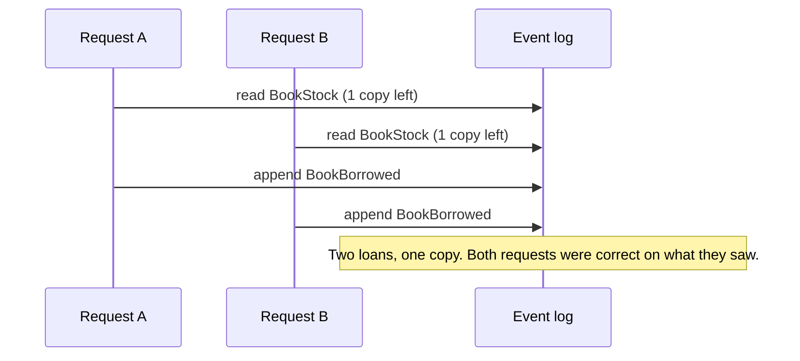

Write-side consistency means checking a business rule when its events are appended, not just when a command first reads state. In Cratis, use a protected read for rules such as available stock or a loan limit. For uniqueness, use a kernel constraint: a rule enforced inside the event store. A plain read followed by an append leaves a gap in which another writer can change the answer.

## Why a read model can be stale at write time

The usual code reads current state, decides, then appends an event. Those are three separate steps, and another request can run between them.



A materialized read model is stored and updated after events are appended, so it can lag behind the log. A passive read model is built from events on demand, but freshness alone does not solve the race: another request can append after either kind of read returns.

For this rule to hold, the append must reject the decision if another stock-changing event arrived after the position captured before the read. The check belongs at append time.

## What read protection does

Read protection carries a description of the command's reads into its append. Cratis Chronicle records a log position before building fresh state from events. At commit, it rejects the append if a later event matches the read's guard: the event types the model uses, for the key it reads. Cratis Arc can arrange that protection for read-model parameters in commands and validators.

| Mode | What an injected read model is | Use it when |
| --- | --- | --- |
| `Off` (default) | A plain read. It returns a snapshot and guards nothing | Nothing changes for existing commands |
| `Measure` | A plain read. Arc measures reads without enforcing protection | You assess an existing application before changing its behavior |
| `On` | Read fresh and guarded. A read that cannot be guarded is refused | New code, and migrated code |

The mode is the Arc switch. Underneath it is the Chronicle API that refuses unguarded reads inside one unit of work, see [Read protection in Chronicle](/chronicle/read-models/read-protection/). The two layers have similar names: Chronicle gives you the mechanism, and the Arc mode turns it on for your commands.

What a guarded command does when it loses the race:

| Outcome | What happens |
| --- | --- |
| No guard was violated | The append can proceed, subject to its other checks and constraints |
| A protected read changed (`ReadChanged`) | The command returns a `400` with the reason `concurrencyViolation` and asks the caller to submit again |
| The guarded append fails | None of its events are written. Arc does not retry the command for you |

The guard matches events, not the final value of the model. A matching event can cause a conflict even if the resulting stock count happens to be unchanged. An unrelated event type or another book's key does not violate this guard; a rename is excluded only if the model does not fold renames.

Position-only scopes do not detect edits to earlier history. The .NET decision-read path additionally captures a history-mutation marker when the kernel supplies one, so revisions or redactions can also invalidate a protected read. See [how guards are derived](/chronicle/dynamic-consistency-boundary/how-guards-are-derived/) before relying on a narrower boundary.

Read protection guards the reads the command makes. It does not guard a writer that decides without a guard, state outside the event log such as another database or an HTTP call, or a read you mark as advisory. A rule holds fully only when every writer that decides on it is guarded, or when it is a constraint.

## An example

For a rule that should return validation feedback, put the check in a `CommandValidator<T>` and inject the read model into its constructor. Under `On`, the read is guarded as part of that command. Keep `Handle()` focused on the resulting events.

A library lets a member borrow a book only while a copy is available. The read model `BookStock` counts available copies per book from `CopyAdded`, `BookBorrowed` and `BookReturned`. The command `BorrowBook` returns `BookBorrowed` from `Handle()`, and its `CommandValidator<BorrowBook>` takes `BookStock` as a constructor parameter and refuses when no copy is left. Under `On`, that read guards the command's append: if another member borrows the last copy first, this command writes nothing and the caller is asked to submit again.

The full code, with the read model, command, validator and a test of the race, is in [Getting started with read protection](/arc/backend/csharp/chronicle/consistency/getting-started/#2-write-a-protected-command).

Turn the mode on in the project file:

```xml
<PropertyGroup>
    <CratisReadProtection>On</CratisReadProtection>
</PropertyGroup>
```

With the mode `On`, the append is guarded by `CopyAdded`, `BookBorrowed` and `BookReturned` for that book, after the position captured before the read. With the mode `Off`, the same validator is a hint: it gives the user quick feedback, and two requests can still both pass. The [getting started guide](/arc/backend/csharp/chronicle/consistency/getting-started/) walks through the command step by step, including the `400` the loser receives.

## Which mechanism holds which rule

Choose by the shape of the rule. A fresh read is useful for stock; it is unnecessary work for a uniqueness rule that the kernel can check directly.

| Mechanism | Use this when | Guards |
| --- | --- | --- |
| Protected read | A rule over state on one or more keys: stock, a count, a capacity | The event types the read model folds, on the key it reads |
| Per-stream read model | The rule depends on one stream of an entity, such as one account's withdrawals in one month. The model is declared with `[EventStream<TSource>(stream)]` | The declared stream when read with a specific stream ID. Other enrolled reads or scopes can widen the guard |
| Stream decision | You decide on the raw events of one routed stream, with no model, such as "was this report already approved" | Any event in that stream |
| Aggregate | Rich behaviour with many rules over one entity's lifecycle | The event types the aggregate handles, on its event source |
| Constraint | A value must be unique, or something may happen once | Every writer, checked inside the append. It cannot count |
| Reactor repair | A rare violation is acceptable and you can correct it with a new event afterwards | Nothing. It is a later correcting event |

Two more shapes are covered in the guides: an explicit scope when the caller sends the revision it saw (editing conflicts), and a plain read when a hint is enough.

Protected reads build state from history on every command. Keep histories small enough to read on demand, and use ordinary reads for display or advisory feedback when no append depends on them. A stream decision likewise reads its whole selected stream.

Under `On`, Chronicle refuses a read it cannot guard rather than silently running it unprotected. Joins and child collections are examples of unsupported projection shapes. Start with a flat, event-source-keyed model; the linked guides explain admission rules for projections and reducers.

## The Dynamic Consistency Boundary idea

Read protection applies the Dynamic Consistency Boundary (DCB) idea: select the events a decision depends on rather than always checking a whole stream. Chronicle uses its own event-source model, not the DCB specification's API; events cannot carry several event source IDs, and custom tags do not participate in concurrency checks. [The Dynamic Consistency Boundary](/concepts/dynamic-consistency-boundary/) explains the idea and where Chronicle sits. If you know DCB from another store, start with [Read this first](/concepts/read-this-first-write-side-consistency/). For exactly which events make an append fail, see [how guards are derived](/chronicle/dynamic-consistency-boundary/how-guards-are-derived/).

## Where to go next

Follow the [write-side consistency learning path](/learning-paths/#write-side-consistency), or choose by how you work with Cratis.

| You are using | Go to |
| --- | --- |
| The whole stack, in order | [Decisions that hold, from model to frontend](/decisions-that-hold-walkthrough/) |
| Arc commands | [Consistency in Arc](/arc/backend/csharp/chronicle/consistency/) |
| The Chronicle client directly | [Choosing how a rule holds in Chronicle](/chronicle/dynamic-consistency-boundary/choosing/) |
| Screenplay models | [What `reads` guarantees](/screenplay/commands/#what-reads-guarantees) |
| Event source definitions and streams | [Event sources](/chronicle/event-sources/) and, for Arc commands, [event source definitions](/arc/backend/csharp/chronicle/commands/event-source-definitions/) |

For the ideas underneath, see [what is event sourcing?](/concepts/event-sourcing/) and [event modeling](/event-modeling/).
