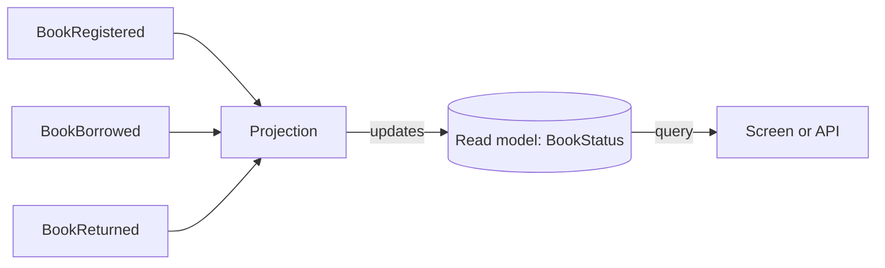

A read model is data shaped to answer a query, such as the books currently on loan. A projection defines how events build that view. Keeping the result in storage lets a screen read the answer without replaying the full history on every request.

For a balance, the projection applies deposits and withdrawals to a running total. Several projections can use the same events to answer different questions: the balance, a transaction list or a monthly summary. This is the read side of an event-sourced [CQRS](/concepts/cqrs/) design. Start with [what is event sourcing?](/concepts/event-sourcing/) if you need the storage model first.

## How projections and read models work

A projection selects the event types it needs and maps their facts into a read model. An event's key identifies which instance to update; for a book-status view, that can be the book id. A materialized projection stores the result for queries to read.

Treat the view as derived data. Business writes go to events, not directly to the projected fields: a direct edit can be overwritten by the next event or replay. If the mapping is wrong, correct it and rebuild the view from the retained facts.

A new view can use old events only if those events contain what it needs. Replay cannot recover a fact that was never recorded. Stored views also update after the append, so they can lag behind it; a failed observer may leave them stale until processing recovers.

Chronicle projections join events, not other read models. Keeping the inputs in the event history avoids making a rebuild depend on another view's current state.

:::caution[A read model is not a lock]
A read model describes the state at the moment you read it, and it can lag behind the event log. A rule that checks a read model and then appends can still be broken by a concurrent request. See [Keeping decisions correct under concurrency](/concepts/keeping-decisions-correct/) for what holds a rule.
:::

## Projections, reducers and read models

The terms overlap, so here is how Chronicle uses them.

| Term | What it is |
| --- | --- |
| Read model | The shaped, queryable result |
| Projection | A declarative rule that maps events onto a read model |
| Reducer | Code that folds each event into the current state, one event at a time |

The examples below use three authoring styles. The interface names in this table are from the .NET client; the tabs show each example's client-specific form:

| Style | What it looks like | Use it when |
| --- | --- | --- |
| Model-bound projection | Attributes on the read model type | Direct field mappings describe the view |
| Declarative projection | A fluent `IProjectionFor<T>` class | The mapping needs more explicit structure |
| Reducer | An `IReducerFor<T>` class | State transitions are easier to write as code |

Chronicle's [choose a read-model style](/chronicle/projections/choosing-a-read-model-style/) page compares these forms with other supported choices, including self-reducing models in .NET.

## A concrete example: a library book

A library tracks whether each book is on the shelf or on loan. Three events carry the story:

<ChronicleClientTabs snippet="site-concepts/projections-and-read-models/events" variants="csharp,kotlin,java" />

The screen needs a small read model: the title, whether the book is on loan and who has it. In a model-bound projection, the read model describes how events fill it:

<ChronicleClientTabs snippet="site-concepts/projections-and-read-models/model-bound" variants="csharp,kotlin,java" />

The registered Chronicle client discovers the model-bound definition, so this form needs no separate projection class. The registration event fills the title and ISBN. Borrowing sets the borrowed flag and member name; returning clears both. In C#, `[ClearWith<BookReturned>]` expresses clearing the member name; the JVM examples use their mapping annotations.

A separate projection class can express the same mapping. AutoMap fills matching title and ISBN properties, while the fluent definition explicitly maps the borrowed flag and member name:

<ChronicleClientTabs snippet="site-concepts/projections-and-read-models/fluent-projection" variants="csharp,kotlin,java" />

Use one style per read model, not both definitions together. These excerpts assume a registered Chronicle client; [Get started with Chronicle](/chronicle/get-started/) covers the host setup.

When you want to fold state with ordinary code, a reducer receives the event, the current state and the event context, and returns the new state. A running balance is a good fit:

<ChronicleClientTabs snippet="site-concepts/projections-and-read-models/reducer" variants="csharp,kotlin,java" />

To read the book-status result, ask for its instance by key. With materialization enabled, this retrieves the stored view, which may not yet include the latest append:

<ChronicleClientTabs snippet="site-concepts/projections-and-read-models/get-instance" variants="csharp,kotlin,java" />

In an Arc .NET application, the same read model carries a `[ReadModel]` attribute and a static query method, and the frontend gets a typed proxy. See [read models in Arc with Chronicle](/arc/backend/csharp/chronicle/read-models/).

## Consistency: materialized or on demand

A **materialized** read model is stored and updated after the append. This is the default: repeated queries read the saved result rather than calculating it again. When one caller needs its own write back, it can wait for the append's observers to finish before querying, and must handle failures or timeouts from that wait.

A **passive** read model is computed on demand from events instead of stored in a sink. Its cost grows with the history it replays. Ordinary passive by-id reads select one event source: they do not generally reconstruct a view that joins sources or uses a custom aggregation key. Keep those views materialized.

Choose freshness separately from write correctness. Even a fresh on-demand result does not protect a later append from another writer. Use an append-time [constraint](/chronicle/constraints/) or a protected decision read for rules that must hold under concurrency. [Read model consistency](/chronicle/read-models/consistency/) explains the read options and their limits.

## Benefits

A materialized view moves calculation out of the query path. The loan screen can read the title, borrower and status together without folding every loan event. A report can use a different shape over the same history.

That separation lets you evolve a view without rewriting business facts. Rebuilds still cost time and need a rollout plan, but the events remain the input.

## Trade-offs and when not to use them

Every view adds a definition to maintain and data to rebuild. Large histories make replay an operational task, and an asynchronously updated screen needs a way to represent pending or stale data.

Do not use an unprotected read-then-append check to enforce a business rule. Two commands can both pass the check, even with on-demand reads. Protect the decision on the write side. For a simple application that only needs current-state records, ordinary database queries may be enough without event projections.

## Common pitfalls

- **One giant read model for every screen.** It brings back the coupling you set out to avoid. Build specialised models.
- **Treating a read model as the source of truth.** It can be dropped and rebuilt. The events are the record.
- **Putting business rules in a projection.** A projection mirrors facts. Decisions belong where commands are handled.
- **Mixing view rebuilds with external actions.** Keep projection logic focused on derived state so a rebuild does not send email. Reactors need a separate replay policy; see [event-driven architecture vs. event sourcing](/concepts/event-driven-architecture/).
- **Unbounded child collections.** A read model that collects every event of a busy entity grows without limit. Keep child lists bounded or split the view.
- **Querying the event log directly for screens.** Use a read model.

## Frequently asked questions

### What is the difference between a projection and a read model?

The read model is the result, and the projection is the rule that produces it. People often say "projection" for both.

### Is a read model the same as a materialized view?

A materialized event-sourced read model is similar: it stores a precomputed result, built from events rather than a SQL view definition. The broader term read model describes the data's purpose, and can also include on-demand results or views over current-state tables.

### How do I rebuild a read model?

Replay the retained events through the projection. Chronicle can rebuild a projection from the start of its history. Keep external actions out of projection logic so rebuilding a view does not send emails or charge payments.

### Can a projection use data from another read model?

Not in a Chronicle projection. Join the relevant events instead, so rebuilding the view does not depend on another read model's freshness or replay order.

### Where is a read model stored?

A materialized read model is written to a storage destination called a sink. MongoDB is the default; a passive read model has no stored instance. See [Chronicle's projections documentation](/chronicle/projections/) for configuration.

## Next steps

For your first view, [choose a read-model style](/chronicle/projections/choosing-a-read-model-style/) and use [Chronicle projections](/chronicle/projections/) to define the mapping. [Chronicle read models](/chronicle/read-models/) covers retrieval; an [Arc query](/arc/backend/csharp/queries/) can expose the result to React.

If you have not yet chosen the view's fields, use [event modeling](/event-modeling/) to work backwards from the screen to the facts it needs. [CQRS explained](/concepts/cqrs/) places that read model alongside the commands that record those facts.
