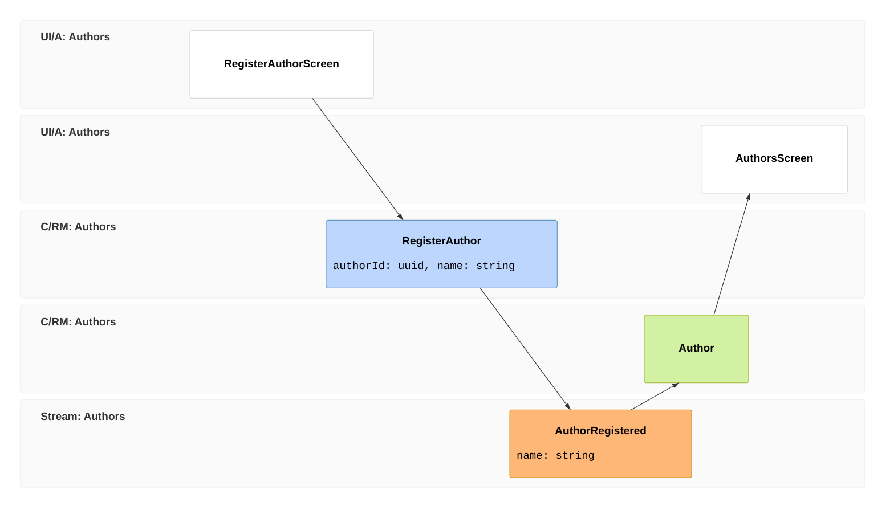

import { Aside, CardGrid } from '@astrojs/starlight/components';
import SimpleCard from '@components/SimpleCard.astro';
import TopicHero from '@components/TopicHero.astro';
import StackJourney from '@components/StackJourney.astro';

<TopicHero icon="rocket" eyebrow="Cratis Platform" title="Follow the feature, across the boundaries">
Cratis Platform connects event sourcing, CQRS, React UI, specifications, and operating tools. Its components share conventions so a feature has a recognizable shape from the first business question to the running system. Developers and AI agents work on that same shape. [Build a feature →](/build-a-full-app/) · [Choose an adoption boundary →](/adopting-cratis/)
</TopicHero>

## One idea, all the way down

Take the library feature in [Build a full-stack feature](/build-a-full-app/): a librarian registers an author and sees that author in a list. The Platform does not turn the requirement into a finished application on its own. It supplies the boundaries through which the feature travels:

| Handoff | Component role | What you can follow |
|---|---|---|
| Business intent → feature design | [Event modeling](/event-modeling/) names commands, events, and read models; a drawing is enough to start | `RegisterAuthor` records `AuthorRegistered`; the author list reads the projected result |
| Browser → application | [Arc](/arc/) exposes commands and queries and generates [typed TypeScript proxies](/arc/understanding-the-proxy-boundary/) | The React screen calls the generated command instead of a separately maintained fetch wrapper |
| Accepted command → durable fact | The Arc/Chronicle integration appends the handler's event through [Chronicle](/chronicle/) | The author id selects the event source; the event carries the author's name |
| Fact → read model | Chronicle runs the projection or reducer for the selected backend | The `Author` read model is derived from the recorded event; this processing is asynchronous |
| Read model → screen | Arc serves an observable query; [Components](/components/) provides the command dialog | The author appears when the query receives the projected result |
| Design → checks | [Specifications and scenario tools](/testing-with-cratis/) exercise commands, events, and read models | Given facts, when a command runs, then the expected fact or model results |
| Running feature → diagnosis | [CLI](/cli/), [Workbench](/chronicle/workbench/), and [Chronicle MCP](/chronicle-mcp/) expose runtime information | Inspect the event and observer state when the screen does not show what you expected |

The application backend runs Arc and the Chronicle client. The Chronicle kernel is a separate server; it owns event storage and processing. The React app runs in the browser. Proxy generation joins their contracts during the build, while queries and projection processing join them at runtime. A successful build does not prove the runtime handoffs worked.

[AuthProxy](/authproxy/) can sit in front of the application to authenticate, resolve tenants, enrich identity, and route requests. It is an adoption choice, not a prerequisite for the local author exercise. [Auth and compliance](/auth-and-compliance/) explains what each layer enforces and what remains your responsibility.

You can also design in [Studio](/studio/) or describe a model in [Screenplay](/screenplay/). For existing systems, [Prologue](/prologue/) proposes models from selected captured signals. These are optional model-first paths, with the maturity limits below.

<Aside type="caution" title="Model-first tools have different maturity levels">
Studio, Screenplay, Stage, Scene, and Prologue form the model-first layer. Studio is a collaborative workspace for event modeling. See the [Studio website](https://cratis.studio/) for access and pricing. Stage, Scene, and Prologue remain experimental and in early development. Generated output needs review. Arc, Chronicle, and Components do not depend on this layer, so you can build without it.
</Aside>

In .NET, wiring the stack into one host is a single call: the [`Cratis` package](/arc/backend/csharp/chronicle/cratis-package/) brings Arc and Chronicle up together with `AddCratis`/`UseCratis`, sharing storage, identity, and hosting. Kotlin, Java, and TypeScript backends wire Arc and Chronicle through their own hosts: `io.cratis:cratis` is the single dependency for a Spring Boot application, and [`@cratis/cratis`](/arc/backend/typescript/chronicle/cratis-package/) registers both with one builder call in Node.js (experimental, and not published to npm). [Arc backends](/arc/backend/) compares the hosts.

How the two line up *in code* is laid out per backend: how a command's handler return becomes an appended event, how the event source id picks the stream, and how a projected read model is served back by a query. Read [Integrate with Chronicle](/arc/backend/csharp/chronicle/) for C#, the [Chronicle guide for Kotlin and Java](/arc/backend/kotlin/guides/chronicle/), or the [Chronicle integration for TypeScript](/arc/backend/typescript/chronicle/).

<StackJourney
  eyebrow="Design, build, operate"
  title="The journey, end to end"
  intro="Use this map to locate the next handoff. Model-first generation and edge hosting are optional; commands, recorded facts, read models, and typed frontend contracts form the application loop."
/>

## Run the whole stack from one AppHost

Before any of this renders, Chronicle and a database have to be running — and "clone the repo, then fix the
compose file" is where most first hours go to die. Chronicle ships a first-class .NET Aspire resource instead,
so the event store is one line in your AppHost. Add the `Cratis.Chronicle.Aspire` package to the AppHost
project, then:

```csharp
var builder = DistributedApplication.CreateBuilder(args);

var chronicle = builder.AddCratisChronicle();

builder.AddProject<Projects.MyApi>("api")
    .WithReference(chronicle);

builder.Build().Run();
```

With no arguments, `AddCratisChronicle()` registers a resource named `chronicle` running the development
image — embedded MongoDB included — so F5 brings the store up with zero external infrastructure, and
`WithReference(chronicle)` hands your API the connection string. The development image is for development and
CI only.

For staging and production, `AddCratisChronicle` takes a configure callback that switches to the production
image. That image has no embedded database and no development conveniences, so it will not start until you
configure three things: storage (MongoDB, PostgreSQL, SQL Server, or SQLite), a TLS certificate, and an
encryption certificate (unless authentication uses an external authority). Compliance encryption keys can also
live in HashiCorp Vault or Azure Key Vault.

Aspire AppHost is a .NET hosting option, not a backend-language API. TypeScript and JVM backends can
connect to a separately hosted Chronicle kernel; [choose a kernel hosting model](/chronicle/get-started/choose-hosting-model/)
if you aren't using Aspire. [Chronicle's Aspire integration](/chronicle/hosting/aspire/) covers its
images, storage options, ports, and connecting .NET clients.

## Security and compliance end to end

Authentication, authorization, tenancy, and compliance are separate concerns, but they travel through the
same request. AuthProxy authenticates and resolves tenant context. Arc authorizes the command or query.
The Arc + Chronicle integration writes events into the tenant's Chronicle namespace. Chronicle encrypts
PII by compliance subject, and Arc releases protected read models before serving query responses.

[Auth and compliance end to end](/auth-and-compliance/) shows that flow across the stack: where identity
is enriched, where access decisions happen, how subjects differ from event source ids, and what erasure
requires after protected data has reached read models.

## Test the same flow

The same column you draw in an event model is also the shape of the test:



That becomes a BDD-style specification:

| Given | When | Then |
|---|---|---|
| no author exists for this id | `RegisterAuthor` runs through Arc | the command succeeds |
| no author exists for this id | `RegisterAuthor` runs through Arc | Chronicle records `AuthorRegistered` |
| `AuthorRegistered` exists | the read model projection handles it | the `Authors` screen can read the author |

In .NET, Cratis Specifications gives that shape a light wrapper over xUnit: `Establish()` is the given, `Because()` is the when, and each `[Fact]` is one then. Arc adds `CommandScenario<TCommand>` so the command runs through the real pipeline. Chronicle adds in-process scenarios for events, projections, and reactors. Together, you test the slice in the same language you designed it: facts in, command happens, facts and read models out.

Kotlin, Java, and TypeScript backends also run the command through the real Arc pipeline and test the read model in process (Java calls its reducer directly). [Testing with Cratis](/testing-with-cratis/) lists the test packages for each backend and walks through the same slice and its specs in every language.

## Build it with AI

Cratis ships first-class tooling so an AI agent can build *and* operate the stack alongside you. That works because the stack is intentionally conventional: the same feature shape, naming, generated boundary, Chronicle diagnostics, and CLI command catalog show up across products.

- **Cratis AI skills** — rules and workflows that teach an assistant the Cratis conventions (vertical slices, `Handle()` on the command record, model-bound projections), so it scaffolds correct slices instead of guessing at the framework. Install them into a repository with `cratis ai install`, or add the skills to one coding tool through its plugin. Projects from the `dotnet new` templates ship a `.cratis/ai.json`, so you run `cratis ai update` once; `cratis new` does that for you.
- **`cratis init`** writes the CLI's command catalog and assistant instruction files into your project, so an agent knows how to browse events, watch observers, and diagnose a stuck partition through the CLI.
- The **Chronicle MCP server** lets an agent connect to a running store, inspect events, observers, and read models, and manage jobs — the same window the CLI gives you, handed to your assistant.

For the author feature, give the agent the model and a bounded task: implement registration, generate the proxies, and add specs for the command and projected list. Review the change, run the checks, then register an author locally and inspect the result. If the event exists but the list is empty, investigate the projection and query before changing the command. The tools make that investigation available to an agent as well as a person; they do not grant permission to replay or mutate a shared store.

[AI-native development](/ai/#one-feature-through-the-agentic-lifecycle) follows that lifecycle, including review and operational approval. [Agentic development with event sourcing](/agentic-development/) explains the reasoning. Model-first generation through Stage is a separate, experimental path; it is not required for this workflow.

And when you or a teammate gets stuck, [Prompter](/prompter/) — the community's Discord assistant — answers Cratis questions grounded in this same documentation, with citations, right where your team already talks.

## Capability map

Cratis has one event store, one application framework, one UI library, and the tools around them; the table lists each product with what it does, its maturity, and its licence. Released means the product publishes packages or images; the READMEs and docs state no further maturity label for it. Where sources disagree, the table uses the more conservative label. The [support matrix](/compatibility/#support-matrix) covers storage, languages, frameworks, and hosting.

| Product | What it does | Maturity | Licence | Docs |
|---|---|---|---|---|
| Chronicle | Event-sourcing database and runtime with an Orleans-based .NET kernel and gRPC/protobuf contracts | Released | MIT | [Chronicle](/chronicle/) |
| Arc | CQRS application framework with commands, queries, validation, and generated TypeScript proxies | Released | MIT | [Arc](/arc/) |
| Components | React component library: command dialogs, typed forms, and query-backed data tables | Released | MIT | [Components](/components/) |
| Fundamentals | Shared .NET and TypeScript building blocks beneath the other products | Released | MIT | [Fundamentals](/fundamentals/) |
| Specifications | BDD-style Given/When/Then specs for .NET with xUnit and NUnit | Released | MIT | [Specifications](/specifications/) |
| CLI | Terminal tool (`cratis`) to inspect and diagnose Chronicle and install Cratis AI | Released | MIT | [CLI](/cli/) |
| Workbench | Web dashboard bundled with Chronicle for browsing events and operating a deployment | Released | MIT | [Workbench](/chronicle/workbench/) |
| Chronicle MCP | MCP server that connects an AI agent to a running Chronicle | Released | MIT | [Chronicle MCP](/chronicle-mcp/) |
| Cratis AI | Rules, agents, and skills for building with Cratis, installed with `cratis ai install` | Preview | MIT | [Cratis AI](/ai/) |
| Screenplay | Declarative `.play` language for modeling a bounded context | Experimental | MIT | [Screenplay](/screenplay/) |
| Stage | Compiles Screenplay, verifies specifications, and performs part of a model as a sandbox | Experimental | MIT | [Stage on GitHub](https://github.com/Cratis/Stage) |
| Prologue | Captures signals from an existing system and proposes an event model for review | Experimental | MIT | [Prologue](/prologue/) |
| Studio | Collaborative workspace for event modeling | See website | Paid product | [Studio](/studio/); [access and pricing](https://cratis.studio/) |
| TypeScript client | `@cratis/chronicle` for Chronicle from Node.js | Released | MIT | [TypeScript](/event-sourcing/typescript/) |
| Kotlin/Java client | `io.cratis:chronicle` with a Spring Boot starter | Released | MIT | [Kotlin](/event-sourcing/kotlin/) |
| Elixir client | `cratis_chronicle` on Hex | Released | MIT | [Elixir](/event-sourcing/elixir/) |
| Go client | `github.com/cratis/chronicle.go` [v0.11.0](https://github.com/Cratis/Chronicle.Go/releases/tag/v0.11.0), a v0.x foundation without observers and projections | Experimental | MIT | [Go](/event-sourcing/go/) |
| Arc.Go | Go framework for Arc, released as [v0.1.1](https://github.com/Cratis/Arc.Go/releases/tag/v0.1.1); the API remains experimental | Early development | MIT | [Arc.Go](/arc/go/) |
| Python client | Chronicle client for Python, not yet published | Pre-alpha | MIT | [Python](/event-sourcing/python/) |

Fundamentals also has a Go module, `github.com/cratis/fundamentals.go`, released as [v0.3.2](https://github.com/Cratis/Fundamentals.Go/releases/tag/v0.3.2); see [Fundamentals for Go](/fundamentals/go/). These Go release tags were checked on 2026-10-20; a tag does not change the maturity labels above.

The .NET client ships with Chronicle itself. See [Chronicle in your language](/chronicle-clients/) for installation per client.

## Each layer, on its own and together

<CardGrid>
  <SimpleCard title="Studio — design" icon="open-book" link="/studio/">
    A collaborative workspace for event modeling. See the [Studio website](https://cratis.studio/) for access and pricing.
  </SimpleCard>
  <SimpleCard title="Screenplay — model as code" icon="pencil" link="/screenplay/">
    The modeling language: a whole bounded context — events, commands, queries, projections, screens, and rules — in one declarative `.play` file that Stage renders and Studio edits.
  </SimpleCard>
  <SimpleCard title="Prologue — capture" icon="magnifier" link="/prologue/">
    Point it at an existing system — no Cratis constructs required — and it captures selected HTTP, database, and telemetry signals, then proposes an event model and a Screenplay for you to review. *(Experimental.)*
  </SimpleCard>
  <SimpleCard title="Chronicle — events" icon="seti:db" link="/chronicle/">
    The event-sourcing database and runtime: gRPC/protobuf boundary, .NET-first client, TypeScript, Kotlin/Java, and Elixir clients (and an experimental Go client), MongoDB/PostgreSQL/SQL Server/SQLite storage, Orleans inside.
  </SimpleCard>
  <SimpleCard title="AuthProxy — edge" icon="seti:lock" link="/authproxy/">
    Authentication, tenant resolution, identity enrichment, routing, and invite-based onboarding in front of your services.
  </SimpleCard>
  <SimpleCard title="Auth and compliance — end to end" icon="seti:lock" link="/auth-and-compliance/">
    How authenticated tenant-aware requests become authorized operations, protected events, and released read models.
  </SimpleCard>
  <SimpleCard title="Arc — CQRS + proxies" icon="puzzle" link="/arc/">
    Full-stack CQRS with typed TypeScript proxies generated from a C#, Kotlin, Java, or TypeScript backend. It pairs naturally with Chronicle, and can also run over MongoDB or a relational database: EF Core in C#, Spring Data JPA on the JVM, or Drizzle in TypeScript.
  </SimpleCard>
  <SimpleCard title="Components — React" icon="laptop" link="/components/">
    Command dialogs, forms, and live data tables that consume Arc's proxies — a screen is a few lines.
  </SimpleCard>
  <SimpleCard title="CLI — operate" icon="rocket" link="/cli/">
    Inspect and interact with a running store from the terminal: events, observers, read models, recommendations, jobs, replay, failed partitions, and diagnostics.
  </SimpleCard>
  <SimpleCard title="Workbench — inspect" icon="laptop" link="/chronicle/workbench/">
    The web-based inspection surface for Chronicle event stores — browse events, observers, projections, and read models in the browser.
  </SimpleCard>
  <SimpleCard title="Specifications — test" icon="approve-check" link="/testing-with-cratis/">
    In-process specs for commands and read models in every backend. In .NET: BDD-style specs over xUnit, with Arc command scenarios and Chronicle event, read-model, and reactor scenarios.
  </SimpleCard>
  <SimpleCard title="Fundamentals — foundation" icon="seti:folder" link="/fundamentals/">
    The shared .NET and TypeScript building blocks the rest of the stack is built on.
  </SimpleCard>
</CardGrid>

## Where to start

<CardGrid>
  <SimpleCard title="Build a full-stack feature" icon="open-book" link="/build-a-full-app/">
    Scaffold an app from the Cratis template and add one slice — command, event, projection, query, and live React screen.
  </SimpleCard>
  <SimpleCard title="Get started with Chronicle" icon="rocket" link="/chronicle/get-started/">
    Start a local kernel and watch one event flow through a projection and a reactor, in the client language you use.
  </SimpleCard>
  <SimpleCard title="Follow a learning path" icon="list-format" link="/learning-paths/">
    An ordered route through the docs for your role — beginner, builder, evaluator, operator, or frontend developer.
  </SimpleCard>
  <SimpleCard title="Test a full-stack slice" icon="approve-check" link="/testing-with-cratis/">
    Turn an event-model column into given/when/then specs.
  </SimpleCard>
  <SimpleCard title="Choosing where to start" icon="right-arrow" link="/adopting-cratis/">
    Greenfield or brownfield — pick an entry point and adopt one piece at a time.
  </SimpleCard>
  <SimpleCard title="Why developers choose Cratis" icon="approve-check" link="/why-cratis/">
    How the products stand alone and compose, and when the stack is — and isn't — the right fit.
  </SimpleCard>
</CardGrid>
