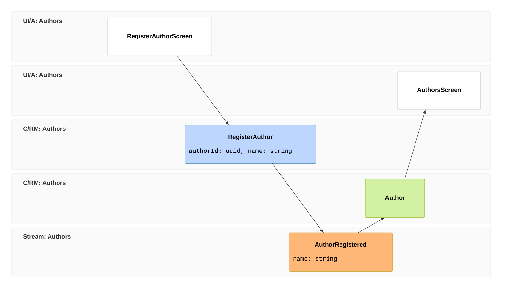

import { Aside, CardGrid } from '@astrojs/starlight/components';
import SimpleCard from '@components/SimpleCard.astro';
import TopicHero from '@components/TopicHero.astro';
import StackJourney from '@components/StackJourney.astro';

To explain how a business record reached its current state, build another view of its history, or find the frontend code affected by a backend change, choose the capability your feature needs first. Cratis Platform products supply those capabilities through event sourcing, generated contracts, and shared models. This reference maps each result to the products involved, their dependencies, and their terms.

<TopicHero icon="rocket" eyebrow="Cratis Platform" title="Choose the parts your application needs">
Compare responsibilities in the [capability map](#capability-map), or [choose an adoption boundary](/adopting-cratis/) for an existing system. Ready to implement a slice? [Build a full-stack feature](/build-a-full-app/). For the trade-offs, read [Why developers choose Cratis](/why-cratis/).
</TopicHero>

## Choose by the result you need

| Your team needs to… | Capability | Products | Condition | Next page |
| --- | --- | --- | --- | --- |
| Explain how today's state came to be | Events with sequence numbers, correlation, identity, and causation context | Chronicle; optionally Workbench for inspection | Ordering is within an event sequence. Context must be recorded; this is not a read/access audit. | [Event context](/chronicle/concepts/correlation-identity-causation/) |
| Answer a new question from existing history | Multiple read models and projection replay | Chronicle; optionally Arc and Components for a screen | Only recorded, available facts can contribute. Views update asynchronously; plan replay and catch-up. | [Projections](/chronicle/projections/) |
| Find frontend usages affected by a backend contract change | Generated TypeScript command/query clients and referenced types | Arc; Components for React compositions | Regenerate, then type-check the frontend. Runtime integration still needs checking; Chronicle is optional. | [Proxy boundary](/arc/understanding-the-proxy-boundary/) |
| Put expected behavior in a model the team can discuss and check | Commands, events, read models, and executable supported scenarios | Screenplay; optionally Studio for shared editing | Studio is paid. Model checks do not verify implementation code. | [Spec-driven development](/spec-driven-development/) |
| Erase protected personal values without discarding the event sequence | Subject-key encryption and key erasure | Chronicle | Protect values before appending. Historical plaintext, exported copies, stale views, and backups need separate handling. | [Compliance and erasure](/chronicle/compliance/) |
| Set a stopping point for agent work and inspect why it advanced | Journeys, progression ceilings, and gates over recorded evidence | Direct | GitHub-first; requires an enabled account. Activated rules matter; an LLM judgment is not proof. | [Direct overview](https://cratis.direct/) |
| Improve one feature while keeping the rest of the system | Independent CQRS or bounded event-sourcing adoption | Arc, Chronicle, and Components as needed | Hosting, generation, and integration remain. Existing rows do not become historical events automatically. | [Adopting Cratis](/adopting-cratis/) |

## One idea, all the way down

Start with the question your feature must answer. If it needs to explain how it reached its current state, [Chronicle](/chronicle/) keeps the event history and derives read models from it. [Arc](/arc/) supplies the application boundary, separating changes from reads through CQRS. You can [use either independently](/why-cratis/), including Arc over current-state storage without Chronicle.

For a C# backend, Arc's proxy generator produces the [typed TypeScript client](/arc/understanding-the-proxy-boundary/) your frontend calls. [Components](/components/) consumes that contract in React forms, dialogs, and tables. Configure generation in the backend before connecting the screen; you still implement the feature's behavior and check its runtime integration.

Before writing code, an [event model](/event-modeling/) lets you name the commands, events, and views together. [Cratis Screenplay](/screenplay/) keeps that model in a `.play` file, and [Studio](/studio/) provides a collaborative workspace for editing it. The same model can feed [source generation](/cli/reference/screenplay/) for review and further implementation. Check the renderer's supported constructs and languages before choosing that route. For an existing system, [Prologue](/prologue/) offers a separate capture-and-model path.

Add [AuthProxy](/authproxy/) when the application needs authentication, tenant resolution, and routing at the edge. For local .NET hosting, the [Aspire integration](/chronicle/hosting/aspire/) lets your AppHost manage the Chronicle kernel, its separate server process. Once the application is running, use the [CLI](/cli/) and Workbench to inspect events and processing state.

<Aside type="note" title="Modeling tools are optional">
Studio, Screenplay, Stage, Scene, and Prologue support design before implementation. Studio is a paid collaborative workspace built on Chronicle. Arc, Chronicle, and Components do not depend on these modeling tools, so you can build directly in code. Generated output still needs review.
</Aside>

In .NET, the [`Cratis` package](/arc/backend/csharp/chronicle/cratis-package/)'s `AddCratis`/`UseCratis` calls configure and activate Arc and the Chronicle client in the application host. The Chronicle kernel runs separately; the client connects to it over gRPC. Kotlin, Java, and TypeScript backends wire Arc and Chronicle through their own hosts: `io.cratis:cratis` is the single dependency for a Spring Boot application, and [`@cratis/cratis`](/arc/backend/typescript/chronicle/cratis-package/) registers both with one builder call in Node.js (published on npm at 1.0.0). [Arc backends](/arc/backend/) compares the hosts.

To connect Arc and Chronicle, follow the guide for your backend: [Integrate with Chronicle](/arc/backend/csharp/chronicle/) for C#, the [Chronicle guide for Kotlin and Java](/arc/backend/kotlin/guides/chronicle/), or the [Chronicle integration for TypeScript](/arc/backend/typescript/chronicle/). Each explains how a handler's return becomes an event, how the event source id selects its stream, and how a query serves the projected read model.

Follow only the handoffs your application needs. The map below connects modeling to application behavior, identity, event storage, React UI, and operations; each component's guide owns its setup.

<StackJourney
  eyebrow="Design, build, operate"
  title="The journey, end to end"
  intro="Follow the handoffs that apply to your application: model a feature, expose commands and queries, add event storage where needed, and connect a React screen. Each component owns its setup and runtime behavior."
/>

## Run a Screenplay as an application sandbox

[Run the Screenplay in Stage](/stage/docker/), send a command, and see the resulting state before implementing the feature. Stage runs the supported subset as a disposable sandbox, not a production host; bind published ports to `127.0.0.1`. To produce application code instead, [render source you own](/cli/reference/screenplay/) for review, customization, and building. Sandbox execution and rendering have separate capability limits; neither supports every model construct or language.

## Run the whole stack from one AppHost

For the Chronicle-backed .NET path shown here, the application connects to a separately running Chronicle kernel. The .NET Aspire resource lets your AppHost manage that kernel alongside the API; it does not move the kernel into the API process. Add the `Cratis.Chronicle.Aspire` package to the AppHost project, then register the resource and pass its reference to the API:

```csharp title="AppHost/Program.cs"
var builder = DistributedApplication.CreateBuilder(args);

var chronicle = builder.AddCratisChronicle();

builder.AddProject<Projects.MyApi>("api")
    .WithReference(chronicle);

builder.Build().Run();
```

With no arguments, `AddCratisChronicle()` registers a resource named `chronicle` running the development
image with embedded MongoDB. When you start the AppHost, it starts that resource alongside the API;
`WithReference(chronicle)` supplies the API's connection string.

<Aside type="caution" title="Development and production use different images">
The development image is for development and CI only.

The optional `AddCratisChronicle` callback configures Chronicle in either mode. Aspire run mode defaults to the development image; for deployment, publish mode defaults to the production image. That image has no embedded database and no development conveniences, so it will not start until you
configure three things: storage (MongoDB, PostgreSQL, SQL Server, or SQLite), a TLS certificate, and an
encryption certificate (unless authentication uses an external authority). Compliance encryption keys can also
live in HashiCorp Vault or Azure Key Vault.
</Aside>

Aspire AppHost is a .NET hosting option, not a backend-language API. TypeScript and JVM backends can
connect to a separately hosted Chronicle kernel; [choose a kernel hosting model](/chronicle/get-started/choose-hosting-model/)
if you aren't using Aspire. [Chronicle's Aspire integration](/chronicle/hosting/aspire/) covers its
images, storage options, ports, and connecting .NET clients.

## Security and compliance end to end

Authentication, authorization, tenancy, and compliance are separate concerns, but they travel through the
same request. AuthProxy authenticates and resolves tenant context. Arc authorizes the command or query.
The Arc + Chronicle integration writes events into the tenant's Chronicle namespace. Chronicle encrypts
personally identifiable information (PII) by compliance subject, and Arc releases protected read models before serving query responses.

[Auth and compliance end to end](/auth-and-compliance/) shows that flow across the stack: where identity
is enriched, where access decisions happen, how subjects differ from event source ids, and what erasure
requires after protected data has reached read models.

## Test the same flow

The same column you draw in an event model is also the shape of the test:



Turn that flow into a behavior-driven specification, with Given describing the starting state, When the action, and Then the result:

| Given | When | Then |
|---|---|---|
| no author exists for this id | `RegisterAuthor` runs through Arc | the command succeeds |
| no author exists for this id | `RegisterAuthor` runs through Arc | Chronicle records `AuthorRegistered` |
| `AuthorRegistered` exists | the read model projection handles it | the `Authors` screen can read the author |

In .NET, Cratis Specifications gives that shape a light wrapper over xUnit: `Establish()` is the given, `Because()` is the when, and each `[Fact]` is one then. Arc adds `CommandScenario<TCommand>` so the command runs through the real pipeline. Chronicle adds in-process scenarios for events, projections, and reactors. Together, you test the slice in the same language you designed it: facts in, command happens, facts and read models out.

Kotlin, Java, and TypeScript backends also run the command through the real Arc pipeline and test the read model in process (Java calls its reducer directly). [Testing with Cratis](/testing-with-cratis/) lists the test packages for each backend and walks through the same slice and its specs in every language.

## Build it with AI

Cratis gives an AI assistant documented conventions for development and tools for inspecting a running Chronicle store. The guidance covers feature shape, naming, generated contracts, Chronicle diagnostics, and the CLI command catalog. You remain responsible for reviewing changes and checking behavior.

For development guidance, install Cratis AI skills into a repository with `cratis ai install`, or add them to one coding tool through its plugin. The rules cover vertical slices, `Handle()` on the command record, and model-bound projections. Projects from the `dotnet new` templates ship a `.cratis/ai.json`, so run `cratis ai update` once; `cratis new` does that for you.

For runtime inspection, `cratis init` writes the CLI's command catalog and assistant instruction files into your project. An agent can then find the commands for browsing events, watching observers, and diagnosing a stuck partition. The Chronicle Model Context Protocol (MCP) server offers a separate connection to a running store for inspecting events, observers, and read models and managing jobs.

[AI-native development](/ai/) covers the setup and available tools. [Agentic development with event sourcing](/agentic-development/) explains how the event log, commands, and specifications give you concrete behavior to check when reviewing an agent-written change.

For a question about the framework, [Prompter](/prompter/) is the community's Discord assistant. It answers from this documentation with citations so you can follow the answer back to its source.

## Direct: govern agentic engineering

To set how far agent work may progress and inspect the evidence behind each next step, use [Cratis Direct](https://cratis.direct/), the control plane for agentic engineering. A person sets the progression ceiling. Journeys define stages of work, gates evaluate recorded evidence, and five loops organize the work: **Deliver, Assure, Operate, Publish, and Steer**. Direct is GitHub-first, lets you bring your own model provider, and is event-sourced on Chronicle. It coordinates agent work; [Cratis AI](/ai/) supplies framework conventions and guidance.

Direct runs Cratis's own engineering today. Access opens in stages to enabled accounts, who [sign in with GitHub](https://app.cratis.direct/); a GitHub account alone does not grant access. Gates depend on the rules you activate, and an LLM assessment is a judgment, not proof. The [public Direct documentation](/direct/) covers the Direct Agent Runner, not a complete service manual.

## Capability map

The table lists product responsibilities and licences. Open-source components and hosted products have different terms; Studio offers [open sign-up with a 14-day free trial](https://lobby.cratis.studio/register) and [per-seat pricing](https://cratis.studio/#pricing), while Direct access is staged as described above. The [support matrix](/compatibility/#support-matrix) covers storage, languages, frameworks, and hosting.

| Product | What it does | Licence / service terms | Docs |
| --- | --- | --- | --- |
| Chronicle | Event-sourcing database and runtime with an Orleans-based .NET kernel and gRPC/protobuf contracts | MIT | [Chronicle](/chronicle/) |
| Arc | CQRS application framework with commands, queries, validation, and generated TypeScript proxies | MIT | [Arc](/arc/) |
| Components | React component library: command dialogs, typed forms, and query-backed data tables | MIT | [Components](/components/) |
| Cratis Choreography | Runtime for durable business processes on Orleans: jobs, workflows, state machines, workers, and startup patching | MIT | [Cratis Choreography](/choreography/) |
| Fundamentals | Shared .NET and TypeScript building blocks beneath the other products | MIT | [Fundamentals](/fundamentals/) |
| Specifications | BDD-style Given/When/Then specs for .NET with xUnit and NUnit | MIT | [Specifications](/specifications/) |
| CLI | Terminal tool (`cratis`) to inspect and diagnose Chronicle and install Cratis AI | MIT | [CLI](/cli/) |
| Workbench | Web dashboard bundled with Chronicle for browsing events and operating a deployment | MIT | [Workbench](/chronicle/workbench/) |
| Chronicle MCP | MCP server that connects an AI agent to a running Chronicle | MIT | [Chronicle MCP](/chronicle-mcp/) |
| Cratis AI | Rules, agents, and skills for building with Cratis, installed with `cratis ai install` | MIT | [Cratis AI](/ai/) |
| Screenplay | Declarative `.play` language for modeling a bounded context | MIT | [Screenplay](/screenplay/) |
| Stage | Screenplay compilation, supported specification verification, and disposable sandbox tooling | MIT | [Stage](/stage/) · [Source](https://github.com/Cratis/Stage) |
| Prologue | Captures signals from an existing system and proposes an event model for review | MIT | [Prologue](/prologue/) |
| Studio | Collaborative Screenplay modeling workspace built on Chronicle; optional for application development | Paid product; 14-day free trial, per-seat pricing | [Studio](/studio/) |
| Direct | Control plane for agentic engineering: journeys, gates, and evidence; enabled-account access | Service; pricing not publicly stated | [Direct](/direct/) · [Product overview](https://cratis.direct/) |
| TypeScript client | `@cratis/chronicle` for Chronicle from Node.js | MIT | [TypeScript](/event-sourcing/typescript/) |
| Kotlin/Java client | `io.cratis:chronicle` with a Spring Boot starter | MIT | [Kotlin](/event-sourcing/kotlin/) |
| Elixir client | `cratis_chronicle` on Hex | MIT | [Elixir](/event-sourcing/elixir/) |
| Go client | `github.com/cratis/chronicle.go` [v0.11.0](https://github.com/Cratis/Chronicle.Go/releases/tag/v0.11.0), without observers and projections | MIT | [Go](/event-sourcing/go/) |
| Arc.Go | Go framework for Arc, released as [v0.1.1](https://github.com/Cratis/Arc.Go/releases/tag/v0.1.1) | MIT | [Arc.Go](/arc/go/) |
| Python client | Chronicle client for Python, not yet published | MIT | [Python](/event-sourcing/python/) |

Fundamentals also has a Go module, `github.com/cratis/fundamentals.go`, released as [v0.3.2](https://github.com/Cratis/Fundamentals.Go/releases/tag/v0.3.2); see [Fundamentals for Go](/fundamentals/go/). These Go release tags were checked on 2026-10-20; consult each product's guide for its supported capabilities.

The .NET client ships with Chronicle itself. See [Chronicle in your language](/chronicle-clients/) for installation per client.

## Each layer, on its own and together

<CardGrid>
  <SimpleCard title="Studio — design" icon="open-book" link="/studio/">
    Design, visualize, and edit Screenplay event models together in an optional paid workspace built on Chronicle. Sign-up is open with a 14-day free trial and per-seat pricing.
  </SimpleCard>
  <SimpleCard title="Screenplay — model as code" icon="pencil" link="/screenplay/">
    The modeling language: a whole bounded context — events, commands, queries, projections, screens, and rules — in one declarative `.play` file. Studio edits the model.
  </SimpleCard>
  <SimpleCard title="Prologue — capture" icon="magnifier" link="/prologue/">
    Point it at an existing system — no Cratis constructs required — and it captures selected HTTP, database, and telemetry signals, then proposes an event model and a Screenplay for you to review.
  </SimpleCard>
  <SimpleCard title="Chronicle — events" icon="seti:db" link="/chronicle/">
    The event-sourcing database and runtime: gRPC/protobuf boundary, .NET-first client, TypeScript, Kotlin/Java, and Elixir clients (and a Go client without observers and projections), MongoDB/PostgreSQL/SQL Server/SQLite storage, Orleans inside.
  </SimpleCard>
  <SimpleCard title="AuthProxy — edge" icon="seti:lock" link="/authproxy/">
    Authentication, tenant resolution, identity enrichment, routing, and invite-based onboarding in front of your services.
  </SimpleCard>
  <SimpleCard title="Auth and compliance — end to end" icon="seti:lock" link="/auth-and-compliance/">
    How authenticated tenant-aware requests become authorized operations, protected events, and released read models.
  </SimpleCard>
  <SimpleCard title="Arc — CQRS + proxies" icon="puzzle" link="/arc/">
    Full-stack CQRS with typed TypeScript proxies generated from a C#, Kotlin, Java, or TypeScript backend. It pairs naturally with Chronicle, and can also run over MongoDB or a relational database: EF Core in C#, Spring Data JPA on the JVM, or Drizzle in TypeScript.
  </SimpleCard>
  <SimpleCard title="Cratis Choreography — durable processes" icon="list-format" link="/choreography/">
    Jobs, workflows and state machines on Orleans that survive restarts, with pluggable storage and startup patching.
  </SimpleCard>
  <SimpleCard title="Components — React" icon="laptop" link="/components/">
    Command dialogs, forms, and live data tables that consume Arc's generated command and query proxies.
  </SimpleCard>
  <SimpleCard title="Direct — govern agent work" icon="list-format" link="/direct/">
    Coordinate agent work across GitHub repositories through defined stages and gates that evaluate recorded evidence. Direct runs Cratis's engineering today; external access opens in stages to enabled accounts.
  </SimpleCard>
  <SimpleCard title="CLI — operate" icon="rocket" link="/cli/">
    Inspect and interact with a running store from the terminal: events, observers, read models, recommendations, jobs, replay, failed partitions, and diagnostics.
  </SimpleCard>
  <SimpleCard title="Workbench — inspect" icon="laptop" link="/chronicle/workbench/">
    The web-based inspection surface for Chronicle event stores — browse events, observers, projections, and read models in the browser.
  </SimpleCard>
  <SimpleCard title="Specifications — test" icon="approve-check" link="/testing-with-cratis/">
    In-process specs for commands and read models in every backend. In .NET: BDD-style specs over xUnit, with Arc command scenarios and Chronicle event, read-model, and reactor scenarios.
  </SimpleCard>
  <SimpleCard title="Fundamentals — foundation" icon="seti:folder" link="/fundamentals/">
    The shared .NET and TypeScript building blocks the rest of the stack is built on.
  </SimpleCard>
</CardGrid>

## Where to start

<CardGrid>
  <SimpleCard title="Build a full-stack feature" icon="open-book" link="/build-a-full-app/">
    Add one slice — command, event, projection, query, and React screen. C# and JVM paths start from a template; the TypeScript backend is published on npm at 1.0.0 and starts from a sample.
  </SimpleCard>
  <SimpleCard title="Get started with Chronicle" icon="rocket" link="/chronicle/get-started/">
    Start a local kernel and watch one event flow through a projection and a reactor, in the client language you use.
  </SimpleCard>
  <SimpleCard title="Follow a learning path" icon="list-format" link="/learning-paths/">
    An ordered route through the docs for your role — beginner, builder, evaluator, operator, or frontend developer.
  </SimpleCard>
  <SimpleCard title="Test a full-stack slice" icon="approve-check" link="/testing-with-cratis/">
    Turn an event-model column into given/when/then specs.
  </SimpleCard>
  <SimpleCard title="Choosing where to start" icon="right-arrow" link="/adopting-cratis/">
    Greenfield or brownfield — pick an entry point and adopt one piece at a time.
  </SimpleCard>
  <SimpleCard title="Why developers choose Cratis" icon="approve-check" link="/why-cratis/">
    How the products stand alone and compose, and when the stack is — and isn't — the right fit.
  </SimpleCard>
</CardGrid>
