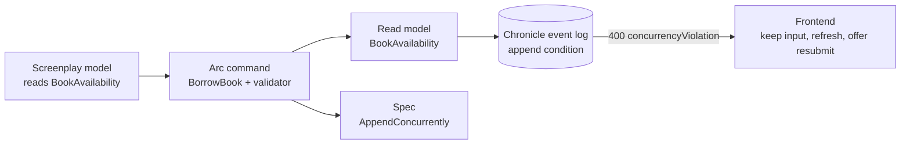

import Recap from '@components/Recap.astro';
import YouWillLearn from '@components/YouWillLearn.astro';

A library has one copy of a book left, and two members press Borrow at the same moment. Each request reads the availability, sees one copy, decides the loan is fine and appends `BookBorrowed`. Each request was right about what it saw, and the library now has two loans for one copy.

Cratis lets the command say what it decided on, and the event log refuses the append if that changed. This tutorial builds that rule once, from the model to the screen. It follows the [Dynamic Consistency Boundary](/concepts/dynamic-consistency-boundary/) idea in Chronicle and Arc.

<YouWillLearn>

- how to state a rule that depends on state in a Screenplay model, and what that declaration does not do yet
- how to turn read protection `On` and write the rule as a `CommandValidator<T>` that takes a read model
- how the read model behind the rule is folded, and which events guard the append
- how to write a spec that makes the race happen and proves the loser writes nothing
- how a frontend tells a lost race from a rejected rule, and what it does with each
- what the guard does not cover

</YouWillLearn>

The rule travels through five places:



## Before you start

Every C# snippet on this page is an excerpt of a file in the [`Library/Lending` sample](https://github.com/Cratis/Samples/tree/main/Library/Lending), with the XML doc comments left out. The Screenplay model and the TypeScript in step 5 are written for this page and compiled on their own; they are not files in the sample.

- Clone [Cratis/Samples](https://github.com/Cratis/Samples) and work from `Library/Lending`.
- Install the .NET SDK that the repository's `global.json` asks for (10.0.100 or a later feature band).
- The commands need Arc 22.108.0 or later, which uses Chronicle 19.71.0 or later. Earlier Arc versions let a caller who sends the `X-Allowed-Severity` header at `Error` skip a validator's rule, which would make step 2 incorrect.
- For step 1 you need the Screenplay compiler: `dotnet tool install --global Cratis.Screenplay.Tool`.

## 1. Model the rule in Screenplay

A [Screenplay](/screenplay/) command can declare the state it decides against with `reads`. This model borrows a book only while `availableCount` is above zero:

```screenplay title="lending.play"
concept Isbn : String
concept MemberId : Uuid

module Library

  feature Lending

    slice StateChange BorrowBook
      command BorrowBook
        isbn     Isbn identifier
        memberId MemberId
        reads BookAvailability by isbn
        validate
          require BookAvailability.availableCount > 0
            message "No copies of this book are available to borrow."
        produces BookBorrowed
          for isbn
          memberId = memberId

      event CopyAdded
        isbn Isbn

      event BookBorrowed
        memberId MemberId

      event BookReturned
        memberId MemberId

      projection BookAvailability => BookAvailability
        from CopyAdded key isbn
          increment availableCount
        from BookBorrowed
          decrement availableCount
        from BookReturned
          increment availableCount
```

`reads BookAvailability by isbn` says that the command decides against that read model, looked up by the command's `isbn`. The `require` line is the rule, and the `projection` is how the read model is folded from events.

Compile it with warnings as errors:

```bash
screenplay lending.play --warnaserror
```

```text
1 file(s) compiled - 0 error(s), 0 warning(s)
```

The `reads` line is a declaration only. It records what the command consulted, so the model shows the read-model-to-command arrow of event modeling. It does not make the append conditional. What guards the append is Arc's read protection, which you turn on in the next step in the code. The `command reads protected` preamble that would carry the guard through Screenplay is not part of a released Screenplay yet, so this page does not use it.

## 2. Write the Arc command and validator

The sample's `Lending` project turns read protection on for every command in the project file. Arc's default is `Off`:

```xml title="Lending/Lending.csproj"
<CratisReadProtection>On</CratisReadProtection>
```

The command only says what happens. The rule is in the validator, which takes the read model as a constructor parameter:

```csharp title="Lending/Lending/Borrowing/Borrowing.cs"
[Command]
public record BorrowBook(ISBN Isbn, MemberId MemberId, int BorrowDays = 21)
{
    public BookBorrowed Handle()
    {
        var borrowedDate = DateTimeOffset.UtcNow;
        return new BookBorrowed(Isbn, "Book Title", MemberId, borrowedDate, borrowedDate.AddDays(BorrowDays));
    }
}

public class BorrowBookValidator : CommandValidator<BorrowBook>
{
    public BorrowBookValidator(BookAvailability? availability) =>
        RuleFor(command => command.Isbn)
            .Must(_ => availability is { AvailableCount: > 0 })
            .WithMessage("No copies of this book are available to borrow.");
}
```

Under `On`, Arc does not hand the validator a plain read. It notes the position of the event log, then reads `BookAvailability` fresh from the log for the command's `Isbn`. Arc picks that key because `ISBN` is the only command property whose type matches the read model's `Id`. It is `null` when the book has no events yet, which the rule treats as no copies.

When the validator passes, the command's append carries a condition: if an event that `BookAvailability` folds arrives for that ISBN after the read, nothing from the command is written. The rule holds under `On` only. With `Off`, the same validator gives quick feedback and two requests can both pass.

Return events from `Handle()`. Under `On`, an event appended inside `Handle` through an injected event log is refused, because it would bypass the condition.

For key choice, which read models are admitted and what Arc refuses, see [Reads](/arc/backend/csharp/chronicle/consistency/reads/) and [Refusals](/arc/backend/csharp/chronicle/consistency/refusals/).

## 3. Fold the read model

`BookAvailability` is a read model that folds itself from events with static `Reduce` methods. An inventory event adds copies, and a reservation or a borrow takes one away:

```csharp title="Lending/Lending/Reserving/Reserving.cs"
[ReadModel]
public record BookAvailability(ISBN Id, int AvailableCount = 0)
{
    public static BookAvailability Reduce(BookAddedToInventory @event, BookAvailability? current, EventContext context)
    {
        var state = current ?? new BookAvailability(new ISBN(context.EventSourceId.Value));
        return state with { AvailableCount = state.AvailableCount + @event.Count };
    }

    public static BookAvailability Reduce(BookReserved @event, BookAvailability? current, EventContext context)
    {
        var state = current ?? new BookAvailability(@event.Isbn);
        return state with { AvailableCount = state.AvailableCount - 1 };
    }

    public static BookAvailability Reduce(BookBorrowed @event, BookAvailability? current, EventContext context)
    {
        var state = current ?? new BookAvailability(@event.Isbn);
        return state with { AvailableCount = state.AvailableCount - 1 };
    }

    public static BookAvailability Reduce(BookReturned @event, BookAvailability? current, EventContext context)
    {
        var state = current ?? new BookAvailability(@event.Isbn);
        return state with { AvailableCount = state.AvailableCount + 1 };
    }
}
```

The model is keyed by the book's ISBN, which is also the event source the events are appended to. It is an unfiltered reducer without constructor dependencies, which is one of the shapes Arc can guard under `On`.

The events the model folds are also the events that guard the append: `BookAddedToInventory`, `BookReserved`, `BookBorrowed` and `BookReturned` for that ISBN. A reservation of the last copy therefore conflicts with a borrow of it. A rename of the book, or a borrow of a different book, does not.

A read model Arc cannot guard is refused under `On` with an error that names the fix. Joins, child collections and models keyed by an event property are examples. Keep the model flat and keyed by the event source.

## 4. Test the race

A spec for the rule alone checks the validator. The race needs a second writer between the command's read and its append. `CommandScenario.AppendConcurrently` is that writer:

```csharp title="Lending/Lending/Borrowing/for_BorrowBook/when_the_last_copy_is_borrowed_concurrently.cs"
public class when_the_last_copy_is_borrowed_concurrently : Specification
{
    static readonly ISBN _isbn = new("978-0316389704");
    readonly CommandScenario<BorrowBook> _scenario = new();
    CommandResult _result;

    void Establish()
    {
        _scenario.Given.ForEventSource(_isbn).Events(new BookAddedToInventory("The Last Wish", AuthorId.New(), 1));
        _scenario.AppendConcurrently(_isbn, new BookBorrowed(_isbn, "The Last Wish", MemberId.New(), DateTimeOffset.UtcNow, DateTimeOffset.UtcNow.AddDays(21)));
    }

    async Task Because() => _result = await _scenario.Execute(new BorrowBook(_isbn, MemberId.New()));

    void Destroy() => _scenario.Dispose();

    [Fact] void should_not_succeed() => _result.ShouldNotBeSuccessful();
    [Fact] void should_report_a_conflict() => _result.ShouldHaveValidationErrorBecauseOf(ValidationResultReason.ConcurrencyViolation);
    [Fact] void should_append_nothing() => _scenario.AppendedEvents.Count.ShouldEqual(0);
}
```

The scenario seeds one copy, so the validator sees availability 1 and passes. The competing `BookBorrowed` is appended after the command's read and before its commit. The command is refused with a `concurrencyViolation` and appends nothing. The competing event stays in the log, and `AppendedEvents` counts only the command's own appends.

`CommandScenario` turns the decision reads on for you. The spec shows the race from the command's side only: what the caller sees is in the next step.

The rule itself has its own spec, [`when_no_copy_is_available`](https://github.com/Cratis/Samples/blob/main/Library/Lending/Lending/Borrowing/for_BorrowBook/when_no_copy_is_available.cs), and a second one proves that a caller cannot switch the rule off. A caller that sends `X-Allowed-Severity` at `Error` asks Arc to drop validation results at that severity. Because `BorrowBook` runs under `On`, Arc keeps the validator's result anyway. The spec sends that severity through the command pipeline:

```csharp title="Lending/Lending/Borrowing/for_BorrowBook/when_no_copy_is_available_and_the_caller_allows_errors.cs"
    async Task Because()
    {
        var command = new BorrowBook(_isbn, MemberId.New());
        await _scenario.Validate(command);

        var provider = (IServiceProvider)typeof(CommandScenario<BorrowBook>)
            .GetField("_serviceProvider", BindingFlags.Instance | BindingFlags.NonPublic)!
            .GetValue(_scenario)!;
        var pipeline = provider.GetRequiredService<ICommandPipeline>();

        _result = await pipeline.Execute(command, provider, ValidationResultSeverity.Error);
    }

    [Fact] void should_not_succeed() => _result.ShouldNotBeSuccessful();
    [Fact] void should_have_validation_errors() => _result.ShouldHaveValidationErrors();
    [Fact] void should_append_nothing() => _scenario.AppendedEvents.Count.ShouldEqual(0);
```

`CommandScenario` has no severity option, so the sample reaches into the scenario's service provider to call the pipeline. That is a workaround in a spec, not an API to use in production code.

Run the Lending specs from the Samples repository root:

```bash
dotnet test Library/Lending/Lending.csproj --configuration Debug
```

## 5. Handle the refusal in the frontend

The caller that loses the race gets an HTTP 400 with one validation result:

| Field | Value |
| --- | --- |
| `reason` | `concurrencyViolation` |
| `reasonDetail` | `ReadChanged` |
| `state` | `{ readModel, key }`, naming the read model and the key |
| `message` | A developer diagnostic that says nothing from the command was written and to submit it again |

`ReadIncomplete` has the same reason and is also retryable. It means the read could not be completed after up to three attempts to fold it while events kept arriving. Nothing was written in either case, and Arc and Chronicle do not re-run the command. A failed rule, such as "no copies available", has the reason `rule` instead.

`ValidationResultReason.ConcurrencyViolation` comes from `@cratis/arc/validation`. `reasonDetail` is a plain string with no TypeScript constant, so the two values are compared as strings. This function sorts one result into what the screen should do. `BorrowBook` is the proxy that a Debug build of the sample generates:

```typescript title="borrow.ts"
import { Guid } from '@cratis/fundamentals';
import { ICommandResult } from '@cratis/arc/commands';
import { ValidationResultReason } from '@cratis/arc/validation';
import { BorrowBook } from './BorrowBook';

export type BorrowOutcome =
    | { kind: 'borrowed' }
    | { kind: 'availabilityChanged' }
    | { kind: 'refused'; messages: string[] }
    | { kind: 'failed' };

const decisionReadDetails = ['ReadChanged', 'ReadIncomplete'];

function isDecisionReadRefusal(result: ICommandResult<unknown>): boolean {
    return result.validationResults.some(validation =>
        validation.reason === ValidationResultReason.ConcurrencyViolation &&
        validation.reasonDetail !== undefined &&
        decisionReadDetails.includes(validation.reasonDetail));
}

export async function borrow(isbn: string, memberId: Guid): Promise<BorrowOutcome> {
    const command = new BorrowBook();
    command.isbn = isbn;
    command.memberId = memberId;

    const result = await command.execute();
    if (result.isSuccess) {
        return { kind: 'borrowed' };
    }

    if (isDecisionReadRefusal(result)) {
        return { kind: 'availabilityChanged' };
    }

    const messages = result.validationResults
        .filter(validation => validation.reason === ValidationResultReason.Rule)
        .map(validation => validation.message);
    return messages.length > 0 ? { kind: 'refused', messages } : { kind: 'failed' };
}
```

What the screen does with each outcome:

| Outcome | Screen |
| --- | --- |
| `borrowed` | Confirm the loan. |
| `availabilityChanged` | Keep what the user entered. Refresh the availability, then offer to submit again. Do not clear the form and do not mark any field invalid: the input was fine, and the state moved. |
| `refused` | Show the messages. A result with the reason `rule` carries copy that the rule's author wrote for the user. |
| `failed` | Show your own generic copy and check the server log. |

Only a `rule` result carries a message meant for the user. The message of a `concurrencyViolation` is a developer diagnostic in English: map it to your own copy, for example "The availability of this book changed while you were borrowing it. Check it and try again."

With `CommandForm` from `@cratis/arc.react`, the same sorting goes in the `onFailed` callback, which receives the original `ICommandResult`. See [Command results](/arc/frontend/core/commands/command-result/) for the shape of the result and the other reasons.

Before the user submits again, re-read what they are deciding on. If you resubmit automatically, a loop can burn through retries on a book with no copies left; let the user see the new state first.

## 6. What is outside the guard

The rule holds for this command under `On`. These are outside it:

- **A writer without a guard.** Another command, service or import that decides on availability without a protected read can still append a `BookBorrowed`. The rule holds fully only when every writer that decides on it is guarded, or when it is a [constraint](/chronicle/constraints/).
- **Reads marked `[Unprotected]`.** Arc accepts an `[Unprotected("reason")]` read as an explicit exception. It guards nothing.
- **Revisions and redactions.** Revising or redacting an earlier event does not move the position that a condition compares, so a decision made before the change can still commit.
- **State outside the event log.** A call to another service, or a value read from another database, is not part of the condition.
- **Other event sequences.** A read across event sequences is not guarded.
- **`Off` and `Measure`.** Both give plain reads. `Measure` reports what `On` would do, and changes no result.
- **The conflicting event.** The result names the read model and the key, not the event that moved the state.

The [Arc read protection pitfalls](/arc/backend/csharp/chronicle/consistency/pitfalls/) page lists more cases. If the rule is only that something is unique or may happen once, a constraint is cheaper than a protected read.

<Recap>

- You declared a rule that depends on state with `reads` in Screenplay, a declaration only until the protected-reads preamble ships.
- You turned read protection `On` and put the rule in a `CommandValidator<BorrowBook>` that takes `BookAvailability`. Arc reads it fresh and guards the append with the events the model folds, for that ISBN.
- You wrote the race as a spec with `AppendConcurrently`, and a second spec showing that a caller cannot lower the validation threshold under `On`.
- The frontend tells `ReadChanged` from a failed rule, keeps the user's input, refreshes and offers to submit again.
- The guard does not cover unguarded writers, `[Unprotected]` reads, revisions and redactions, state outside the log, other event sequences, or `Off` and `Measure`.

</Recap>

## Go deeper

- The idea: [The Dynamic Consistency Boundary](/concepts/dynamic-consistency-boundary/) and [Keeping decisions correct under concurrency](/concepts/keeping-decisions-correct/).
- If you know DCB, KurrentDB, Marten or Axon: [Read this first](/concepts/read-this-first-write-side-consistency/).
- Arc: [Getting started with read protection](/arc/backend/csharp/chronicle/consistency/getting-started/), [Validators](/arc/backend/csharp/chronicle/consistency/validators/), [Refusals](/arc/backend/csharp/chronicle/consistency/refusals/) and [Test the race](/arc/backend/csharp/chronicle/consistency/scenarios/testing/).
- Chronicle: [How guards are derived](/chronicle/dynamic-consistency-boundary/how-guards-are-derived/) and [Read protection in Chronicle](/chronicle/read-models/read-protection/).
- The sample: [Library/Lending](https://github.com/Cratis/Samples/tree/main/Library/Lending) and its README section on read protection.
- The [write-side consistency learning path](/learning-paths/#write-side-consistency).
