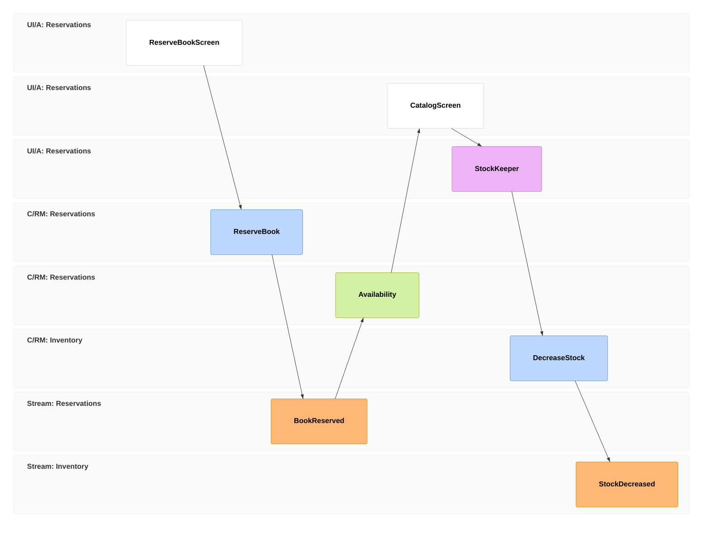
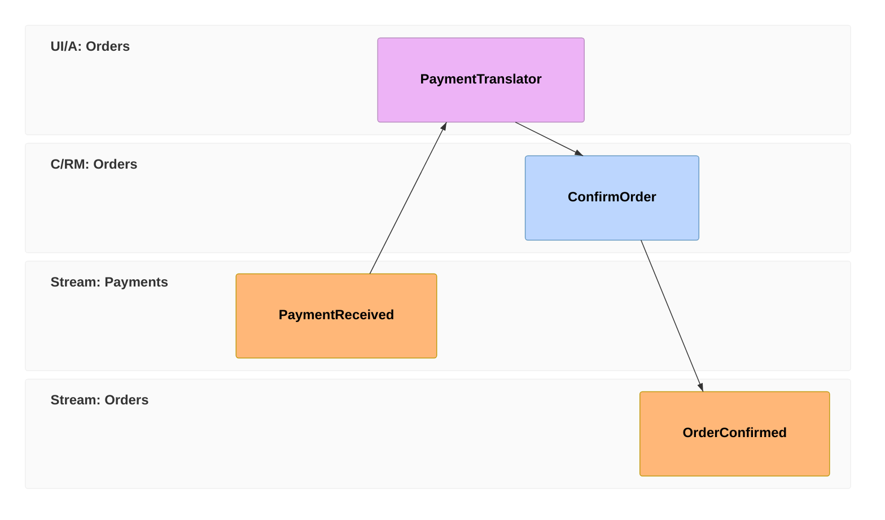

import { CardGrid, Aside } from '@astrojs/starlight/components';
import SimpleCard from '@components/SimpleCard.astro';
import TopicHero from '@components/TopicHero.astro';

<TopicHero icon="list-format" eyebrow="The Cratis Stack" title="Design the flow before you write the code">
The hard part of an event-sourced system is not the plumbing. It is deciding *what the events are*, where commands come from, and which read model each screen needs. Get that wrong and you find out late, in code. **Event modeling** lays the whole flow out on one timeline first, and because the timeline's pieces map onto Cratis's building blocks, the model you draw becomes the blueprint for your slices.
</TopicHero>

## What event modeling is

Event modeling is a method for designing an information system by drawing how information flows through it over time. You lay out a timeline from left to right: the screens people use, the commands they issue, the events those commands record and the read models the next screens display. The result is one picture that a domain expert, a designer and a developer read the same way.

It is for teams that build event-sourced or otherwise event-driven systems and want the domain expert in the design, not only in the requirements. [Adam Dymitruk](https://eventmodeling.org/) created the method, and [eventmodeling.org](https://eventmodeling.org/) (read 2026-10-19) is its primary source. This page describes the method in short and shows how Cratis supports it end to end. The notation and the seven steps are Dymitruk's; the mapping to Cratis is Cratis's own.

## The building blocks

You read a model like a comic strip, one frame after another. The vocabulary is small: **wireframe, command, event, read model, processor.** There are no class diagrams and no database schemas, only the flow of facts.

Read it as a story. A reader reserves a book on a **screen** (`ui`); that fires the `ReserveBook` **command** (`cmd`), which records the `BookReserved` **event** (`evt`), an immutable fact. That fact is projected into an `Availability` **read model** (`rmo`) that the catalog screen reads. A **processor** (`pcr`) watching reservations issues a follow-up command to decrease stock. The rows are **swimlanes**, one per bounded context (`Reservations`, `Inventory`).

A command is never stored. An event is the record of the fact. A read model is derived from events. Those rules give the diagram its discipline: every screen reads something a read model provides, every read model is fed by events, and every event comes from a command or from another system.

<Aside type="tip" title="Why past tense matters">
Events are named in the **past tense** — `BookReserved`, not `ReserveBook` — because they are facts that already happened and can never be un-happened. If you catch yourself wanting a nullable field on an event ("reserved-or-maybe-cancelled"), the model is usually telling you it is really *two* events. Chronicle's analyzers warn about nullable event properties for the same reason.
</Aside>

## The four patterns

The connections in a model repeat one of four patterns. Once you can see them, a feature becomes a handful of small, known pieces.

| Pattern | Shape | What it does |
|---|---|---|
| **Command** | `ui ➜ cmd ➜ evt` | A user acts; a command validates and records a fact. *The write side.* |
| **View** | `evt ➜ rmo ➜ ui` | Facts are projected into the state a screen reads. *The read side.* |
| **Automation** | `evt ➜ pcr ➜ cmd` | A processor reacts to a fact and issues a command on its own. |
| **Translation** | external `evt ➜ pcr ➜ cmd` | A fact from another context is adapted into this one's commands. |

The first two are the everyday CQRS loop. The last two are how work flows *between* contexts without direct coupling: a processor watches for a fact and acts. A translation begins on a **reset frame** (`rf`) because its triggering event comes from somewhere else:

## The steps

Dymitruk describes seven steps. You can run them in a workshop with sticky notes, on a whiteboard, or in a tool.

1. **Brainstorming.** Ask what happens in the business. Write each answer as a past-tense event on a sticky note: `BookAdded`, `BookReserved`, `BookBorrowed`, `BookReturned`. Do not worry about order yet.
2. **The plot.** Arrange the events on a timeline so the story reads from start to finish. Remove duplicates and merge near-synonyms. Gaps show up as missing steps in the story.
3. **The storyboard.** Add the wireframes that people use along the timeline, from the first screen to the last. This keeps the model tied to real use.
4. **Identify inputs.** These are the commands. For each event that a person causes, add the command that triggers it, placed between the screen and the event.
5. **Identify outputs.** These are the read models, or views. For each screen that shows information, add the read model that supplies it, and draw which events feed it.
6. **Apply Conway's Law.** Separate the model into swimlanes, one per system, team or bounded context, so each team owns its own part of the timeline. Then cut each swimlane into vertical slices, each one small enough to build and test on its own.
7. **Elaborate scenarios.** Write the rules as examples. For each command or read model, write a few given/when/then examples. Given these past events, when this command arrives, then this event is recorded, or a rejection.

Throughout, check for completeness by walking the timeline. Every screen shows data that exists, and every field in a read model comes from an event that carries it. That check is where the method pays for itself: you find that a screen has no source for a number it displays, or that an event is missing the field a later screen needs, while the fix is still a sticky note.

## Reserving a book, from model to code

Brainstorming a library gives you the events `BookAdded`, `BookReserved`, `ReservationExpired` and `BookBorrowed`. When you add commands and a read model, you notice something. The catalog needs to show how many copies are available, but `BookReserved` carries only the book and the member. Where does the number of copies come from? The event `BookAdded` has to record the number of copies. You found the gap before writing code.

The slice for reserving a book then turns directly into code. In Arc and Chronicle, the command is a record whose `Handle()` returns the event:

<ArcBackendTabs snippet="site-concepts/event-modeling/reserve-book" variants="csharp,kotlin,java" />

The read model that the catalog screen reads is described by the events that feed it. A model-bound projection uses attributes on the type itself:

<ArcBackendTabs snippet="site-concepts/event-modeling/book-availability" variants="csharp,kotlin,java" />

Both are excerpts. `[Decrement<BookReserved>]` lowers `AvailableCopies` by one each time a `BookReserved` event is projected. See [projections and read models](/concepts/projections-and-read-models/) for how projections work.

The model tells you which processors you need as well. If a separate inventory slice must act when a book is reserved, for example a `StockKeeper` processor that issues a `DecreaseStock` command, that is an automation: a processor that reacts to `BookReserved`. In Chronicle that is a reactor class implementing `IReactor`.

## Why it fits Cratis almost one-to-one

This is what makes event modeling more than a whiteboard exercise for Cratis: **each block has a Cratis primitive,** and the four patterns match the four kinds of [vertical slice](/arc/vertical-slices/) Cratis organizes code around. You still write the code, but you do not have to invent its shape.

| Event-model block | What it means | In Cratis |
|---|---|---|
| Wireframe (`ui`) | a screen the user sees | a React screen — [Components](/components/) + Arc.React |
| Command (`cmd`) | an intent to change state | a `[Command]` record with `Handle()` — [Arc](/arc/) |
| Event (`evt`) | a fact that happened | an `[EventType]` record in [Chronicle](/chronicle/) |
| Read model (`rmo`) | state a screen reads | a `[ReadModel]` built by a [projection](/chronicle/projections/) |
| Processor (`pcr`) | automation that reacts to facts | an `IReactor` in Chronicle |
| Swimlane | a bounded context | a vertical slice / feature folder |

And the patterns line up exactly with how a Cratis slice is classified:

| Event-modeling pattern | Cratis slice type |
|---|---|
| Command | **State Change** — command + events |
| View | **State View** — read model + projection |
| Automation | **Automation** — a reactor that decides and acts |
| Translation | **Translation** — a reactor that adapts events across slices |

Both come from the same idea: **events are the source of truth and everything else is derived from them.** With Arc and Chronicle together, a `[Command]`'s `Handle()` can return the event it records; a `[ReadModel]` declares the events it is built from; an `IReactor` reacts to a fact and triggers the next step. Draw the timeline and you have named your commands, events, read models, and reactors, in the order they happen.

<Aside type="caution" title="Processors run again on replay">
A reactor that issues a command is a side effect. Chronicle re-delivers events to a reactor when it is replayed, so the follow-up command would run again. Mark such a handler `[OnceOnly]` to skip it during replays; Arc's `ARCCHR0006` analyzer warns when you forget. `[OnceOnly]` excludes replays only. It is not exactly-once delivery: recovering a failed partition delivers the event again, so make the follow-up safe to repeat. See [OnceOnly](/chronicle/reactors/once-only/) and [delivery identity](/chronicle/reactors/delivery-identity/).
</Aside>

<Aside type="note" title="The model is the column, the slice is the code">
Read a single vertical column of an event model (one screen, its command, the event, the read model behind the next screen) and you are looking at one [vertical slice](/arc/vertical-slices/): one feature folder with the command, event, projection, and React component that implement it. The [full-stack walkthrough](/build-a-full-app/) builds exactly that column, block by block.
</Aside>

## The model is also the test

Event modeling already has the given/when/then shape baked in. The left side of the column is the context, the command is the behavior under test, and the event/read-model blocks are the expected outcome:

| Event-model block | Specification role |
|---|---|
| Existing events before the command | **Given** |
| Command or reactor in the column | **When** |
| New event, projected read model, or side effect | **Then** |

That is why Cratis leans on BDD-style specifications. `Cratis.Specifications.XUnit` gives xUnit the `Establish()` / `Because()` / `[Fact]` lifecycle, and Arc and Chronicle add scenarios in the same language: `CommandScenario<TCommand>` for the command, `EventScenario` with `Given` for past facts, `ReadModelScenario<TReadModel>` for projections, and `ReactorScenario<TReactor>` for automation.

[Testing with Cratis](/testing-with-cratis/) shows a concrete event-model column translated into an executable stack spec.

## Cratis from model to running code

Cratis supports the method from the first sticky note to the running system. Each tool has a stated maturity; generated output needs review in every case, and none of the model-first tools is required to use Arc, Chronicle or Components.

| Step | Tool | Maturity |
|---|---|---|
| Design the model with your team | [Studio](/studio/), a shared place to design and edit event models | Preview |
| Write the model as text | [Screenplay](/screenplay/), a declarative `.play` language for events, commands, read models and rules | Experimental |
| Render, compile and verify it | [Stage](/screenplay/faq/#what-are-stage-and-studio), which compiles Screenplay and verifies specifications | Experimental |
| Start from an existing system | [Prologue](/prologue/), which proposes a model from captured signals for you to review | Experimental |
| Build the slices | [Arc](/arc/) commands and read models, [Chronicle](/chronicle/) events, projections and reactors | See the [capability map](/cratis-stack/) |

Agents can take part at every step. [EventModelers.ai](/eventmodelers-ai/) is a visual event modeling platform whose Build Kits turn a slice marked Planned into a tested Cratis vertical slice. [AI-native development](/ai/) covers the setup.

To see one rule travel the whole way, from a Screenplay model through an Arc command, a Chronicle read model and a spec, to the frontend, follow [Decisions that hold, from model to frontend](/decisions-that-hold-walkthrough/). To build a single column, follow [Build a full-stack feature](/build-a-full-app/).

## Benefits

- **A shared language.** A domain expert can point at an event and say it only happens after payment. That correction would otherwise show up as a bug three sprints later.
- **Early detection of gaps.** A screen with no data behind it, or an event nothing produces, shows on the timeline.
- **Small, buildable slices.** Each slice has a clear input and output, so work divides cleanly between people.
- **Examples that become tests.** The given/when/then examples are specifications you can run.

## When it's the wrong fit

Event modeling earns its keep when behavior is interesting: facts accumulate, screens derive state from history, and work flows between contexts. It is overkill when there is not much of a story to tell: a settings form that reads and writes a single row, a static lookup table, a pure request/response with no meaningful event worth keeping. If a feature is plain CRUD over one record, model it as CRUD. Reach for event modeling when the *flow*, not the storage, is where the complexity lives.

- **It needs the right people in the room.** If domain experts do not take part, you model your assumptions.
- **It is a design method, not a specification of everything.** It does not describe look and feel, performance targets or infrastructure.
- **Large models need discipline.** Without clear swimlanes per context, a big board becomes hard to read.

## Common pitfalls

- **Naming events like commands.** `ReserveBook` is a command. `BookReserved` is the event. If you cannot use the past tense, you probably have a command.
- **Starting with the database.** Model the flow of information first. Tables come last, or not at all.
- **Skipping screens.** Without wireframes, you invent read models no one needs.
- **Putting decisions in read models.** A read model shows data. Rules belong in the command side.
- **Modelling in isolation.** A model one developer drew alone is a design, not a shared understanding.
- **Treating the model as finished.** It changes as you learn. Keep it where the team will update it.

## Frequently asked questions

### Is event modeling the same as event storming?

No. Event storming is a workshop format for discovering the events in a domain, which maps to the first steps above. Event modeling goes further. It adds screens, commands and read models on a single timeline and produces a blueprint you can build from.

### Do I need event sourcing to use event modeling?

Not strictly. The method describes information flow and works for any system. It fits event sourcing most naturally, because events are first-class in both.

### What tool should I use?

A whiteboard or sticky notes work. [Cratis Studio](/studio/) is a collaborative environment for designing and editing event models. It is in Preview at [app.cratis.studio](https://app.cratis.studio). [Screenplay](/screenplay/) lets you write the same model as text.

### How big should a model be?

Model one capability or one bounded context at a time. Use swimlanes for contexts and slices for features.

### How does a model become code?

Each block has a Cratis counterpart, listed in [Why it fits Cratis](#why-it-fits-cratis-almost-one-to-one). The vertical slices that follow from it are in [Arc vertical slices](/arc/vertical-slices/).

## Go deeper

<CardGrid>
  <SimpleCard title="Build the slice it describes" icon="add-document" link="/build-a-full-app/" />
  <SimpleCard title="Decisions that hold, model to frontend" icon="approve-check" link="/decisions-that-hold-walkthrough/" />
  <SimpleCard title="Test the slice it describes" icon="approve-check" link="/testing-with-cratis/" />
  <SimpleCard title="Studio" icon="list-format" link="/studio/" />
  <SimpleCard title="Events &amp; projections in Chronicle" icon="seti:db" link="/chronicle/" />
  <SimpleCard title="Vertical slices in Arc" icon="seti:folder" link="/arc/vertical-slices/" />
</CardGrid>

Related concepts: [what is event sourcing?](/concepts/event-sourcing/), [projections and read models](/concepts/projections-and-read-models/), [keeping decisions correct](/concepts/keeping-decisions-correct/) and [specifications](/specifications/).
