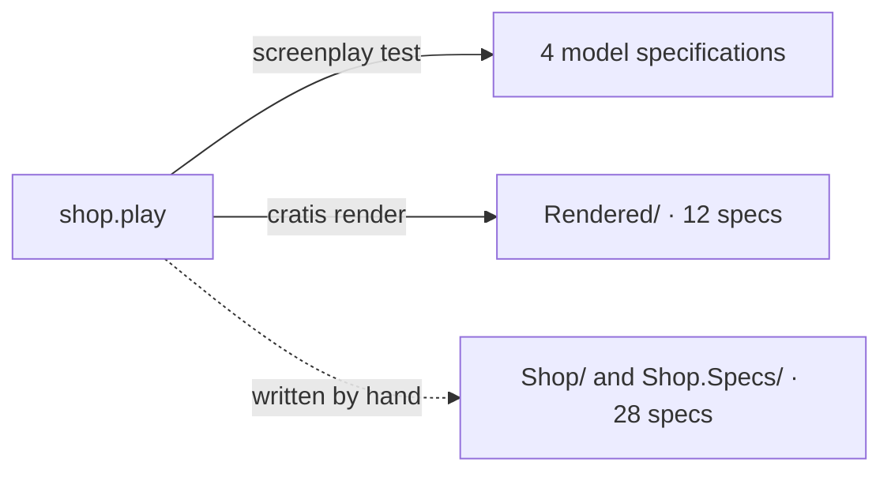

import Recap from '@components/Recap.astro';
import YouWillLearn from '@components/YouWillLearn.astro';

Open a handler in an average codebase and you find `Guid.NewGuid()` next to an invite code built from `System.Random`, and an order number that only that one handler knows how to make. Each call site decides how a value is created. The model says one thing, the code does another, and a test cannot choose the value the handler just invented.

Cratis moves that decision to the concept that owns the value. You declare how a value is generated once, in the model. [Stage](/screenplay/) renders it into code, [Arc](/arc/) creates it before your handler runs, and specs pin it by name. This tutorial follows one small shop through all of those steps.

<YouWillLearn>

- how to declare four generated values in a Screenplay model, and how to choose a strategy for each
- what Stage renders from the model, and what it does not render yet
- how to write the same shop by hand with Arc: a context-aware `OrderId`, a `[NotAudited]` secret, and the `X.New()` migration
- how to pin generated values, the clock and the tenant in specs

</YouWillLearn>

The shop has four server-owned values:

| Concept | Strategy | Random bits | Role |
| --- | --- | ---: | --- |
| `CustomerId` | `cus_` plus a lowercase ULID | 80 | generated identifier |
| `OrderId` | TypeID `order_…` (a UUIDv7 inside) | 74 | generated identifier, time taken from the command |
| `InviteCode` | NanoID, 10 characters without look-alikes | 50 | generated property, too short for an identifier |
| `ApiKey` | 32 random bytes, URL-safe base64 | 256 | generated property, kept off the causation chain |

The same shop is built three times, and each build is checked:



## Before you start

Every snippet on this page is an excerpt of a file in the [`GeneratedValues/Shop` sample](https://github.com/Cratis/Samples/tree/main/GeneratedValues/Shop), and every printed output comes from running it. Values such as ids are sample values.

- Clone [Cratis/Samples](https://github.com/Cratis/Samples) and work from `GeneratedValues/Shop`.
- Install the .NET SDK that the repository's `global.json` asks for (10.0.100 or a later feature band).
- Run `dotnet tool restore` in `GeneratedValues/Shop`. It installs the pinned Screenplay compiler (4.151.0) and Cratis CLI (3.59.0). Use these pinned tools: an older Cratis CLI, such as one installed with Homebrew, bundles a Screenplay that does not know `generate`.
- You need no Docker, Chronicle or MongoDB. Every step below runs in memory. The sample pins Cratis.Fundamentals 7.24.0 and Arc 22.87.1.

```bash
dotnet tool restore
```

## 1. Model the shop in Screenplay

A [Screenplay](/screenplay/) concept can say how its values are created. The model for the shop declares four concepts, each with a `generate` line:

```screenplay title="shop.play"
concept CustomerName : String

// A prefixed, lowercase ULID: 80 random bits, time-ordered.
concept CustomerId : String
  generate ulid prefix "cus_" case lower

// A TypeID: lowercase prefix plus a UUIDv7 suffix, 74 random bits, time-ordered.
concept OrderId : String
  generate typeid "order"

// A short code without look-alike characters: 10 characters x 5 bits = 50 random bits.
// Too few bits for an identifier, so commands generate it as a plain property.
concept InviteCode : String
  generate nanoid 10 alphabet "23456789ABCDEFGHJKLMNPQRSTUVWXYZ"

// 32 random bytes as URL-safe base64 without padding: 256 random bits.
// Screenplay cannot generate secrets yet; this declares only the value's shape.
concept ApiKey : String
  generate bytes 32 base64url
```

A command then says which of its properties the server generates. `RegisterCustomer` generates the id of the stream it writes to, so the caller sends only a name:

```screenplay title="shop.play"
    slice StateChange RegisterCustomer
      command RegisterCustomer
        customerId CustomerId generated identifier
        name       CustomerName
        produces event CustomerRegistered
          name CustomerName = name
        returns customerId
```

`generated identifier` marks the value that selects the event stream. A bare `generated` marks any other server-owned property, like the invite code:

```screenplay title="shop.play"
      command IssueInvite
        customerId CustomerId identifier
        inviteCode InviteCode generated
        produces event InviteIssued
          inviteCode InviteCode = inviteCode
        returns inviteCode
```

A model specification pins a generated value so the result is deterministic. For an identifier, `for "…"` names the stream, and `generated inviteCode = "…"` pins any other generated property:

```screenplay title="shop.play"
      specification IssuingAnInvite
        when IssueInvite
          customerId = "cus_01m4t7txm0hrn5rwemy2dkwtgq"
          generated inviteCode = "K7MPQ2XRT9"
        then InviteIssued
          for "cus_01m4t7txm0hrn5rwemy2dkwtgq"
          inviteCode = "K7MPQ2XRT9"
        then returns "K7MPQ2XRT9"
```

### Choose a strategy

Pick by what the value is for. The full guide, with a flowchart and a collision table, is [Choosing a strategy](/fundamentals/csharp/generating-values/choosing-a-strategy/) in Fundamentals.

| The value is… | Choose | Why |
| --- | --- | --- |
| an id that people read in logs or URLs, sorted by age | `ulid`, optionally with `prefix` and `case` | 80 random bits, sorts by creation time |
| an id that names its type | `typeid "order"` | the prefix names the type; 74 random bits |
| a short code people type | `nanoid` with an alphabet | readable, but few bits, so never an identifier |
| a token or an API key | `bytes 32 base64url` | 256 random bits |

The Screenplay pages [Choose a generation strategy](/screenplay/generated-values/choosing/) and [strategy reference](/screenplay/generated-values/strategies/) list every strategy and its encoding.

### Run the model

Compile with warnings as errors, then run the model specifications:

```bash
dotnet screenplay shop.play --warnaserror
```

```text
1 file(s) compiled - 0 error(s), 0 warning(s)
```

```bash
dotnet screenplay test shop.play
```

```text
shop.play(6,1): Information PLAY0270: A domain declaration is authoring metadata and is not part of ESM v1 behavior.
shop.play(50,9): Warning PLAY0683: Generated property 'inviteCode' of 'IssueInvite' has 50 random bits; 1% collision probability after about 4.757E+06 values.
passed: Shop.Customers.IssueApiKey.IssuingAnApiKey
passed: Shop.Customers.IssueInvite.IssuingAnInvite
passed: Shop.Customers.RegisterCustomer.RegisteringACustomer
passed: Shop.Orders.PlaceOrder.PlacingAnOrder
passed: 4 discovered, 4 selected, 4 executed; 4 passed, 0 failed, 0 unsupported
```

### Read the warning

`PLAY0683` is the model telling you the truth about `InviteCode`. Ten characters from a 32-character alphabet carry 50 random bits, and 50 bits collide after a few million codes. Compilation alone does not report it; binding and the evaluator do.

That is why `InviteCode` is a generated property and not a generated identifier. An identifier needs at least 64 random bits, because a collision would write two customers' facts to one stream. A property can tolerate a rare collision if something else catches it. Screenplay's own fix is a unique constraint on the event property. Stage cannot render that constraint on a generated value yet (see the limits in the next step), so the sample leaves the warning in view instead of hiding it.

### When not to generate

Do not mark a value `generated` when:

- **The client supplied it.** A client-supplied identity is input. Keep it and enforce uniqueness with a constraint.
- **The same request must give the same id.** Random generation does not provide idempotency: a retry draws a different value.
- **The number must be gapless.** Invoice numbers need an allocator, not randomness.
- **It would authorize something.** A generated id identifies; it never proves who is calling.
- **It is a secret.** Screenplay cannot generate secrets yet. `ApiKey` declares only the shape of the value; step 3 shows how Arc handles the secret.

The [choosing guide](/screenplay/generated-values/choosing/) has the full list and the reasoning.

## 2. Render the application with Stage

Stage turns the model into a working Arc backend. Run the render command from `GeneratedValues/Shop`, into a directory that does not exist yet:

```bash
dotnet cratis render shop.play --target cratis --name Shop --project-name Shop.Rendered --destination ./Rendered
```

```text
╭─Rendered─────────────────────────────────────────────────────────────────────╮
│ …/GeneratedValues/Shop/Rendered                                              │
│ Target:    cratis                                                            │
│ Documents: 1                                                                 │
│ Artifacts: 57                                                                │
│ Written:   57                                                                │
│ Removed:   0                                                                 │
│ Unchanged: 0                                                                 │
│ Recovered: False                                                             │
╰──────────────────────────────────────────────────────────────────────────────╯
```

The sample commits the result in `Rendered/`. To check that it still matches the model, add `--check`. The command exits 0 when the output is current and 6 when the model has changes that are not rendered yet:

```bash
dotnet cratis render shop.play --target cratis --name Shop --project-name Shop.Rendered --destination ./Rendered --check
```

### What Stage produced

Each generated concept implements `IGeneratable<T>`, and its `New()` makes one call to `GenerateValue`:

```csharp title="Rendered/Common/OrderId.cs"
public record OrderId(string Value) : global::Cratis.Chronicle.Events.EventSourceId<string>(Value), global::Cratis.Concepts.IGeneratable<OrderId>
{
    public static readonly OrderId NotSet = new(string.Empty);

    public static OrderId New() => new(global::Cratis.Concepts.GenerateValue.TypeId("order"));

    public static implicit operator OrderId(string value) => new(value);
}
```

The command's `Handle` receives the generated id as a `[GeneratedValue]` parameter, so the id is not part of the request:

```csharp title="Rendered/Shop/Orders/PlaceOrder/PlaceOrder.cs"
    public (global::Shop.Common.OrderId, global::Cratis.Chronicle.EventSequences.EventsWithConcurrencyScopes) Handle([global::Cratis.Arc.Commands.ModelBound.GeneratedValueAttribute("orderId")] global::Shop.Common.OrderId orderId)
```

The generated TypeScript proxy for `RegisterCustomer` ends at that boundary too. It has a `name` property and no id:

```ts title="Rendered/Shop/Customers/RegisterCustomer/RegisterCustomer.ts"
export interface IRegisterCustomer {
    name?: string;
}
```

Stage also turns each model specification into an Arc command scenario that pins the generated value by name. Build and run them:

```bash
dotnet test Rendered/Shop.Rendered.csproj --configuration Debug
```

```text
Passed!  - Failed:     0, Passed:    12, Skipped:     0, Total:    12
```

Do not edit files under `Rendered/`. Change `shop.play` and render again. The rendered project pins Arc 22.83.0 and Chronicle 19.54.0, the versions Stage 4.92.0 targets, and building it in Debug also regenerates the TypeScript proxies beside each command.

### Limits of the rendered application

- **Time-ordered values use the wall clock.** Stage renders `IGeneratable<T>.New()`, not the context form, so the time part of a rendered `OrderId` or `CustomerId` is not the command's received time. The next step writes `OrderId` by hand to fix that.
- **Unique constraints on generated values are refused.** Stage will not render the constraint that would answer `PLAY0683`, so `InviteCode` keeps its collision warning.
- **The frontend ends at the typed proxy.** The proxy sends a command without an id, and the response reaches the proxy, but this sample builds no screen on it.

The [Stage reference for generated values](https://github.com/Cratis/Stage/blob/main/Documentation/reference/generated-values-rendering.md) lists the full mapping, the diagnostics Stage raises, and how it renders fixtures.

## 3. Write it by hand in Arc

The `Shop/` project is the same shop written with [Arc](/arc/), the way you would if you did not render it. Start with the simplest case.

### Keep the id out of the request

`CustomerId` implements `IGeneratable<CustomerId>`, and its strategy is the same one Stage rendered for `generate ulid prefix "cus_" case lower`:

```csharp title="Shop/Common/CustomerId.cs"
public record CustomerId(string Value) : EventSourceId<string>(Value), IGeneratable<CustomerId>
{
    /// <summary>
    /// Converts text to a <see cref="CustomerId"/>.
    /// </summary>
    /// <param name="value">The text to convert.</param>
    public static implicit operator CustomerId(string value) => new(value);

    /// <summary>
    /// Generates a new customer identity.
    /// </summary>
    /// <returns>A new <see cref="CustomerId"/>.</returns>
    public static CustomerId New() => new($"cus_{GenerateValue.Ulid().ToLowerInvariant()}");
}
```

`RegisterCustomer` receives only a name. Arc creates the `CustomerId` before it calls `Handle`, and the handler returns the id as the response and as the event source:

```csharp title="Shop/Customers/Registration/RegisterCustomer.cs"
[Command]
public record RegisterCustomer(CustomerName Name)
{
    /// <summary>
    /// Handles the command.
    /// </summary>
    /// <param name="customerId">The generated identity of the new customer.</param>
    /// <returns>The new identity, and the event that records the registration on it.</returns>
    public (CustomerId, EventForEventSourceId) Handle([GeneratedValue("customerId")] CustomerId customerId) =>
        (customerId, new EventForEventSourceId(customerId, new CustomerRegistered(Name)));
}
```

The parameter is not a command property, so it is not in the request body or in the generated client inputs. The name in `[GeneratedValue("customerId")]` stays stable if you rename the C# parameter, and it is the name specs pin by. See [Generated values](/arc/backend/csharp/commands/generated-values/) in the Arc commands documentation for naming, validation and captures.

### Let time follow the command

A rendered `OrderId` reads the wall clock when it is created. In hand-written code you can do better. `OrderId` implements `IGeneratableInContext<OrderId>`, so Arc passes a `GenerationContext` carrying the command's received time:

```csharp title="Shop/Orders/Placing/PlaceOrder.cs"
public record OrderId(string Value) : EventSourceId<string>(Value), IGeneratableInContext<OrderId>
{
    /// <summary>
    /// Generates a new order identity for the given context.
    /// </summary>
    /// <param name="context">The time and tenant of the operation generating the identity.</param>
    /// <returns>A new <see cref="OrderId"/>.</returns>
    public static OrderId New(GenerationContext context) => new(GenerateValue.TypeId("order", context));
}
```

The command is declared the same way as before:

```csharp title="Shop/Orders/Placing/PlaceOrder.cs"
[Command]
public record PlaceOrder(CustomerId CustomerId)
{
    /// <summary>
    /// Handles the command.
    /// </summary>
    /// <param name="orderId">The generated identity of the new order.</param>
    /// <returns>The new identity, and the event that records the order on it.</returns>
    public (OrderId, EventForEventSourceId) Handle([GeneratedValue("orderId")] OrderId orderId) =>
        (orderId, new EventForEventSourceId(orderId, new OrderPlaced(CustomerId)));
}
```

Arc supplies the command's received time as `GenerationContext.Now`, so the time inside the TypeID is the moment the command arrived. It does not read a second clock. A TypeID has no tenant part: Arc also provides the tenant in the context, but this id does not use it. A value that must carry the tenant is a separate concept that builds its text from `context.Tenant`; see [Context-dependent values](/fundamentals/csharp/generating-values/context/).

### Keep a secret off the causation chain

`ApiKey` is the only concept in the shop that is a secret. It is marked `[NotAudited]`:

```csharp title="Shop/Customers/ApiKeys/ApiKey.cs"
[NotAudited]
public record ApiKey(string Value) : ConceptAs<string>(Value), IGeneratable<ApiKey>
{
    /// <summary>
    /// Generates a new API key.
    /// </summary>
    /// <returns>A new <see cref="ApiKey"/>.</returns>
    public static ApiKey New() => new(GenerateValue.Bytes(32, ValueEncoding.Base64Url));
}
```

`NotAuditedAttribute` comes from `Cratis.Arc.Chronicle.Commands`. Wherever a command carries an `ApiKey`, Arc leaves its value out of the causation recorded with the command's events.

That is all it does. It does not keep the key out of event payloads, command responses or logs, so you keep it out of those yourself. `IssueApiKey` shows both sides: the event carries no key and is appended to the existing `CustomerId`, not to an `ApiKey` event source, and the response returns the key once.

```csharp title="Shop/Customers/ApiKeys/IssueApiKey.cs"
    public (ApiKey, EventForEventSourceId) Handle([GeneratedValue("apiKey")] ApiKey apiKey) =>
        (apiKey, new EventForEventSourceId(CustomerId, new ApiKeyIssued()));
```

`RevokeApiKey` takes the key as request input instead. The concept's marking keeps it off the causation of `ApiKeyRevoked`, and the spec [`when_revoking_an_api_key`](https://github.com/Cratis/Samples/blob/main/GeneratedValues/Shop/Shop.Specs/Customers/ApiKeys/for_RevokeApiKey/when_revoking_an_api_key.cs) checks it. See [Secrets and tokens](/fundamentals/csharp/generating-values/secrets-and-tokens/) for how to generate and handle secrets.

### Migrate `X.New()` out of `Handle`

Code that already generates ids inline looks like this. The handler creates its identity itself, so a spec cannot choose it:

```csharp title="Shop/Carts/Starting/StartCartWithInlineGeneration.cs"
[Command]
public record StartCartWithInlineGeneration
{
    /// <summary>
    /// Handles the command.
    /// </summary>
    /// <returns>The identity of the new cart.</returns>
    public CartId Handle() => CartId.New();
}
```

Building the project reports one diagnostic, on purpose:

```text
Shop/Carts/Starting/StartCartWithInlineGeneration.cs(22,31): warning ARC0028: Move inline generation of 'CartId' to a [GeneratedValue] Handle parameter so scenarios can pin it
```

The code fix, "Move to a `[GeneratedValue]` parameter", produces `StartCart`:

```csharp title="Shop/Carts/Starting/StartCart.cs"
[Command]
public record StartCart
{
    /// <summary>
    /// Handles the command.
    /// </summary>
    /// <param name="cartId">The generated identity of the new cart.</param>
    /// <returns>The identity of the new cart.</returns>
    public CartId Handle([GeneratedValue("cart")] CartId cartId) => cartId;
}
```

The rule is documented on [ARC0028](/arc/backend/csharp/code-analysis/arc0028/). For a larger migration, including specs that used an identity-source queue, see [Migrate generated identifiers](/arc/upgrading/generated-values/).

## 4. Test it

Three levels of spec check the shop, and all three pin values by name.

| Level | What runs | Where |
| --- | --- | --- |
| Model specifications | Screenplay's in-memory evaluator, with `for "…"` and `generated x = "…"` | `shop.play` |
| Rendered specifications | Arc command scenarios that Stage wrote from the model | `Rendered/` |
| Hand-written specifications | Arc command scenarios you write | `Shop.Specs/` |

The first two come free with the model. The rest of this step is the third level, in `Shop.Specs/`:

```bash
dotnet test Shop.Specs/Shop.Specs.csproj --configuration Debug
```

```text
Passed!  - Failed:     0, Passed:    28, Skipped:     0, Total:    28
```

### Pin a value by name

`PinGeneratedValue` takes the name from `[GeneratedValue("orderId")]` and the value to use. The pinned id is the same literal the model's `PlacingAnOrder` specification uses:

```csharp title="Shop.Specs/Orders/Placing/for_PlaceOrder/when_placing_an_order/with_a_pinned_order_id.cs"
public class with_a_pinned_order_id : Specification
{
    readonly CommandScenario<PlaceOrder> _scenario = new();
    readonly CustomerId _customerId = new("cus_01m4t7txm0hrn5rwemy2dkwtgq");
    readonly OrderId _orderId = new("order_01m4t7txm0fgx9p7tehmp6mprg");
    CommandResult _result = null!;

    void Establish() => _scenario.PinGeneratedValue("orderId", _orderId);
    async Task Because() => _result = await _scenario.Execute(new PlaceOrder(_customerId));
    void Destroy() => _scenario.Dispose();

    [Fact] void should_succeed() => _result.ShouldBeSuccessful();
    [Fact] void should_return_the_pinned_order_id() => ((CommandResult<OrderId>)_result).Response.ShouldEqual(_orderId);
    [Fact] Task should_place_the_order_on_the_pinned_id() => _scenario.ShouldHaveAppendedEvent<PlaceOrder, OrderPlaced>(_orderId, @event => @event.CustomerId == _customerId);
}
```

The rendered specification pins the same name the same way:

```csharp title="Rendered/Shop/Orders/PlaceOrder/when_placing_an_order.cs"
        _scenario.PinGeneratedValue("orderId", new global::Shop.Common.OrderId("order_01m4t7txm0fgx9p7tehmp6mprg"));
```

An unpinned generated value fails the command, and the failure tells you how to pin it. This is the strict default, so a spec never passes by accident on a random id:

```csharp title="Shop.Specs/Orders/Placing/for_PlaceOrder/when_placing_an_order/without_a_pin.cs"
    [Fact] void should_fail_the_command() => _result.ShouldNotBeSuccessful();
    [Fact] void should_report_an_exception_not_a_validation_failure() => _result.ShouldHaveExceptions();
    [Fact] void should_explain_how_to_pin_it() => _result.ExceptionMessages.Any(message => message.Contains("PinGeneratedValue(\"orderId\",", StringComparison.Ordinal)).ShouldBeTrue();
```

### Fix the clock and the tenant

To check that `OrderId` really follows the command's time, let the scenario generate the value and fix its inputs. `Clock` sets the received time, `Tenant` sets the tenant, and `AllowGeneration()` lets the scenario call the real strategy:

```csharp title="Shop.Specs/Orders/Placing/for_PlaceOrder/when_placing_an_order/with_a_fixed_clock_and_tenant.cs"
    void Establish() => _scenario = new CommandScenario<PlaceOrder>()
        .Clock(_receivedAt)
        .Tenant(new TenantId("north"))
        .AllowGeneration();
```

The spec then reads the time back out of the TypeID and compares it with the fixed clock:

```csharp title="Shop.Specs/Orders/Placing/for_PlaceOrder/when_placing_an_order/with_a_fixed_clock_and_tenant.cs"
    [Fact] void should_use_the_received_time_as_the_time_part() => TypeIdTime.Of(_orderId.Value).ShouldEqual(_receivedAt);
    [Fact] void should_capture_the_generated_order_id() => _scenario.GeneratedValues.Last<OrderId>("orderId").ShouldEqual(_orderId);
```

`TypeIdTime` is a small helper in the sample that decodes the 48-bit timestamp at the start of a TypeID's UUIDv7 suffix. A TypeID has no tenant part, so the fixed tenant only scopes the execution; the spec asserts the time, not the tenant.

Stage does not support clock fixtures for generated values yet, so time assertions belong in hand-written scenarios. See [Pin generated values in command specs](/arc/backend/csharp/testing/generated-values/) for the full scenario API, and [Testing generated values](/fundamentals/csharp/generating-values/testing/) for specs outside Arc.

## 5. Coming next

Two chapters wait on work that has not shipped, so they are not part of this tutorial yet.

- **Freshness.** A generated identifier must be new, and a collision must be rejected, not merged into an existing stream. Stage renders a `BeforeFirst` concurrency scope for generated event sources today. Since Chronicle 19.40.1, Chronicle re-checks those scopes on every renumbered storage retry and checks a batch's scopes once against pre-batch state, all-or-nothing; see [Concurrency](/chronicle/events/concurrency/). What is still coming is Arc's own freshness guard for hand-written commands ([Arc#3129](https://github.com/Cratis/Arc/issues/3129)). Until then, hand-written Arc handlers return plain `EventForEventSourceId` results, as in step 3, and Arc's generated-value documentation states that generation has no freshness guard.
- **Studio.** Editing the generation strategy in Studio's concept editor, with a preview of the generated code, waits on [StudioIssues#588](https://github.com/Cratis/StudioIssues/issues/588).

<Recap>

- You declared four server-owned values once, in the model, and chose a strategy for each with a reason. `InviteCode` stayed a generated property because 50 bits are too few for an identifier.
- Stage rendered `IGeneratable<T>` concepts and `[GeneratedValue]` handlers, with wall-clock time, no unique constraints on generated values, and a frontend that ends at the typed proxy.
- In Arc you wrote the context form for `OrderId`, marked `ApiKey` `[NotAudited]` (command causation only, not events, responses or logs), and moved `X.New()` out of `Handle`.
- Specs pin generated values by name, and fix the clock and tenant when time matters.

</Recap>

## Go deeper

- Fundamentals: [Generating values](/fundamentals/csharp/generating-values/), with a [tutorial](/fundamentals/csharp/generating-values/tutorial/), [choosing a strategy](/fundamentals/csharp/generating-values/choosing-a-strategy/), [context-dependent values](/fundamentals/csharp/generating-values/context/), [secrets and tokens](/fundamentals/csharp/generating-values/secrets-and-tokens/), [testing](/fundamentals/csharp/generating-values/testing/) and a [reference](/fundamentals/csharp/generating-values/reference/).
- Screenplay: [Generated values](/screenplay/generated-values/), [choosing a strategy](/screenplay/generated-values/choosing/) and [strategies](/screenplay/generated-values/strategies/).
- Stage: the [generated values rendering reference](https://github.com/Cratis/Stage/blob/main/Documentation/reference/generated-values-rendering.md).
- Arc: [Generated values](/arc/backend/csharp/commands/generated-values/), [pinning generated values in specs](/arc/backend/csharp/testing/generated-values/) and [migrating generated identifiers](/arc/upgrading/generated-values/).
- The sample: [GeneratedValues/Shop](https://github.com/Cratis/Samples/tree/main/GeneratedValues/Shop), including its README with every command and output.
- Related: [Build a full-stack feature](/build-a-full-app/) and [Testing with Cratis](/testing-with-cratis/).
