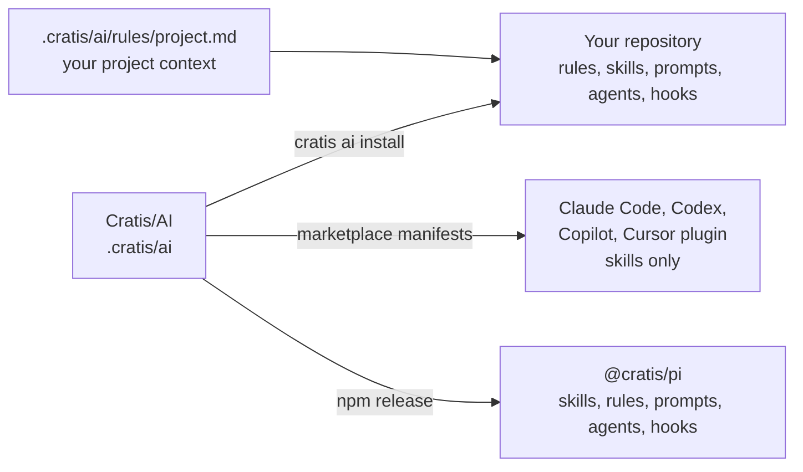

import { CardGrid, Aside } from '@astrojs/starlight/components';
import SimpleCard from '@components/SimpleCard.astro';
import TopicHero from '@components/TopicHero.astro';

<TopicHero icon="puzzle" eyebrow="The Cratis Stack" title="Give your coding agent Cratis context">
Cratis AI gives coding agents framework guidance for tasks such as writing a command, defining a projection, or changing an existing event type. Install it when you want the agent to work from Cratis conventions without restating them in every prompt. Choose a repository-managed installation for a team, or a native plugin for one coding tool.
</TopicHero>

## What the corpus contains

The shared guidance lives in [Cratis/AI](https://github.com/Cratis/AI), under
`.cratis/ai`. This collection, called the corpus, holds five kinds of content.
The coding tool's integration, or harness, determines how each kind reaches
the agent:

| Kind | What it does | Example |
| --- | --- | --- |
| Rules | Standing guidance; some applies universally, some only to matching paths | C# and TypeScript conventions, the vertical-slice rules for applications |
| Skills | A focused workflow the agent can load for a matching task | `cratis-chronicle-projection` |
| Prompts | Reusable instructions that start a workflow | `new-vertical-slice` |
| Agents | Subagent definitions a harness can delegate to | `spec-writer`, `security-reviewer` |
| Hooks | Executable checks and guards connected to supported harness events or tools | The Cratis quality gate |

A skill starts with Markdown instructions and may include references, scripts,
or other supporting files. Loading its instructions is not the same as running
a script. Hooks provide executable checks, but their wiring differs by harness;
an installed rule alone does not enforce a convention.

## Which channel delivers what

| Channel | Rules | Skills | Prompts | Agents | Hooks | Version |
| --- | --- | --- | --- | --- | --- | --- |
| `cratis ai install` | Yes, by profile and language | Yes, by profile | Yes | Yes | By harness | Current default branch, or a `--source` checkout |
| Marketplace plugin (`cratis@cratis`) | No | All | No | No | No | Default branch, unpinned |
| `@cratis/pi` | Yes | Yes, by `.cratis/ai.json` if present | Yes | Yes | Yes | npm version |

Use the managed CLI path when the repository should carry the team's guidance
and selected harness adapters. The marketplace plugins for Claude Code, Codex,
GitHub Copilot, and Cursor expose skills only. Pi's package includes the wider
integration, without managing other coding tools.

The channels share a source corpus, but the installed revision and harness
behavior can differ. The [agent harness guide](/ai/harnesses/) gives each tool's
install command and hook coverage.
[Cratis AI distribution](/ai/trust-and-distribution/) explains how to update or
return to an earlier revision.

## Skills guide complete workflows

Choose skills for the work you need to finish. For example,
`cratis-chronicle-projection` guides projection authoring; the migration skills
address changes to an existing contract. Product skills use names beginning
with `cratis-`, grouped here by task:

- Model before you build: `cratis-chronicle-event-modeling`,
  `cratis-event-model-diagram`, and the `cratis-screenplay-*` skills for
  Screenplay models.
- Build one artifact by convention: `cratis-arc-command`,
  `cratis-arc-command-validation`, `cratis-chronicle-read-model`,
  `cratis-chronicle-projection`, `cratis-chronicle-reducer`,
  `cratis-chronicle-reactor`, `cratis-chronicle-event-constraints`,
  `cratis-fundamentals-concept`, `cratis-arc-react-page`.
- Change what already exists: `cratis-chronicle-event-type-migration`,
  `cratis-arc-ef-core-migration`.
- Apply compliance and tenancy requirements: `cratis-chronicle-compliance`,
  `cratis-chronicle-multi-tenancy`,
  `cratis-arc-authentication-authorization-and-identity`.
- Write behavior specs: `cratis-application-slice-specifications`,
  `cratis-chronicle-event-specifications`,
  `cratis-chronicle-read-model-specifications`, `cratis-specifications-csharp`,
  `cratis-specifications-typescript`.
- Review a change: `cratis-code-review`, `cratis-security-review`,
  `cratis-performance-review`.
- Inspect or operate a running store: `cratis-chronicle-cli-operations`,
  `cratis-chronicle-mcp-inspection`, `cratis-cli-terminal-workbench`,
  `cratis-chronicle-web-workbench`.
- Work with a specific client: `cratis-chronicle-client-dotnet`,
  `cratis-chronicle-client-typescript`, `cratis-chronicle-client-kotlin`,
  `cratis-chronicle-client-elixir`, and the Kotlin Arc skills.

Prompts start larger workflows: `new-vertical-slice`, `scaffold-feature`,
`add-concept`, `add-projection`, `add-reactor`, `add-reducer`,
`add-business-rule`, `add-ef-migration`, `write-specs`, `write-documentation`,
`code-review`, and `review-pr`. They come with the managed install and
`@cratis/pi`, not with the marketplace plugin.

A profile selects the guidance relevant to your repository. Choose an
application profile when building on Cratis, or an engineering profile when
working on Cratis itself. That keeps application vertical-slice rules out of a
framework-only selection. [Profiles](/ai/profiles/) explains how to choose.

## Operating a live store is a separate surface

Executable Chronicle operations live in the documented [CLI](/cli/) and the
[Chronicle MCP server](/chronicle-mcp/), each with its own authentication and
confirmation boundaries. The skills describe how to use those tools; they do
not carry their own way into your store.

## Do not copy configuration between repositories

Install shared guidance through a supported channel instead of copying
`.cratis/ai`, `.claude`, `.github`, `.agents`, or `.pi` trees from another
repository. A copied tree can carry the other project's assumptions and has no
managed update path. Keep your own project context separate from managed
content; the [setup guide](/ai/getting-started/) explains where it belongs and
which installed files to commit for the team.

<Aside type="note" title="Maintaining Cratis itself?">
Cratis-owned repositories use the same managed install with an engineering
profile. See [Use AI as a Cratis maintainer](/ai/cratis-maintainers/).
</Aside>

## Get the skills and the operating tools today

For coding guidance, follow [Start using Cratis AI](/ai/getting-started/) to
install into a repository and check that your agent sees the selected skills.
Use a [native plugin](/ai/harnesses/) if you only need one coding tool.

If the task also needs live-store access, `cratis init` gives the assistant the
CLI command catalog. Connect [Chronicle MCP](/chronicle-mcp/) separately when
your host and authorization policy allow it. After an agent changes code, use
[code analysis](/code-analysis/) to check the framework contracts covered by
the compiler and lint rules.

## Where to go next

<CardGrid>
  <SimpleCard title="Start using AI" icon="rocket" link="/ai/getting-started/">
    Install Cratis AI into a repository and confirm your agent sees it.
  </SimpleCard>
  <SimpleCard title="Profiles" icon="list-format" link="/ai/profiles/">
    Choose application, engineering, or documentation guidance for a repository.
  </SimpleCard>
  <SimpleCard title="Ecosystem support" icon="puzzle" link="/ai/ecosystems/">
    What each coding tool receives through each channel.
  </SimpleCard>
  <SimpleCard title="Cratis maintainers" icon="seti:folder" link="/ai/cratis-maintainers/">
    Work on Cratis repositories with an agent, without copying the corpus.
  </SimpleCard>
  <SimpleCard title="Code analysis" icon="seti:json" link="/code-analysis/">
    The compiler and lint rules that check contracts whether or not an agent wrote the code.
  </SimpleCard>
</CardGrid>
