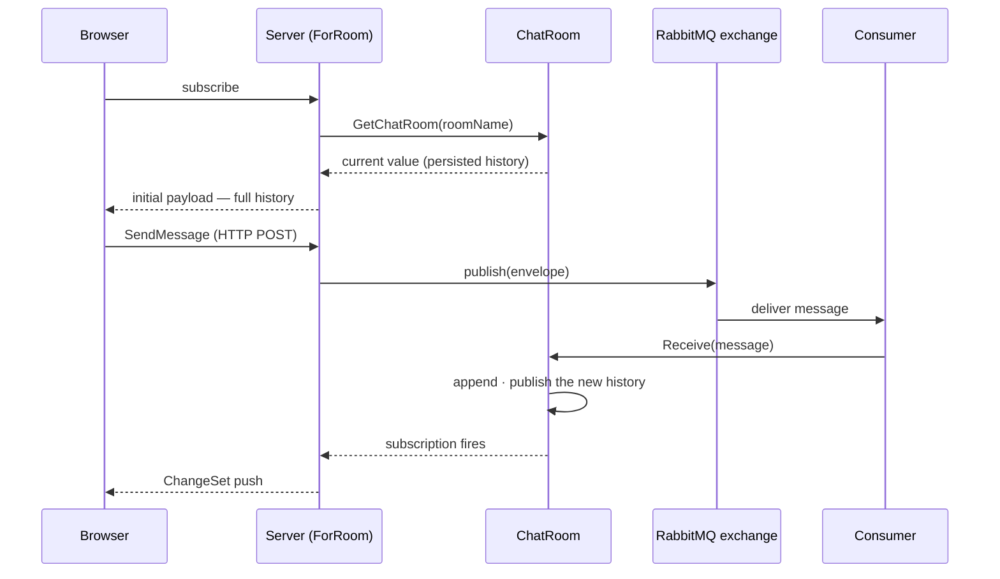

import YouWillLearn from '@components/YouWillLearn.astro';
import Recap from '@components/Recap.astro';

Use RabbitMQ to deliver chat messages when browsers connect to different server instances. This guide extends the [in-memory chat](/scenarios/chat/in-memory/): each instance still keeps rooms in memory, but loads a room's history from your storage on first access and receives new messages through the broker.

Keep the previous guide's React component and observable query contract. You will change how rooms get their initial history and how the command reaches them. Have a RabbitMQ instance available and supply your own persistence implementation; no database implementation is included here.

The backend is shown in C#, Kotlin, Java, and TypeScript; the RabbitMQ publisher and consumer are plain application code and are shown in C# only. Arc for TypeScript is published on npm; its feature coverage differs from the other backends. [How the backends differ](/scenarios/chat/#how-the-backends-differ) summarizes the per-language differences.

<YouWillLearn title="What you'll build">

- A `ChatService` that loads initial history before creating each `ChatRoom`
- A `SendMessage` command that publishes through a publishing contract rather than writing directly to the room
- A RabbitMQ publisher and a consumer that routes each message to the appropriate room (shown for C#)
- The same observable query and React component from the in-memory guide, unchanged

</YouWillLearn>

## Architecture



`SendMessage` publishes to RabbitMQ rather than updating the local room. Each server instance's consumer receives the envelope from its own bound queue and routes it to the named `ChatRoom`. The room appends the message and publishes its updated history to query subscribers. Command completion does not mean that every browser has received the message.

## Folder structure

```text
Chat/
├── IChatPersistence.cs        ← Persistence abstraction
├── ChatRoom.cs                ← ChatRoom + ChatService (persistence-backed)
├── IChatPublisher.cs          ← Publishing abstraction
├── ChatRoomPage.cs            ← ChatMessage read model + SendMessage command
├── RabbitMqChatPublisher.cs   ← IChatPublisher over RabbitMQ
├── ChatSubscriber.cs          ← BackgroundService — RabbitMQ consumer
└── ChatRoomPage.tsx           ← React component (unchanged from in-memory guide)
```

This is the C# layout. Kotlin and TypeScript keep the same backend files as `.kt` or `.ts`, and Java puts each public type in its own file. The RabbitMQ publisher and consumer are shown for C# only (Step 2).

## Step 1 — The backend

The persistence contract reads a room's history, oldest first. `ChatService` calls it when the room is first requested, whether by a query or the broker consumer, then keeps the room for later requests. `Receive` appends incoming messages to that local history.

The publishing contract separates `SendMessage` from the broker client. The command creates the message's `Id` once and includes it in the envelope, so each instance receives the same identity. The room changes only when its consumer receives that envelope.

The read model and query keep their previous shape. In TypeScript, the query now awaits the room because its history loads asynchronously.

<ArcBackendTabs snippet="scenarios/chat/rabbitmq/backend" />

The sample only reads persistence: neither the publisher nor the consumer saves new messages. Before relying on history after a restart, add a storage write path. Coordinate that write with broker delivery and the initial history load so an arriving message is not missed or included twice. `Receive` appends without deduplicating by `Id`; a stable identity alone does not make redelivery safe.

History loading differs by backend:

- **C#** blocks on the first load of a room's history and loads each room once, even when two requests ask for it at the same time. A `Lazy` keeps a failed load's exception, so the service removes a failed room and the next subscriber tries again. For production, consider warming the rooms when the application starts, with a hosted service.
- **Kotlin and Java** load the history inside `computeIfAbsent`, so a room is loaded once. The persistence contract is a blocking call, as with JDBC.
- **TypeScript** loads the history asynchronously, so `getChatRoom` and the query are `async`. The service caches the pending load, so concurrent subscribers share one load, and forgets a failed load so the next subscriber tries again. `ChatPersistence` and `ChatPublisher` are abstract classes because a TypeScript interface does not exist at runtime to be a service token.

Register your implementations of the two contracts with the application's services:

- **C#**: see the registrations after Step 2.
- **Kotlin and Java**: make each implementation a Spring bean, for example with `@Component`.
- **TypeScript**: `builder.services.addSingleton(ChatPersistence, YourChatPersistence)` and `builder.services.addSingleton(ChatPublisher, YourChatPublisher)`.

## Step 2 — RabbitMQ

RabbitMQ is plain application code, not an Arc integration. This step shows it for C# with the [RabbitMQ .NET client](https://www.rabbitmq.com/client-libraries/dotnet); with Kotlin, Java or TypeScript, use your platform's AMQP client in the same roles.

The publisher implements `IChatPublisher` by publishing the envelope to the `chat.messages` fanout exchange:

```csharp
// Chat/RabbitMqChatPublisher.cs
using System.Text.Json;
using RabbitMQ.Client;

namespace MyApp.Chat;

public class RabbitMqChatPublisher(IChannel channel) : IChatPublisher
{
    public async Task Publish(ChatMessageEnvelope envelope) =>
        await channel.BasicPublishAsync(
            exchange: "chat.messages",
            routingKey: string.Empty,
            body: JsonSerializer.SerializeToUtf8Bytes(envelope));
}
```

`ChatSubscriber` runs for the lifetime of the application. It declares an exclusive, auto-delete queue and binds it to the fanout exchange. Each instance needs its own queue: sharing one would distribute messages between consumers instead of delivering them to every instance.

This queue receives messages while it is bound. It does not retain a disconnected instance's backlog, and the cached rooms do not reload history on reconnection. The durable exchange declaration does not provide durable chat storage. Start the consumer and establish its binding before sending messages; reconnect handling and missed-message recovery are not implemented in this sample.

```csharp
// Chat/ChatSubscriber.cs
using System.Text.Json;
using Microsoft.Extensions.Hosting;
using RabbitMQ.Client;
using RabbitMQ.Client.Events;

namespace MyApp.Chat;

/// <summary>
/// Background service that consumes chat messages from RabbitMQ and routes them
/// to the appropriate <see cref="ChatRoom"/>.
/// </summary>
public class ChatSubscriber(
    IConnectionFactory connectionFactory,
    ChatService chatService) : BackgroundService
{
    /// <inheritdoc/>
    protected override async Task ExecuteAsync(CancellationToken stoppingToken)
    {
        await using var connection = await connectionFactory.CreateConnectionAsync(stoppingToken);
        await using var channel = await connection.CreateChannelAsync(cancellationToken: stoppingToken);

        // Fanout exchange — every bound queue receives every published message.
        await channel.ExchangeDeclareAsync(
            exchange: "chat.messages",
            type: ExchangeType.Fanout,
            durable: true,
            cancellationToken: stoppingToken);

        // Exclusive, auto-delete queue — scoped to this server instance.
        var queue = await channel.QueueDeclareAsync(
            exclusive: true,
            autoDelete: true,
            cancellationToken: stoppingToken);

        await channel.QueueBindAsync(
            queue: queue.QueueName,
            exchange: "chat.messages",
            routingKey: string.Empty,
            cancellationToken: stoppingToken);

        var consumer = new AsyncEventingBasicConsumer(channel);
        consumer.ReceivedAsync += async (_, ea) =>
        {
            var envelope = JsonSerializer.Deserialize<ChatMessageEnvelope>(ea.Body.Span)!;
            var message = new ChatMessage(envelope.Id, envelope.User, envelope.SentAt, envelope.Message);
            chatService.GetChatRoom(envelope.RoomName).Receive(message);
            await channel.BasicAckAsync(ea.DeliveryTag, multiple: false, cancellationToken: stoppingToken);
        };

        await channel.BasicConsumeAsync(
            queue: queue.QueueName,
            autoAck: false,
            consumer: consumer,
            cancellationToken: stoppingToken);

        await Task.Delay(Timeout.Infinite, stoppingToken);
    }
}
```

Register the services in your `Program.cs`:

```csharp
builder.Services.AddSingleton<ChatService>();
builder.Services.AddHostedService<ChatSubscriber>();
builder.Services.AddSingleton<IChatPersistence, YourChatPersistenceImplementation>();
builder.Services.AddSingleton<IChatPublisher, RabbitMqChatPublisher>();

// Register IConnectionFactory pointing at your RabbitMQ instance.
builder.Services.AddSingleton<IConnectionFactory>(_ =>
    new ConnectionFactory { HostName = "localhost" });

// Register a singleton IChannel for the publisher.
builder.Services.AddSingleton<IConnection>(sp =>
    sp.GetRequiredService<IConnectionFactory>()
      .CreateConnectionAsync().GetAwaiter().GetResult());
builder.Services.AddSingleton<IChannel>(sp =>
    sp.GetRequiredService<IConnection>()
      .CreateChannelAsync().GetAwaiter().GetResult());
```

Build the backend to generate the proxies. They are the same `ForRoom.ts`, `SendMessage.ts`, and `ChatMessage.ts` as in the in-memory version, so the frontend does not change.

<a id="step-5--delta-mode"></a>

## Step 3 — Delta mode

The room still publishes a complete history, so delta mode works as in the in-memory guide. A new subscription receives the room's current history: the loaded messages plus any messages it has received since. After that, Arc matches messages by `Id` and sends additions as a `ChangeSet` rather than sending the whole list again.

The `use()` hook applies each `ChangeSet` transparently, so `messagesResult.data` always holds the complete current collection.

See [delta mode](/arc/backend/csharp/queries/change-stream/) and the [in-memory guide](/scenarios/chat/in-memory/#step-2--delta-mode) for how the ChangeSet is computed and why `ChatMessage` has an `Id`.

<a id="step-6--the-react-component"></a>

## Step 4 — The React component

The React component is **identical** to the one in the [in-memory guide](/scenarios/chat/in-memory/#step-3--the-react-component). The observable query contract, `ForRoom.use({ roomName })` returning `messagesResult.data`, does not change regardless of how the backend sources its data.

## What changed from the in-memory version

| Aspect | In-Memory | RabbitMQ |
| ------ | --------- | -------- |
| Initial history | Empty `[]` | Loaded from persistence layer |
| New messages enter via | The room's `Send` | The broker consumer, through the room's `Receive` |
| `SendMessage` handler | Sends to the room through the chat service | Publishes an envelope through the publishing contract |
| Delivery across instances | No, state is process-local | Each instance receives messages through its bound queue |
| Observable query | Unchanged | Unchanged |
| React component | Unchanged | Unchanged |

The query still returns an observable source of complete message histories: a subject in C# and TypeScript, a `Flow` in Kotlin, or a `Flow.Publisher` in Java. Its subscription lifecycle is unchanged. Leaving a room ends that query subscription, not the application's broker consumer or the cached room.

<Recap>

Connect a browser to each of two server instances, join the same room, and send a message. With both consumers bound, both browsers should receive it. Next, [react to individual message changes in the frontend](/scenarios/chat/change-stream/) with `useChangeStream()`; that guide uses the simpler in-memory backend.

</Recap>
