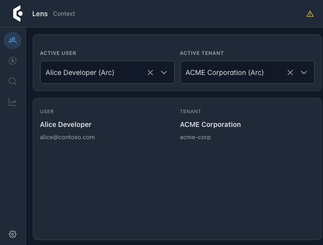
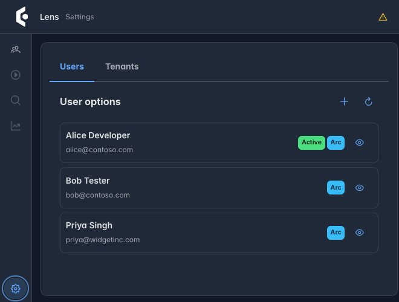
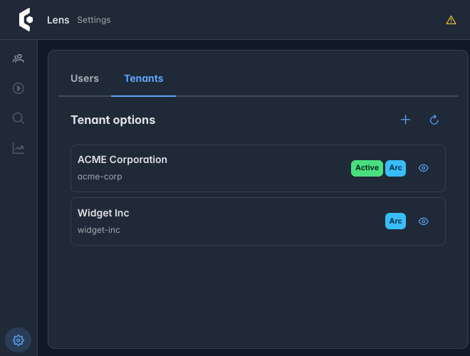

import { Aside, Steps } from '@astrojs/starlight/components';

Cratis Lens is a browser extension for exercising a running Cratis Arc app's commands and queries with development users and tenants. Use it when you need to send a specific payload or compare query results between tenants without building a throwaway page. Commands run against the connected backend and can change its data, so choose an app and test identities you intend to use for development.

## What it does

Lens opens as a popup with five tabs. When the current tab is a running Arc
application, Lens detects it and enables the command, query, and diagnostics
tabs; on any other page only Context and Settings are available.

Choose a user and tenant in **Context**, then open **Commands** or **Queries**.
Both group the app's operations by namespace. Commands use a form built from
the command's schema and show the result or validation errors. Queries accept
parameters and show returned data in a table. Lens discovers these operations
through `/.cratis/commands` and `/.cratis/queries` on the detected backend.

If an observable query stops updating, open **Query Diagnostics** to inspect
its connection health, transport, shared connection (the multiplexer), and
cache state. Use **Settings** to add development identities or refresh the
users and tenants supplied by the app.

Lens detects the backend address from the running page's Arc context and saves
it with the page origin. Open the popup on the intended app before running an
operation; if detection fails, the command, query, and diagnostics tabs stay
disabled. Lens does not read Chronicle CLI connection contexts.

When you switch user or tenant, Lens clears Arc's `.cratis-identity` cookie for
the detected backend and page origins and reloads matching tabs. This lets the
next request establish a new identity instead of reusing the previous cookie.
Lens sends the tenant in `x-cratis-tenant-id` by default and the selected user's
identity in `x-ms-client-principal`, `x-ms-client-principal-id`, and
`x-ms-client-principal-name` headers.

<Aside type="caution" title="A selection is shared across the browser profile">
Lens stores one active user and tenant for the browser profile, not one per tab.
Its header rules match XMLHttpRequest/fetch traffic initiated by the detected
page's hostname; without a page origin, they match the backend host. Closing
the popup does not remove those rules. Clear both selections in Context or
disable the extension when you finish.

These are simulated request headers, not a login or an authorization bypass.
The backend must accept the identity format and resolve the tenant header.
Arc's .NET host ignores unsigned forwarded identity headers by default. Do not
enable trust in client-supplied headers on a publicly reachable backend to make
Lens impersonation work; follow the development setup linked below.
</Aside>

## Where the tenant and user roster comes from

Lens requests `GET /.cratis/tenants` and `GET /.cratis/users` from the detected
backend. In C#, supply their data through `ICanProvideTenants` and
`ICanProvideUsers`. The Kotlin/Java Spring Boot integration uses
`TenantsProvider` and `UsersProvider`, including adapters for asynchronous Java
providers. Each host can combine multiple providers. A successful response
with no registered providers is an empty array, so there are no backend-supplied
entries to select.

<Aside type="caution" title="Discovery access depends on the host">
In Arc's .NET host, discovery endpoints are anonymous in Development by default
and require authentication elsewhere. Outside Development, they are not mapped
if the host cannot enforce authentication. Explicit introspection settings can
change access or disable discovery, so an unavailable roster does not necessarily
mean there are no users. Keep provider data limited to development scenarios
and check your host's access policy before exposing it. The Kotlin/Java guide
below describes that integration's setup separately.
</Aside>

When you open the Lens popup on a page it recognizes as a running Arc
application, it fetches both endpoints and merges the result into its own
roster (each entry tagged `Arc`). You can also add entries by hand from Lens
itself. Those are tagged `Custom` and survive even when the backend's own list
changes or is temporarily unreachable.

The screenshots show a roster with three demo users and two demo tenants.

### Context — the active user and tenant



The **Context** tab shows the active user and tenant for this browser profile.
Choose either from the merged roster, or clear a selection to stop Lens adding
its headers. Switching reloads matching tabs, so save any unfinished work in
the app first. The backend still decides how to authenticate the request and
which tenant's data it can access; a roster entry alone grants no access.

### Settings — the roster, tagged by source





The **Settings** tab lists every known user and tenant, each with an `Arc` or
`Custom` badge so you can tell whether an entry came from the backend's
providers or was added locally. The green `Active` badge marks the selection
currently in effect. Use the eye icon to inspect the full identity or tenant
payload the backend returned, the `+` to add a custom entry, and the refresh
icon to fetch again from the backend without reopening the popup.

See [Development users and tenants (C#)](/arc/backend/csharp/identity/development-and-topologies/)
or [Development users and tenants (Kotlin and Java)](/arc/backend/kotlin/guides/development-users-and-tenants/)
for how to implement a provider, and [Tenancy in Arc](/arc/backend/csharp/tenancy/)
for how this discovery seam relates to actual tenant resolution at request
time.

## Install from the Chrome Web Store

Open the [Chrome Web Store listing](https://chromewebstore.google.com/detail/cratis-lens/hfdpoljbaknodcgejjohafbfjejijklj) and choose **Add to Chrome**. Then navigate to your running Arc app and open the Lens popup so it can detect the backend and load its development roster. Check the active user and tenant in **Context** before executing a command.

## Install it (side-load)

To work on Lens itself or use a source change, build and load it as an unpacked Chrome extension. You need Node.js 20 or later, Yarn, and Chrome. The source is at [github.com/Cratis/Lens](https://github.com/Cratis/Lens).

<Steps>

1. Clone the repo, then from the `Source` folder install and build:

   ```bash
   cd Source
   yarn install
   yarn build
   ```

   This produces `Source/dist/` (including `manifest.json`).

2. Open `chrome://extensions`, enable **Developer mode**, choose **Load unpacked**, and select the `Source/dist` folder. Lens appears as **Cratis Lens**.

3. Navigate to your running Arc app and open the Lens popup once so it detects the app. The Commands, Queries, and Query Diagnostics tabs become available.

</Steps>

For an active edit loop, run `yarn dev` to rebuild on change, and reload the extension from `chrome://extensions` after each rebuild.

## Where to go next

To populate the roster, follow [Provide tenants and users (C#)](/arc/backend/csharp/identity/development-and-topologies/)
or [Provide tenants and users (Kotlin/Java)](/arc/backend/kotlin/guides/development-users-and-tenants/).
Then use [Tenancy in Arc](/arc/backend/csharp/tenancy/) to connect the selected
tenant to your backend's resolution and isolation rules.

For the operations Lens discovers, read [Queries in Arc](/arc/backend/csharp/queries/).
If you need to inspect the events recorded in Cratis Chronicle instead, use
[the Narrator VS Code extension](/tools/vscode-extension/).
