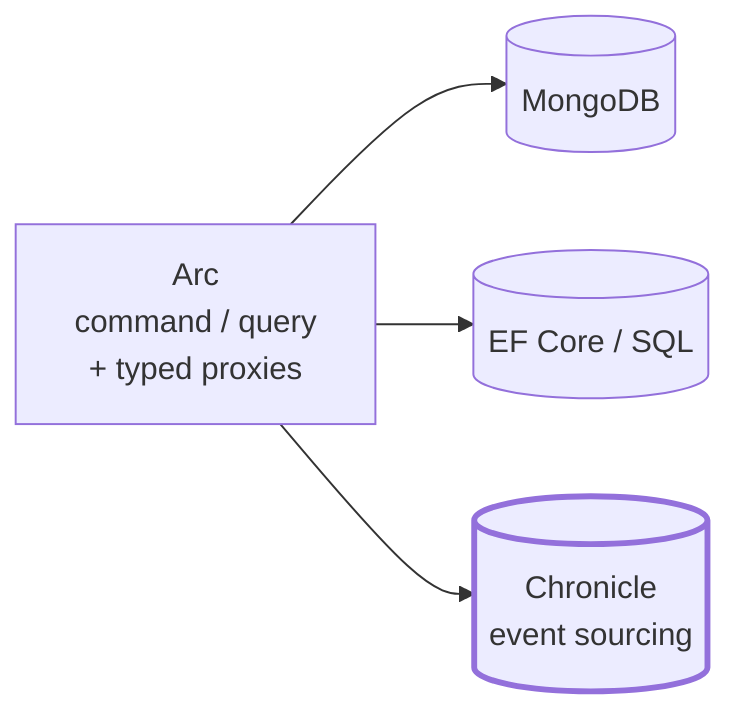
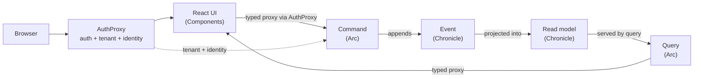

import { Aside, Card, CardGrid } from '@astrojs/starlight/components';
import SimpleCard from '@components/SimpleCard.astro';
import TopicHero from '@components/TopicHero.astro';

Cratis Platform helps teams explain how current state arose, build new views from recorded history, and find typed frontend usages affected by a backend contract change. These are separate reasons to adopt it: choose the boundary your feature needs without replacing the rest of your system.

<TopicHero icon="open-book" eyebrow="Why developers choose Cratis" title="Explain a change. Answer the next question.">
Compare the [day-to-day changes](#what-changes-day-to-day) with the work your application needs before choosing a component. To try the event-store boundary, [get started with Chronicle](/chronicle/get-started/); for an API and React UI, [build a full-stack feature](/build-a-full-app/).
</TopicHero>

<Aside type="note" title="Choose the integration for your backend">
Cratis Chronicle also has [TypeScript, Kotlin/Java, and Elixir clients](/chronicle-clients/). Cratis Arc backend capabilities differ by language. For Arc and Chronicle together, follow the [C# integration](/arc/backend/csharp/chronicle/), [Kotlin and Java integration](/arc/backend/kotlin/guides/chronicle/), or [TypeScript integration from source](/arc/backend/typescript/chronicle/). Check the [support matrix](/compatibility/#support-matrix) and each backend's capabilities before choosing a path.
</Aside>

## Explain today's state and build the next view

An order's current status tells you where it is now. When someone disputes a change or needs a different view of that order, the team needs the facts behind the status as well as the screen that displays it.

<CardGrid>
  <Card title="Trace the facts behind the current state" icon="seti:db">
    [Chronicle keeps changes as events](/chronicle/why-event-sourcing/), with sequence numbers and correlation, identity, and causation context. A read model is a view derived from those facts for a particular question. The [CLI](/cli/) and Workbench let you inspect events, their processing, and the resulting read models. The explanation reaches only as far as the facts and context you recorded; an event history is not a separate read/access audit.
  </Card>
  <Card title="Answer another question from the same history" icon="open-book">
    A new order screen need not replace the recorded facts. Chronicle [projections](/chronicle/projections/) derive multiple focused read models from the same events. Supported replay can rebuild a view from available history, but cannot recover facts that were never recorded. Materialized views update asynchronously; a full replay takes its observer out of live processing until catch-up, so plan for capacity, failures, and side effects.
  </Card>
  <Card title="Find the frontend usages a contract change affects" icon="puzzle">
    When an order field changes in C#, regenerate its TypeScript proxies and type-check the frontend for incompatible typed usages. Arc separates writes into commands and reads into queries, the pattern called Command Query Responsibility Segregation (CQRS), exposes them over HTTP, and generates the clients. Cratis Components uses them in React command forms and query-backed tables instead of hand-maintained contract copies. [The proxy boundary](/arc/understanding-the-proxy-boundary/) explains the check: generation must run, and typed agreement does not replace runtime integration checks.
  </Card>
</CardGrid>

## Agree on expected behavior before implementation

For the same order feature, keep commands, facts, views, and Given/When/Then specifications together in a [Cratis Screenplay](/screenplay/) `.play` model. [Cratis Studio](/studio/) is an optional paid workspace where the team can edit that model together. Supported scenarios execute in the in-memory reference evaluator; operation fixtures do not execute there, and model checks do not establish that the implementation behaves correctly.

You can carry the model into [source generation](/cli/reference/screenplay/) instead of leaving the design in a separate diagram, subject to the renderer's supported constructs and languages. Modeling and generation do not replace implementation, testing, or deployment.

Keep the code for one behavior together as a [vertical slice](/arc/vertical-slices/): command, events, projection, screen, and specifications. [Code analysis](/code-analysis/) checks naming and discovery conventions, while [Cratis AI](/ai/) packages those conventions for assistants. The [Given/When/Then tests](/testing-with-cratis/) follow the same sequence as the design: existing facts, a command, and the facts or read models that should result. You still implement the domain rules and review generated or agent-written code.

## Erase protected values without discarding the event sequence

When an erasure request concerns personal data, Chronicle can make protected values unreadable while retaining events, sequence numbers, and non-PII fields. Values must be marked as PII before append so they are encrypted under the subject's key; erasure deletes the key revisions and blocks replacement keys unless explicitly authorized. Adding a marker later does not protect historical plaintext.

This is an erasure mechanism, not compliance certification. Repeat erasure in each relevant namespace and resolve partial failures. Identity display names and causation values are not erased by deleting the subject key; exported copies, stale read models, backups, and restore/re-erasure need their own handling. [Event sourcing and GDPR](/concepts/event-sourcing-gdpr/) and [Chronicle compliance](/chronicle/compliance/) explain the mechanism and remaining responsibilities.

## How the responsibilities fit together

The products connect at explicit boundaries. A command describes intent, an event records what happened, a projection builds a read model, and a query serves it to the screen. Identity and tenant context travel through that flow too, but authentication, authorization, and storage isolation remain separate responsibilities:

| Concern | Where Cratis carries it |
|---|---|
| Domain behavior | Arc turns it into commands and queries, Chronicle records the facts as the default source of truth for information systems; Studio (an optional paid workspace) and Screenplay model it |
| Frontend contract | Arc generates TypeScript proxies from C#, and Components renders those proxies as forms, dialogs, and live tables |
| Chronicle client boundary | Chronicle exposes gRPC/protobuf contracts, with .NET as the first-class client and TypeScript, Kotlin/Java, and Elixir clients for other runtimes |
| Chronicle storage | MongoDB, PostgreSQL, Microsoft SQL Server, and SQLite implementations let the event store fit the deployment |
| Runtime scale | Chronicle runs its kernel on .NET Orleans, so event sequences, observers, jobs, and long-running processing live on a distributed actor runtime |
| Authentication and tenant resolution | AuthProxy handles the edge and forwards trusted identity and tenant context into the app |
| Authorization | Arc gates commands and queries at the boundary, with identity details available in backend and React |
| Tenant isolation | Arc resolves the tenant per request and routes Chronicle work to that tenant's namespace; tenant selection, membership authorization, and storage isolation are separate decisions, so you still check that a caller belongs to the tenant they select. Arc MongoDB resolves a tenant-specific database, while EF Core isolation is yours to implement ([details](/auth-and-compliance/#tenant-context-follows-the-request-into-chronicle)) |
| Operations and observability | Workbench, CLI, OpenTelemetry, recommendations, replay, jobs, failed partitions, and diagnostics expose what the runtime is doing |
| Testing | Cratis Specifications, Arc command scenarios, and Chronicle in-process scenarios turn an event-model column into executable given/when/then specs |
| AI assistance | Cratis AI rules and skills in `.cratis/ai`, analyzers, the CLI catalog, and the Chronicle MCP server give agents the same rails developers use |
| Agent-work governance | Direct defines journeys and evaluates recorded evidence at gates before work proceeds; people retain review and approval responsibilities |

For product capabilities, dependencies, and terms, use the [Cratis Platform capability map](/cratis-stack/).

Use this map to locate a responsibility before configuring it. For example, choosing a tenant in a request does not establish that the caller may access it; [Auth and compliance end to end](/auth-and-compliance/) follows that distinction through the application.

## Chronicle as an architecture choice

Chronicle is more than a .NET package. It is a client-server event-sourcing database and runtime with an open protocol boundary and a kernel built for long-running event processing.

<CardGrid>
  <SimpleCard title="Language-neutral boundary" icon="puzzle" link="/chronicle/architecture/">
    Chronicle speaks gRPC/protobuf at the kernel boundary. The .NET client is the first-class experience, and Chronicle also ships TypeScript, Kotlin/Java, and Elixir clients — the JVM client includes a Spring Boot starter.
  </SimpleCard>
  <SimpleCard title="A database-agnostic event store" icon="seti:db" link="/chronicle/hosting/configuration/storage/">
    The event store is database-agnostic, with pluggable storage-provider implementations including MongoDB (default), PostgreSQL, SQL Server, and SQLite — pick the one you already operate.
  </SimpleCard>
  <SimpleCard title="Built on Orleans" icon="rocket" link="/chronicle/architecture/">
    The kernel is built on .NET Orleans, giving Chronicle a distributed actor foundation for event sequences, observers, jobs, reminders, and recovery.
  </SimpleCard>
  <SimpleCard title="Operable by design" icon="approve-check" link="/cli/chronicle/">
    Use Workbench, CLI, OpenTelemetry, and server recommendations to inspect processing. Follow observer replay, failed partitions, jobs, and read models when diagnosing a running store.
  </SimpleCard>
</CardGrid>

## What changes day to day

Compare the work you do today with the conventions you would adopt:

| Instead of... | You work with... |
|---|---|
| Duplicating request and response shapes in C# and TypeScript | One C# command/query model, generated into typed frontend proxies |
| Spreading one feature across controllers, handlers, clients, and UI folders | A vertical slice organized by behavior |
| Rebuilding screens by hand after a write | Observable queries and components that follow the read model |
| Rebuilding authentication, tenancy, and identity plumbing per service | AuthProxy at the edge, Arc identity and tenancy inside the app, Chronicle namespaces underneath |
| Teaching every developer and AI assistant a project-specific architecture from scratch | Strong conventions, analyzers, and Cratis AI guidance that make each feature look like the rest |
| Locking event history to one application language or database engine | Chronicle's gRPC boundary, .NET/TypeScript/Kotlin/Java/Elixir clients, and MongoDB/PostgreSQL/SQL Server/SQLite storage implementations |
| Debugging from logs alone | Events, observers, read models, and replay visible through the tools |
| Treating CQRS and event sourcing as the same decision | Arc for the command/query boundary and Chronicle for event history; adopt either separately or connect them |

The result is a workflow that stays close to the language developers already use: "what happened?", "what state does this screen need?", "what command changes it?", and "what did the runtime do with it?"

## The products behind it

<CardGrid>
  <SimpleCard title="Chronicle" icon="seti:db" link="/chronicle/">
    The event-sourcing database and runtime. gRPC/protobuf at the boundary, .NET-first client experience, storage choice underneath, and Orleans-powered processing inside.
  </SimpleCard>
  <SimpleCard title="Arc" icon="puzzle" link="/arc/">
    The application framework. Exposes commands and queries and generates TypeScript proxies from backend declarations for the frontend to call.
  </SimpleCard>
  <SimpleCard title="Components" icon="laptop" link="/components/">
    The React library. Build command forms, data tables, and dialogs that consume Arc's generated proxies.
  </SimpleCard>
  <SimpleCard title="AuthProxy" icon="seti:lock" link="/authproxy/">
    The edge gateway. Handles authentication, tenant resolution, identity enrichment, routing, and invite-based onboarding.
  </SimpleCard>
  <Card title="Studio" icon="open-book">
    [Studio](/studio/) is a paid collaborative workspace built on Chronicle for designing Screenplay event models. It is optional for application development, and generated code needs review. [Sign up for a 14-day free trial](https://lobby.cratis.studio/register); [pricing is per seat](https://cratis.studio/#pricing).
  </Card>
  <Card title="Control how far agent work proceeds" icon="list-format">
    Set a progression ceiling and inspect the evidence behind the next step. [Cratis Direct](https://cratis.direct/) is the control plane for agentic engineering. Journeys define stages of work; gates evaluate recorded evidence. Governance depends on the rules activated, and an LLM assessment is judgment, not proof; people retain review and approval responsibilities. It runs Cratis's own engineering today. Access opens in stages to enabled accounts, who [sign in with GitHub](https://app.cratis.direct/); a GitHub account alone does not grant access. Public docs cover the [Direct Agent Runner](/direct/).
  </Card>
  <SimpleCard title="CLI" icon="rocket" link="/cli/">
    A terminal window into a running store — inspect events, watch observers, and diagnose issues.
  </SimpleCard>
</CardGrid>

## Can I use Cratis products independently?

You do not have to adopt the whole stack. Start with the boundary you need, keeping the dependencies of that choice in view:

- **Chronicle on its own** is an event-sourcing database you can use from *any* .NET host — a worker, a console app, a different web framework — and from other runtimes too. The .NET client is the first-class path, but the kernel boundary is gRPC/protobuf and Chronicle also ships [TypeScript, Kotlin/Java, and Elixir clients](/chronicle-clients/) — the JVM client with a Spring Boot starter. Append events, build projections, react to them. No Arc, no React required.
- **Arc on its own** is a full-stack CQRS framework with **generated, typed C# → TypeScript proxies**. Its commands and queries can persist straight to **MongoDB** or **EF Core / SQL** when you deliberately want CQRS without an event log ([here's the standalone shape](/arc/arc-without-event-sourcing/)). You still get the typed frontend, the command forms, and live queries.
- **Components without Chronicle** is a React library that renders Arc's generated proxies as forms, tables, and dialogs. Those compositions still need Arc contracts; they are not a frontend-only integration for an arbitrary backend.
- **AuthProxy on its own** is a gateway for authentication, tenancy, identity enrichment, routing, and invites in front of any backend and frontend you point it at.

Cratis recommends event sourcing for information systems and CQRS for separating changes from reads. Those are separate decisions: you can use Chronicle without Arc, and Arc can run without Chronicle.

The dependency only runs one way. Arc is a layer that can sit **on top of** Chronicle — but Chronicle's clients never depend on Arc, which is why each works without the other. (Chronicle's own server and Workbench happen to use Arc internally; that does not add Arc to your application.) AuthProxy sits at the edge and can front the app whether Arc is backed by MongoDB, EF Core, or Chronicle. What the full combination changes is how much of the application is handled by one coherent set of conventions.

| You want… | Reach for | Event sourcing? |
| --- | --- | --- |
| History as the source of truth, from any backend or client runtime | **Chronicle** on its own | Yes |
| An event store over MongoDB, PostgreSQL, Microsoft SQL Server, or SQLite | **Chronicle** with the matching storage backend | Yes |
| A typed full-stack app over a traditional database | **Arc + Components** over MongoDB / EF Core | Not required |
| Authentication, tenancy, identity enrichment, and routing at the edge | **AuthProxy** in front of your services | Optional |
| A typed full-stack app *and* a full event history | **Arc + Chronicle + Components** — the domain loop | Yes |
| A SaaS application with edge routing, identity, tenant isolation, typed UI, history, and operations | **AuthProxy + Arc + Components + Chronicle + CLI** | Default |

The last row is our default recommendation for a new information system. New to the stack? [Choosing where to start](/adopting-cratis/) walks through how to start there, or how to adopt one piece at a time in an existing system.

## Together: the whole loop

With AuthProxy at the edge, Chronicle as Arc's persistence, and Components in React, one user action crosses the following boundaries. AuthProxy resolves identity and tenant context; Arc authorizes the operation before the command records a fact:

In the C# path, you write the command, event, and projection on the backend. Arc generates the client contract, and Components uses it in the screen. Chronicle keeps the events in the selected tenant's namespace. You must still configure tenant membership checks and the storage isolation your application requires.

<Aside type="note" title="Regenerate and type-check after contract changes">
When a C# command's shape changes, regenerate the TypeScript proxies and type-check the frontend to find incompatible typed usages. This checks the generated contract; it does not replace runtime integration checks.
</Aside>

## The principles behind it

Cratis recommends immutable, past-tense, single-purpose events as the default source of truth for information systems. If an event needs nullable fields to describe different outcomes, consider whether those outcomes are separate facts. Keep the behavior and its [specifications](/testing-with-cratis/) together in a [vertical slice](/arc/vertical-slices/) so the code can be read alongside the model.

The protocol and storage choices are separate from that domain model. Chronicle exposes gRPC/protobuf contracts, with .NET as the first-class client and other clients using the same kernel boundary. MongoDB, PostgreSQL, Microsoft SQL Server, and SQLite are storage options; choosing one does not require changing your event vocabulary.

Configuration still matters where responsibilities meet. Follow [identity and access](/arc/understanding-identity-and-access/), [authorization](/arc/backend/csharp/core/authorization/), [tenancy](/arc/backend/csharp/tenancy/), [AuthProxy](/authproxy/), and [Chronicle namespaces](/chronicle/concepts/namespaces/) for the boundaries your application uses. Naming and discovery conventions reduce repetitive registration, but they do not choose your access policy. Likewise, generated contracts, analyzers, and AI guidance help you check and navigate a feature; they do not establish that its behavior is correct.

## When Cratis is a good fit — and when it isn't

Because the products are separable, "is Cratis a good fit?" is really a set of connected questions.

Arc is worth evaluating when you have a .NET backend or a [Kotlin or Java backend on Spring Boot](/arc/backend/kotlin/) and maintain the same contract again in TypeScript. Its command/query boundary and generated proxies replace that duplication. You adopt its conventions for declaring and discovering endpoints, so try one feature before applying them across an existing application.

For event sourcing, Cratis's default recommendation is yes for information systems. Choose Chronicle when decisions, processes, or integrations need a record of how they reached their current state. For a genuinely current-state-only slice, such as reference data or settings, Arc over a database can be the simpler boundary. [Why Event Sourcing](/chronicle/why-event-sourcing/) explains the recommendation and its trade-offs.

For a throwaway prototype, decide what you need to demonstrate. Evaluate event history or a typed command/query boundary in a small slice if either is part of the question. If neither is, leave Cratis out of the prototype.

When *neither* fits — a couple of static pages, say — Cratis is more than you need, and that's fine. Your backend language narrows the choice more than it rules Cratis out: Arc's released backends are C# and Kotlin/Java, with a TypeScript backend available from source, not npm, while Chronicle also has [TypeScript and Elixir clients](/chronicle-clients/), and any language with a gRPC implementation can [implement its contracts](/chronicle/building-a-client/).

## Try modeled behavior before generating an application

Keep commands, events, and views together in a Screenplay `.play` model, then [send a modeled command and see its resulting state in Stage](/stage/docker/). Stage runs only supported behavior in a disposable sandbox, not a production host; bind published ports to `127.0.0.1`.

## Where to start

<CardGrid>
  <SimpleCard title="New to event sourcing?" icon="approve-check" link="/chronicle/why-event-sourcing/">
    Read why you would keep facts rather than only current state, then follow Chronicle's getting-started guide.
  </SimpleCard>
  <SimpleCard title="Just want a typed full-stack app?" icon="puzzle" link="/arc/">
    Use Arc over a database when a bounded slice or adoption step needs CQRS and generated React contracts without an event log.
  </SimpleCard>
  <SimpleCard title="Adding to an existing system?" icon="right-arrow" link="/adopting-cratis/">
    Choose one feature and introduce Arc or Chronicle alongside the code that already runs.
  </SimpleCard>
</CardGrid>
